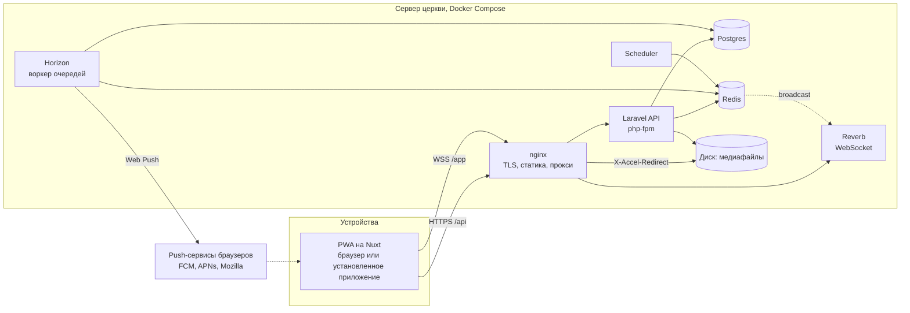
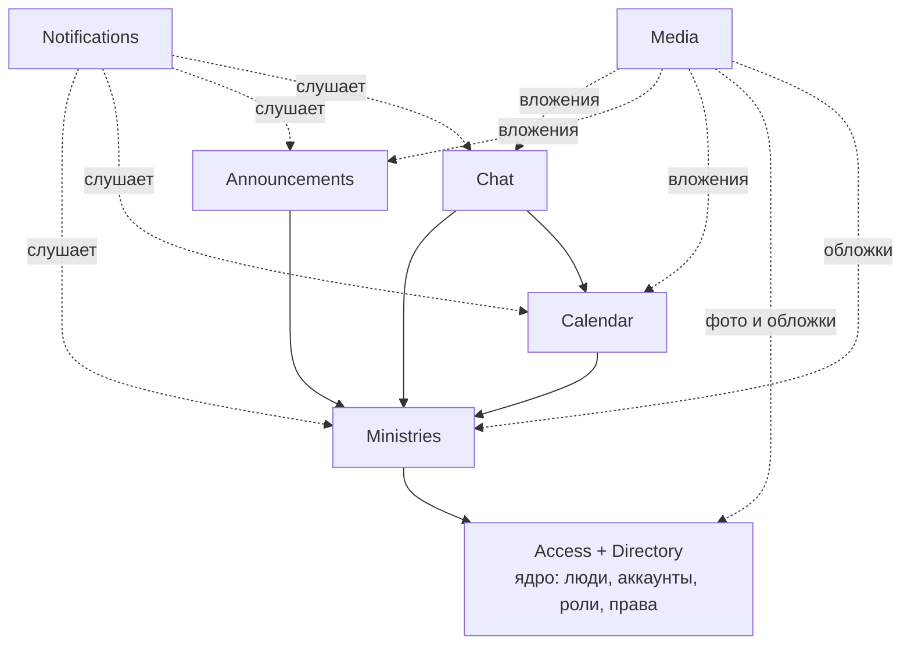

# Архитектура внутренней системы церкви

Дата: 2026-09-12. Статус: согласовано с заказчиком, реализация не начата.

Документ фиксирует архитектуру, принятую на проектной сессии. Словарь терминов в [CONTEXT.md](../CONTEXT.md), причины ключевых решений в [docs/adr](./adr/). Термины в документе на русском, идентификаторы кода, таблиц и прав на английском.

## 1. Назначение и рамки

Внутренняя система одной поместной церкви:

- справочник людей и аккаунты по приглашению;
- служения с настраиваемыми ролями и правами;
- календарь событий со слотами ресурсов и шаблонами;
- доска объявлений;
- чаты: служений, событий, группы, личные;
- уведомления и пуши.

Проектный потолок: 1000 человек в справочнике, 300 активных аккаунтов, 30 служений, десятки событий в неделю. Один сервер, один разработчик, русский язык интерфейса.

Вне рамок v1: финансы, посещаемость, согласие и отказ по назначениям, недоступность людей, помещения и техника как ресурсы (расширение заложено, см. [ADR-0007](./adr/0007-resource-type-discriminator.md)), домашние группы с материалами, публичный сайт, мультиарендность, офлайн-режим, импорт данных, SMS, резервные копии (см. раздел 15).

## 2. Обзор системы



| Слой | Выбор |
|---|---|
| Клиент | Nuxt актуальной версии, SPA (`ssr: false`), Nuxt UI, Pinia, `@vite-pwa/nuxt`, Laravel Echo |
| API | Laravel актуального релиза, PHP 8.4+, Sanctum (cookie-сессии), Policies |
| Realtime | Laravel Reverb |
| Очереди и расписание | Redis, Horizon, Laravel Scheduler |
| БД | PostgreSQL 17+ |
| Медиафайлы | локальный диск через Laravel Storage, отдача через nginx `X-Accel-Redirect` |
| Пуши | Web Push с VAPID: `laravel-notification-channels/webpush` поверх `minishlink/web-push` |
| Инфраструктура | Docker Compose, nginx, Let's Encrypt, GitHub Actions с деплоем по SSH |

## 3. Термины и идентификаторы в коде

Канонические определения в [CONTEXT.md](../CONTEXT.md). Здесь соответствие коду.

| Термин | Класс | Таблица |
|---|---|---|
| Человек | `Person` | `people` |
| Аккаунт | `User` | `users` |
| Приглашение, ссылка сброса пароля | `AccessLink` | `access_links` |
| Роль | `Role` | `roles`, `role_permissions` |
| Право | `Permission` (перечисление в коде) | нет таблицы |
| Выдача глобальной роли | `PersonRole` | `person_roles` |
| Служение | `Ministry` | `ministries` |
| Участие | `MinistryMember` | `ministry_members`, `ministry_member_roles` |
| Событие | `Event` | `events` |
| Слот | `EventSlot` | `event_slots` |
| Назначение | `EventAssignment` | `event_assignments` |
| Шаблон | `EventTemplate` | `event_templates`, `event_template_slots` |
| Объявление | `Announcement` | `announcements`, `announcement_views` |
| Чат | `Chat` | `chats`, `chat_members`, `chat_pinned_messages` |
| Сообщение | `Message` | `messages` |
| Уведомление | `Notification` (Laravel) | `notifications`, `notification_settings` |
| Push-подписка | `PushSubscription` | `push_subscriptions` |
| Медиафайл, вложение | `Media`, `MediaAttachment` | `media`, `media_attachments` |
| Журнал действий | `AuditEntry` | `audit_entries` |
| Настройки | `Setting` | `settings` |

## 4. Модули и границы

Модульный монолит: одно приложение Laravel, модули как неймспейсы `App\Modules\<Name>` с папками `Models`, `Policies`, `Actions`, `Events`, `Listeners`, `Jobs`, `Http/{Controllers,Requests,Resources}`, `Database/Migrations`. Сторонние пакеты модульности не используются.

| Модуль | Отвечает за | Владеет таблицами | Публикует доменные события |
|---|---|---|---|
| Access | каталог прав, роли обоих уровней, выдача глобальных ролей, вычисление прав, журнал | `roles`, `role_permissions`, `person_roles`, `audit_entries` | `RoleDeleted`, `PersonRolesChanged` |
| Directory | люди, аккаунты, приглашения, сессии, свой профиль, стирание данных | `people`, `users`, `access_links`, `sessions` | `PersonCreated`, `PersonArchived`, `UserCreated`, `UserDisabled`, `UserEnabled`, `PersonErased` |
| Ministries | служения, участие, роли участников, роль по умолчанию | `ministries`, `ministry_members`, `ministry_member_roles` | `MinistryCreated`, `MinistryArchived`, `MemberAdded`, `MemberRemoved`, `MemberRolesChanged` |
| Calendar | события, слоты, назначения, шаблоны, генерация, напоминания, iCal | `events`, `event_slots`, `event_assignments`, `event_templates`, `event_template_slots`, `event_reminders` | `EventCreated`, `EventChanged`, `EventCancelled`, `AssignmentCreated`, `AssignmentRemoved` |
| Announcements | объявления, просмотры | `announcements`, `announcement_views` | `AnnouncementPublished` |
| Chat | чаты всех видов, состав, сообщения, закрепления, непрочитанное | `chats`, `chat_members`, `messages`, `chat_pinned_messages` | `MessageSent`, `MessageEdited`, `MessageDeleted` |
| Notifications | центр уведомлений, категории, push-подписки, доставка | `notifications`, `notification_settings`, `push_subscriptions` | нет |
| Media | загрузка, обработка, раздача, вложения, очистка | `media`, `media_attachments` | нет |
| Settings | настройки церкви | `settings` | `SettingsChanged` |

Правила границ:

1. В таблицы модуля пишет только он сам, через классы `Actions`. Контроллеры и слушатели других модулей вызывают Actions, а не модели напрямую.
2. Читать чужие модели можно: связи Eloquent и запросы для списков. Это монолит с одной базой, запрет чтения дал бы только церемонию.
3. Реакции между модулями идут через доменные события Laravel и слушатели в очереди. Пример: Ministries публикует `MemberAdded`, слушатель в Chat добавляет аккаунт в чат служения.
4. Проверки прав живут в Policies каждого модуля, но все опираются на один сервис `Access\PermissionResolver`. Проверки по имени роли в коде запрещены, только ключи прав.
5. Модуль Notifications ничего не знает о смысле событий других модулей сверх того, что нужно для текста уведомления и адресатов. Он слушает, а не вызывается.



Стрелка «A → B» читается как «A зависит от B». Access и Directory взаимно зависимы (роли выдаются людям, приглашение требует роль) и считаются одним ядром.

## 5. Модель данных

Общие соглашения:

- Первичные ключи ULID (`HasUlids`), 26 символов. Публичные идентификаторы в URL это ULID, последовательных чисел нет.
- Время в `timestamptz`, хранится в UTC. Часовой пояс церкви одна настройка, все отображения и правила повторения считаются в нём.
- Архивируемые сущности имеют `archived_at`. Списки по умолчанию скрывают архивные, связи и история их показывают. Физическое удаление есть только у медиафайлов-сирот и в процедуре стирания персональных данных.
- Внешние ключи с `ON DELETE RESTRICT`. Удаление роли снимает её с носителей явно в Action, не каскадом базы.
- Уникальность «среди неархивных» реализуется частичными индексами Postgres (`WHERE archived_at IS NULL`).
- Валидация значений enum: тип Postgres `enum` или `varchar` с check-ограничением, одинаково для всех таблиц (выбрать один способ в первой миграции).

### 5.1 Access

`roles`

| Колонка | Тип | Примечание |
|---|---|---|
| id | ulid | |
| scope | enum `global`, `ministry` | |
| ministry_id | ulid, null | обязателен при `scope = ministry`, запрещён при `global` |
| name | varchar(100) | уникально среди глобальных; уникально в пределах служения |
| description | text, null | |
| is_system | bool | `true` только у роли «Администратор» |
| timestamps | | |

Ограничения: check на согласованность `scope` и `ministry_id`; частичные уникальные индексы `(name) WHERE scope = 'global'` и `(ministry_id, name) WHERE scope = 'ministry'`; `UNIQUE (id, ministry_id)` для составного внешнего ключа из `ministry_member_roles`.

`role_permissions`: `role_id`, `permission varchar(64)`, первичный ключ по паре. Ключ права проверяется кодом по каталогу (раздел 6.1) и по области: глобальной роли нельзя выдать право служения и наоборот.

`person_roles`: `person_id`, `role_id` (только `scope = global`, проверяет Action), `assigned_by_user_id`, `created_at`. Первичный ключ по паре `(person_id, role_id)`.

`audit_entries`: `id`, `actor_user_id` (null для консольных команд), `action varchar` (например `role.created`, `member.roles_changed`), `subject_type`, `subject_id`, `payload jsonb` (до и после для изменений), `ip`, `created_at`. Только запись и чтение, правок нет.

### 5.2 Directory

`people`

| Колонка | Тип | Примечание |
|---|---|---|
| id | ulid | |
| last_name, first_name | varchar(100) | обязательны |
| patronymic | varchar(100), null | |
| photo_media_id | ulid, null | FK `media` |
| phone | varchar(20), null | E.164, нормализуется через libphonenumber с регионом из настроек |
| email | varchar(254), null | нижний регистр |
| birth_date | date, null | |
| status | enum `member`, `attendee`, `guest` | член церкви, посещает, гость |
| note | text, null | видна только с `people.view_notes` |
| contacts_public | bool | «показывать мои контакты всем», меняет сам человек |
| archived_at | timestamptz, null | |
| timestamps | | |

Индекс для поиска: `pg_trgm` GIN по `lower(last_name || ' ' || first_name)`. Дубликаты не запрещены (у ребёнка может быть телефон родителя), но при создании человека с уже существующим телефоном или email интерфейс показывает предупреждение.

`users`

| Колонка | Тип | Примечание |
|---|---|---|
| id | ulid | |
| person_id | ulid | FK `people`, `UNIQUE` |
| phone | varchar(20), null | `UNIQUE`, логин; независим от телефона в карточке человека |
| email | varchar(254), null | `UNIQUE`, логин; независим от email в карточке человека |
| password | varchar | bcrypt/argon2id |
| remember_token | varchar, null | |
| ical_token | varchar(64) | `UNIQUE`, случайный, для ленты календаря |
| last_login_at | timestamptz, null | |
| disabled_at | timestamptz, null | отключённый аккаунт не может войти, сессии сброшены |
| timestamps | | |

Check: `phone IS NOT NULL OR email IS NOT NULL`.

Логины аккаунта и контакты человека это разные поля. Смена телефона в карточке человека не меняет логин, и наоборот. Логин меняется отдельной операцией с подтверждением текущего пароля; при приёме приглашения логин лишь предзаполняется из контактов.

`access_links`: `id`, `person_id`, `kind` enum `invite`, `password_reset`, `token_hash` (`UNIQUE`, хранится хеш, сам токен показывается один раз), `created_by_user_id`, `expires_at` (7 суток для приглашения, 24 часа для сброса), `used_at`, `revoked_at`, `created_at`.

`sessions`: стандартная таблица Laravel с `user_id`, `ip_address`, `user_agent`, `last_activity`. Служит списком устройств.

### 5.3 Ministries

`ministries`: `id`, `name` (уникально среди неархивных), `description`, `cover_media_id`, `default_role_id` (FK `roles`, заполняется в той же транзакции, что создаёт служение и его роли; в коде считается обязательным), `chat_id` (FK `chats`, создаётся вместе со служением), `archived_at`, `timestamps`.

`ministry_members`: `id`, `ministry_id`, `person_id`, `joined_at`, `added_by_user_id`. `UNIQUE (ministry_id, person_id)`, плюс `UNIQUE (id, ministry_id)` для составного ключа ниже.

`ministry_member_roles`: `member_id`, `role_id`, `ministry_id`. Первичный ключ `(member_id, role_id)`. Составные внешние ключи `(member_id, ministry_id) → ministry_members(id, ministry_id)` и `(role_id, ministry_id) → roles(id, ministry_id)` гарантируют на уровне базы, что участнику выдана роль его же служения.

### 5.4 Calendar

`events`

| Колонка | Тип | Примечание |
|---|---|---|
| id | ulid | |
| owner_type | enum `church`, `ministry` | владелец |
| ministry_id | ulid, null | обязателен при `owner_type = ministry` |
| template_id | ulid, null | FK `event_templates`, если создано из шаблона |
| occurrence_date | date, null | дата вхождения по календарю церкви, для идемпотентной генерации |
| title | varchar(200) | |
| description | text, null | |
| location | varchar(200), null | пока свободный текст |
| starts_at, ends_at | timestamptz | `ends_at > starts_at` |
| visibility | enum `church`, `ministry`, `assigned` | у церковного события `ministry` запрещена |
| status | enum `scheduled`, `cancelled` | |
| cancelled_at | timestamptz, null | |
| cancel_reason | varchar(500), null | |
| chat_id | ulid, null | чат события, создаётся по кнопке |
| created_by_user_id | ulid | |
| archived_at | timestamptz, null | |
| timestamps | | |

Индексы: `(starts_at)`, `(ministry_id, starts_at)`, частичный `UNIQUE (template_id, occurrence_date) WHERE template_id IS NOT NULL`.

`event_slots`: `id`, `event_id`, `label varchar(100)` (для слота с ролью по умолчанию имя роли, можно переопределить), `resource_type` enum `person`, `role_id` (FK `roles` со `scope = ministry`, null для свободного слота), `required_count smallint > 0`, `sort_order`, `timestamps`. Check: `resource_type = 'person'` (расширяется миграцией при добавлении помещений).

`event_assignments`: `id`, `slot_id`, `resource_type` enum `person`, `person_id` (FK `people`, null), `assigned_by_user_id`, `created_at`. Check: при `resource_type = 'person'` заполнен `person_id`. `UNIQUE (slot_id, person_id)`. Индекс `(person_id)` для поиска пересечений. Слот может быть заполнен сверх `required_count`, интерфейс показывает «3 из 2».

`event_templates`

| Колонка | Тип | Примечание |
|---|---|---|
| id | ulid | |
| owner_type, ministry_id | как у событий | |
| title, description, location, visibility | как у событий | |
| start_time | time | локальное время церкви |
| duration_minutes | int | |
| recurrence | jsonb, null | `null` для шаблона без повторения; иначе `{type, weekday, nth, anchor_date}` |
| active | bool | неактивный шаблон не генерирует события |
| generated_until | date, null | до какой даты события уже созданы |
| created_by_user_id | ulid | |
| archived_at | timestamptz, null | |
| timestamps | | |

Правило повторения `recurrence.type`: `weekly` (каждый `weekday`), `biweekly` (каждые две недели от `anchor_date`), `monthly_nth_weekday` (`nth` от 1 до 5 или −1 для последнего, `weekday`).

`event_template_slots`: как `event_slots`, но с `template_id`.

`event_reminders`: `event_id`, `kind` enum `h24`, `h2`, `sent_at`. Первичный ключ по паре: одно напоминание каждого вида на событие.

### 5.5 Announcements

`announcements`: `id`, `scope` enum `church`, `ministry`, `ministry_id` (обязателен при `scope = ministry`), `author_user_id`, `title varchar(200)`, `body text` (подмножество Markdown: абзацы, жирный, курсив, ссылки, списки, заголовки), `pinned_at`, `hide_after date` (null означает «показывать всегда»), `notify_on_publish bool`, `published_at`, `archived_at`, `timestamps`.

`announcement_views`: `announcement_id`, `user_id`, `viewed_at`. Первичный ключ по паре. Счётчик просмотров это `count(*)`.

### 5.6 Chat

`chats`

| Колонка | Тип | Примечание |
|---|---|---|
| id | ulid | |
| type | enum `ministry`, `event`, `group`, `direct` | |
| ministry_id | ulid, null, `UNIQUE` | для `ministry` |
| event_id | ulid, null, `UNIQUE` | для `event` |
| direct_key | varchar(53), null, `UNIQUE` | два ULID аккаунтов через `:` в отсортированном порядке, для `direct` |
| title | varchar(100), null | у служения и события берётся от родителя, у личного не нужен |
| avatar_media_id | ulid, null | |
| created_by_user_id | ulid, null | |
| last_message_id, last_message_at | денормализация | для списка чатов |
| archived_at | timestamptz, null | архивный чат только для чтения |
| timestamps | | |

`chat_members`: `chat_id`, `user_id`, `is_owner bool` (создатель группы), `muted_until timestamptz null` (null: звук включён; дата в далёком будущем: навсегда), `last_read_message_id`, `joined_at`. Первичный ключ по паре. Выход из группы удаляет строку; из чата служения и события выход невозможен, состав ведёт синхронизация.

`messages`: `id` (ULID, монотонен по времени с точностью до миллисекунды, курсор пагинации это пара `created_at, id`), `chat_id`, `sender_user_id`, `body text null` (до 4000 символов), `reply_to_id` (FK `messages`, null), `edited_at`, `deleted_at` (заглушка «Сообщение удалено», вложения отвязываются и удаляются), `created_at`. Индекс `(chat_id, created_at DESC, id DESC)`. Сообщение без текста обязано иметь вложение, проверяет Action.

`chat_pinned_messages`: `chat_id`, `message_id` (`UNIQUE`), `pinned_by_user_id`, `pinned_at`.

Непрочитанное считается как число сообщений чата с парой `(created_at, id)` больше `last_read_message_id`, не удалённых и не своих. На проектном масштабе считается запросом, денормализация не нужна.

### 5.7 Notifications

`notifications`: стандартная таблица Laravel (`id uuid`, `type`, `notifiable_type`, `notifiable_id`, `data jsonb`, `read_at`, `created_at`). Это центр уведомлений. Сообщения чатов сюда не пишутся: сам список чатов и есть их «входящие».

`notification_settings`: `user_id`, `category` enum `announcements`, `chat`, `assignments`, `reminders`, `enabled bool`. Отсутствие строки означает «включено».

`push_subscriptions`: `id`, `user_id`, `endpoint text UNIQUE`, `public_key`, `auth_token`, `content_encoding`, `user_agent`, `created_at`, `last_success_at`, `failures smallint`. Удаляется при ответе push-сервиса 404 или 410 и при выходе с устройства.

### 5.8 Media

`media`: `id`, `uploader_user_id`, `disk varchar`, `path`, `original_name`, `mime`, `size bigint`, `kind` enum `image`, `video`, `file`, `width`, `height`, `variants jsonb` (пути миниатюр), `status` enum `processing`, `ready`, `failed`, `created_at`.

`media_attachments`: `id`, `media_id` (`UNIQUE`: медиафайл принадлежит ровно одному объекту), `attachable_type`, `attachable_id`, `sort_order`, `created_at`. Полиморфная связь с сообщением, объявлением или событием. Фото человека, обложка служения и аватар чата ссылаются на `media` прямыми колонками, а не через вложения.

### 5.9 Settings

`settings`: `key varchar PK`, `value jsonb`, `updated_at`. Ключи: `church.name`, `church.timezone`, `church.phone_region` (регион по умолчанию для разбора телефонов), `calendar.horizon_weeks` (8), `calendar.reminder_offsets` (`["h24","h2"]`). Лимиты медиафайлов живут в конфиге приложения, не в настройках.

## 6. Права доступа

Подробное обоснование в [ADR-0003](./adr/0003-permissions-in-code-roles-in-data.md).

### 6.1 Каталог прав

Каталог это класс `App\Modules\Access\Permission` с ключами, областью (`global` или `ministry`), русским названием и описанием для редактора ролей. Эндпоинт `GET /api/v1/permissions` отдаёт его клиенту.

Глобальные права:

| Ключ | В интерфейсе | Что даёт |
|---|---|---|
| `people.view` | Видеть справочник | Список людей и карточка: ФИО, фото, статус, служения |
| `people.view_contacts` | Видеть контакты | Телефон, email, дата рождения любого человека |
| `people.view_notes` | Видеть заметки | Заметки руководства о людях |
| `people.manage` | Управлять людьми | Создавать, редактировать, архивировать людей, менять ФИО и статус, стирать данные |
| `people.invite` | Приглашать | Создавать приглашения и ссылки сброса пароля, отключать и включать аккаунты |
| `ministries.create` | Создавать служения | Создание и архивация служений |
| `ministries.view_all` | Видеть все служения | Состав, события, объявления любого служения без участия в нём; чаты служений только для чтения |
| `ministries.manage_all` | Управлять всеми служениями | Все внутренние права в каждом служении |
| `roles.manage_global` | Управлять глобальными ролями | Редактор глобальных ролей и выдача их людям |
| `calendar.church.manage` | Управлять церковным календарём | События и шаблоны уровня церкви, все их слоты, отмена, чаты этих событий |
| `announcements.church.publish` | Публиковать объявления церкви | Публикация, правка, закрепление, архивация церковных объявлений |
| `chats.create_groups` | Создавать группы | |
| `chats.dm` | Писать в личные чаты | Начинать личный чат с любым аккаунтом |
| `chats.moderate_all` | Модерировать любые чаты | Удалять чужие сообщения, закреплять, менять состав групп, архивировать чаты |
| `settings.manage` | Настройки церкви | |
| `audit.view` | Журнал действий | |

Права внутри служения:

| Ключ | В интерфейсе | Что даёт |
|---|---|---|
| `members.manage` | Управлять составом | Добавлять и исключать участников, выдавать и снимать роли служения |
| `members.view_contacts` | Контакты участников | Телефон, email, дата рождения участников этого служения |
| `roles.manage` | Управлять ролями служения | Создавать, редактировать, удалять роли служения, выбирать роль по умолчанию |
| `events.manage` | Управлять событиями служения | События и шаблоны служения, все их слоты, отмена, чат события |
| `slots.assign` | Заполнять слоты своих ролей | Назначать людей в слоты с ролями этого служения в любых событиях |
| `announcements.publish` | Объявления служения | Публикация, правка, закрепление, архивация объявлений служения |
| `chat.moderate` | Модерировать чат служения | Удалять чужие сообщения, закреплять |
| `ministry.edit` | Редактировать служение | Название, описание, обложка |

Всегда доступно без прав любому активному аккаунту: свой профиль (фото, телефон, email, дата рождения, флаг «показывать контакты всем», настройки уведомлений, устройства, свои логины и пароль), свой календарь и лента iCal, объявления церкви, события с видимостью «вся церковь», события своих служений с видимостью «служение», события, куда назначен, чаты, где состоит, центр уведомлений.

### 6.2 Вычисление прав

```text
permissions(user):
    если user.disabled_at задан → пустое множество
    roles = глобальные роли user.person
    если среди них роль с is_system → ВСЕ глобальные права + маркер «админ»
    иначе → объединение role_permissions всех roles

can(user, key):
    key ∈ permissions(user) или «админ»

canInMinistry(user, key, ministry):
    если «админ» или can(user, 'ministries.manage_all') → true
    member = участие user.person в ministry
    если нет участия → false
    иначе → key ∈ объединение прав ролей участника в этом служении

isMember(user, ministry):
    есть участие user.person в ministry
```

Резолвер возвращает для аккаунта одну структуру: множество глобальных прав и словарь «служение → множество прав». Она кешируется в Redis под ключом с версией прав аккаунта. Любое изменение ролей, их прав, выдачи ролей или участия увеличивает версию у затронутых аккаунтов (слушатели событий `PersonRolesChanged`, `MemberRolesChanged`, `MemberAdded`, `MemberRemoved`, `RoleDeleted`, изменение `role_permissions`). Та же структура отдаётся клиенту в `GET /auth/me` для скрытия кнопок; сервер остаётся единственным авторитетом.

### 6.3 Инварианты ролей

1. Роль «Администратор» создаётся при установке, одна, `is_system = true`. Её нельзя удалить, переименовать, изменить её права. Нельзя снять её с последнего человека-носителя.
2. Глобальные роли удаляются с подтверждением, в котором показано число носителей. При удалении Action снимает роль со всех людей и пишет запись в журнал.
3. Приглашение можно создать только человеку, у которого есть хотя бы одна глобальная роль, нет аккаунта и который не архивирован. После создания аккаунта инварианта нет: человек без ролей видит только всегда доступный минимум, в списке людей у него пометка «без ролей».
4. У каждого служения есть роль по умолчанию. Она создаётся вместе со служением под именем «Участник» без прав, рядом создаётся роль «Лидер» со всеми правами служения. Обе обычные: переименовываются, редактируются, удаляются. Роль, стоящую по умолчанию, удалить нельзя, пока не выбрана другая.
5. Новый участник получает роль по умолчанию. Снять с участника последнюю роль нельзя: либо добавить другую, либо исключить из служения.
6. Роль служения нельзя удалить, пока на неё ссылаются слоты активных шаблонов или слоты будущих событий со статусом `scheduled`. Интерфейс показывает список ссылок.
7. Глобальной роли можно выдать только глобальные права, роли служения только права служения. Право `roles.manage` внутри служения не позволяет затронуть ничего вне служения.
8. Роль служения выдаётся только участнику этого служения (составной внешний ключ, раздел 5.3).
9. Отключённый аккаунт (`disabled_at`) не имеет прав, его сессии и push-подписки удаляются. Включение снимает `disabled_at`; сессии и подписки появляются заново при следующем входе.

### 6.4 Правила видимости

Люди:

- Список и базовая карточка: `people.view`.
- Контакты человека P видны, если выполнено любое: смотрящий сам P; `people.view_contacts`; у P включён `contacts_public`; есть служение, где состоят оба и у смотрящего в нём `members.view_contacts`.
- Заметка: `people.view_notes`.
- Своё: любой аккаунт видит и правит свои фото, телефон, email, дату рождения, флаг контактов, а также свои логины и пароль с подтверждением текущего пароля. ФИО и статус меняет только `people.manage`.

События:

- Видимость `church`: все аккаунты.
- Видимость `ministry`: участники служения-владельца, `ministries.view_all`, управляющие событием.
- Видимость `assigned`: назначенные, управляющие событием, `ministries.view_all` для событий служений, а также носители `slots.assign` в служениях, чьи роли требуются слотами (иначе им нечего заполнять).
- Управление событием: владелец `church` → `calendar.church.manage`; владелец `ministry` → `events.manage` в этом служении.
- Заполнение слота: управляющий событием заполняет любые слоты; `slots.assign` в служении S заполняет слоты с ролями S в любом событии; свободные слоты заполняет только управляющий.
- Шаблоны: те же правила, что для событий их владельца.

Объявления: `church` видят все; `ministry` видят участники и `ministries.view_all`. Публикация и правка: `announcements.church.publish` или `announcements.publish` в служении; автор правит своё.

Чаты: доступ по участию. Чат служения читают также носители `ministries.view_all` без права писать. Модерация: `chat.moderate` в служении для его чата; управляющие событием для чата события; владелец группы для группы; `chats.moderate_all` везде. Личный чат никто не модерирует.

Медиафайлы: доступ определяется объектом-владельцем. Вложение сообщения видно участникам чата, вложение объявления и события тем, кому видны они, фото человека тем, у кого `people.view`, обложка служения тем, кому видно служение, аватар чата его участникам.

### 6.5 Журнал действий

Пишутся: создание, изменение и удаление ролей и их прав; выдача и снятие глобальных ролей; добавление и исключение участников и смена их ролей; приглашения, ссылки сброса, отключение и включение аккаунтов, смена логина; архивация и стирание людей; создание и архивация служений; отмена событий; архивация объявлений и чатов; удаление чужих сообщений модераторами; изменение настроек. Не пишутся: обычные правки контента и отправка сообщений. Чтение по `audit.view`, фильтры по актору, действию, объекту и периоду, курсорная пагинация.

## 7. Ключевые процессы

### 7.1 Установка

Команда `php artisan app:install` в интерактивном режиме запрашивает название церкви, часовой пояс, регион телефонов, ФИО и телефон или email первого администратора, пароль. Создаёт настройки, роль «Администратор», человека, выдаёт ему роль, создаёт аккаунт. Других ролей команда не создаёт.

### 7.2 Приглашение и вход

1. Носитель `people.manage` создаёт человека. Носитель `roles.manage_global` выдаёт глобальную роль.
2. Носитель `people.invite` нажимает «Пригласить». Сервер проверяет инварианты (раздел 6.3, пункт 3), создаёт `access_links` с хешем токена, возвращает ссылку и QR один раз. Ссылку передают любым способом: мессенджер, лично с экрана.
3. Человек открывает `/invite/{token}`. Публичный эндпоинт показывает имя и просит телефон или email (предзаполнены из карточки) и пароль. Создаётся `users`, ссылка помечается использованной, аккаунт входит, публикуется `UserCreated`.
4. Слушатель в Chat добавляет новый аккаунт в чаты всех служений человека и в чаты событий, куда он назначен.
5. Клиент предлагает установить PWA (обязательный шаг на iOS) и включить уведомления по явному нажатию кнопки.

Вход: телефон или email плюс пароль, cookie-сессия Sanctum с «запомнить меня» на 365 дней. Сброс пароля: если настроен SMTP и у аккаунта есть email, ссылка по почте; иначе носитель `people.invite` создаёт ссылку сброса (`access_links.kind = password_reset`, 24 часа) и передаёт её человеку. Экран «Устройства» показывает сессии и позволяет завершить любую, кроме текущей, или все. Отключает и включает аккаунт носитель `people.invite`; включение публикует `UserEnabled`. Свои логины и пароль аккаунт меняет на экране «Вход» с подтверждением текущего пароля; контакты в карточке человека при этом остаются как были.

### 7.3 Служение

Создание (`ministries.create`) в одной транзакции: служение, роли «Лидер» (все права служения) и «Участник» (без прав), `default_role_id` на «Участника», чат типа `ministry`. Создатель не становится участником автоматически.

Добавление участника (`members.manage`): выбирается человек, выдаётся роль по умолчанию и, по желанию, другие роли. Публикуется `MemberAdded`, Chat добавляет аккаунт человека в чат служения, если аккаунт есть. Исключение публикует `MemberRemoved`, Chat удаляет из чата.

Архивация служения: шаблоны деактивируются, будущие события со статусом `scheduled` отменяются с уведомлением назначенным, чат архивируется и остаётся для чтения, участие сохраняется в истории.

### 7.4 Календарь

Создание события: владелец, заголовок, время, место, видимость, слоты. Слот с ролью получает подпись по имени роли, слот без роли обязан иметь подпись. Событие можно создать из шаблона на выбранную дату: копируются поля и слоты, `template_id` и `occurrence_date` заполняются.

Назначение в слот: сервер проверяет право на слот, создаёт `event_assignments` и возвращает в ответе список предупреждений: `role_mismatch` (у человека нет требуемой роли), `time_conflict` (с идентификаторами пересекающихся событий), `over_capacity` (слот заполнен сверх `required_count`). Предупреждения не блокируют. Эндпоинт кандидатов возвращает участников с требуемой ролью с уже вычисленными флагами пересечений, чтобы лидер видел их до выбора.

Пересечение считается по `[starts_at, ends_at)` среди событий со статусом `scheduled`, куда человек назначен. Индекс по `person_id` и `starts_at` достаточен для проектного масштаба.

Изменение времени, места или отмена публикуют `EventChanged` или `EventCancelled`. Отмена ставит статус, событие остаётся в календаре с пометкой.

Генерация из шаблонов: команда `calendar:materialize` раз в сутки. Для каждого активного шаблона с правилом повторения вычисляются даты вхождений от `generated_until + 1` до `сегодня + horizon_weeks` в часовом поясе церкви, для каждой создаётся событие с копией слотов, `generated_until` сдвигается. Частичный уникальный индекс `(template_id, occurrence_date)` делает повторный запуск безопасным. Отменённые события остаются и не пересоздаются. Правки шаблона не затрагивают созданные события. Подробнее в [ADR-0005](./adr/0005-materialized-events-instead-of-recurrence.md).

Напоминания: команда `calendar:send-reminders` каждые 5 минут. Для каждого вида (`h24`, `h2`) выбираются события со статусом `scheduled`, у которых `starts_at` попадает в окно `[now + offset, now + offset + 5 мин)` и нет записи в `event_reminders`. Назначенным с аккаунтом отправляется уведомление категории `reminders`, записывается `event_reminders`. Назначенный после прохождения окна напоминание этого вида не получает: это принято.

Лента iCal: `GET /api/v1/calendar/feed/{ical_token}.ics` без сессии, по токену аккаунта. Содержит события со статусом `scheduled`, куда назначен человек, в виде VEVENT с названием, местом, слотами человека в описании. Токен можно перевыпустить в настройках.

### 7.5 Объявления

Публикация с областью, заголовком, текстом в подмножестве Markdown, вложениями, флагом закрепления, датой «скрыть после» и галочкой «уведомить» (по умолчанию включена). Публикуется `AnnouncementPublished`; при включённой галочке Notifications рассылает уведомление категории `announcements` всем активным аккаунтам (область `church`) или аккаунтам участников (область `ministry`). Открытие объявления пишет `announcement_views`. Списки скрывают объявления с прошедшей `hide_after`. Закреплённые идут первыми. Редактирование не рассылает повторное уведомление.

Markdown очищается на сервере при сохранении (белый список конструкций) и рендерится на клиенте библиотекой с санитайзером.

### 7.6 Чат

Отправка: `POST /chats/{id}/messages` с текстом, идентификаторами заранее загруженных медиафайлов и необязательным `reply_to_id`. Action проверяет участие, привязывает медиафайлы (они должны быть загружены этим же аккаунтом и ещё никуда не привязаны), сохраняет сообщение, обновляет `last_message_*` у чата, публикует `MessageSent`.

Слушатели `MessageSent`: broadcast в канал `chat.{id}` и в каналы `user.{id}` участников для обновления списка чатов; пуш всем участникам, кроме автора, у кого чат не в режиме «без звука» и включена категория `chat`, с `tag = chat-{id}`, чтобы уведомления одного чата сворачивались в одно. Присутствие в приложении не отслеживается: пуш идёт всегда, клиент в открытом чате его гасит через service worker (`notificationclick` и проверка активных окон).

Чтение: клиент шлёт `POST /chats/{id}/read` с последним видимым сообщением, сервер обновляет `last_read_message_id` и пересылает счётчик в `user.{id}`.

Правка и удаление своих сообщений без ограничения по времени. Удаление ставит `deleted_at`, отвязывает и удаляет медиафайлы, рассылает `MessageDeleted`. Модератор удаляет чужие сообщения, действие попадает в журнал.

Состав: чаты служений и событий синхронизируются слушателями (`MemberAdded`, `MemberRemoved`, `AssignmentCreated`, `AssignmentRemoved`, `UserCreated`). Группу создаёт носитель `chats.create_groups`, становится владельцем, управляет составом и названием, участники могут выйти. Личный чат создаётся лениво первым сообщением; `direct_key` не даёт завести второй чат для той же пары.

Новый участник видит всю историю чата. Автоудаления нет. Архивный чат открывается для чтения, писать нельзя.

### 7.7 Уведомления

| Категория | Триггер | Адресаты | Каналы | Tag пуша |
|---|---|---|---|---|
| `announcements` | опубликовано объявление с включённой галочкой | все аккаунты или участники служения | database, webpush, broadcast | `announcement-{id}` |
| `chat` | новое сообщение | участники чата кроме автора, не «без звука» | webpush, broadcast | `chat-{chatId}` |
| `assignments` | назначение создано | аккаунт назначенного | database, webpush, broadcast | `event-{eventId}` |
| `assignments` | назначение снято | аккаунт назначенного | database, webpush, broadcast | `event-{eventId}` |
| `assignments` | событие изменено (время, место) или отменено | аккаунты назначенных | database, webpush, broadcast | `event-{eventId}` |
| `assignments` | галочка «уведомить участников служения» или «уведомить всех» при создании события, по умолчанию выключена | участники служения или все аккаунты | database, webpush, broadcast | `event-{eventId}` |
| `reminders` | за 24 часа и за 2 часа до начала | аккаунты назначенных | database, webpush, broadcast | `event-{eventId}-reminder` |

Реализация: классы `Notification` Laravel с каналами `database` (центр уведомлений), `webpush` (если категория включена и есть подписки) и `broadcast` (канал `user.{id}`, для живого бейджа). Категория `chat` канал `database` не использует. Все уведомления ставятся в очередь.

Web Push: сервер хранит VAPID-ключи в окружении. Полезная нагрузка содержит заголовок, текст, иконку, `tag` и `data.url` для перехода. Service worker показывает уведомление и по клику открывает или фокусирует нужный маршрут. Ответы 404 и 410 удаляют подписку, прочие ошибки увеличивают `failures`; подписка с десятью подряд ошибками удаляется.

### 7.8 Медиафайлы

Загрузка: `POST /media` (multipart, поле `file`, поле `purpose`: `message`, `announcement`, `event`, `person_photo`, `ministry_cover`, `chat_avatar`). Сервер проверяет MIME по содержимому (`finfo`), расширение по белому списку, размер по виду файла, сохраняет на диск `media` по пути `{yyyy}/{mm}/{ulid}.{ext}`, создаёт запись. Изображения получают статус `processing` и задачу в очереди: удаление EXIF, поворот по ориентации, пережим до 2000 px по большей стороне, миниатюры 320 и 1080 px в WebP. Документы и видео сразу `ready`.

Лимиты и типы:

| Вид | Размер | Типы |
|---|---|---|
| image | до 10 МБ | jpeg, png, webp, gif, heic (конвертируется в jpeg при наличии imagick с libheif, иначе отклоняется с понятной ошибкой) |
| file | до 50 МБ | pdf, doc, docx, xls, xlsx, ppt, pptx, txt, csv, zip, mp3, m4a, ogg |
| video | до 100 МБ | mp4, mov, webm, без перекодирования, воспроизведение штатным `<video>` |

nginx: `client_max_body_size 100m`. PHP: `upload_max_filesize = 100M`, `post_max_size = 110M`.

Привязка: создающие эндпоинты сообщений, объявлений и событий принимают `media_ids[]`. Сервер проверяет, что загрузил тот же аккаунт и файл ещё не привязан, создаёт `media_attachments`. Прямые ссылки (фото человека, обложка, аватар) ставятся отдельными эндпоинтами с тем же правилом.

Раздача: ресурсы API отдают уже подписанные ссылки вида `/api/v1/media/{id}?variant=thumb&expires=…&signature=…` (временная подпись Laravel, 60 минут). Контроллер проверяет право на объект-владелец (раздел 6.4), ставит `Content-Type`, `Content-Disposition` и отвечает заголовком `X-Accel-Redirect: /_protected/{path}`. nginx отдаёт файл из `internal`-location с `alias` на каталог медиафайлов. PHP байты не гоняет.

Очистка: ежедневная задача удаляет медиафайлы без привязки старше 24 часов. Удаление сообщения удаляет его файлы физически.

### 7.9 Стирание персональных данных

Команда `php artisan people:erase {id}` для запроса «удалите меня»: ФИО заменяется на «Удалённый человек», контакты, дата рождения, заметка и фото стираются, аккаунт удаляется вместе с сессиями и подписками, человек архивируется. Участия, назначения и сообщения остаются, но ссылаются на обезличенную запись. Запись в журнал. Через интерфейс операция недоступна намеренно.

## 8. API

Соглашения:

- REST JSON под `/api/v1`. Одна версия на весь срок жизни v1, единственный клиент.
- Ответы через Laravel API Resources. Даты в ISO 8601 в UTC. Идентификаторы ULID.
- Ошибки в формате Laravel: `422` с `message` и `errors` по полям; нарушения доменных правил также `422` с полем `code` (`role.last_role_cannot_be_removed`, `invite.person_has_no_global_role`, `role.in_use`). `403` без раскрытия деталей права.
- Предупреждения, не блокирующие операцию, возвращаются в теле успешного ответа в массиве `warnings`.
- Пагинация: курсорная для сообщений, уведомлений и журнала; постраничная для списков людей, событий, объявлений.
- OpenAPI генерируется из кода (`dedoc/scramble`), по ней собирается типизированный клиент (`openapi-typescript`) в `apps/web`. Схема коммитится, расхождение проверяет CI.
- Авторизация запроса: cookie-сессия Sanctum, CSRF-cookie через `/sanctum/csrf-cookie`, `statefulApi()`.

Контур эндпоинтов по модулям:

| Модуль | Эндпоинты |
|---|---|
| Auth | `POST /auth/login`, `POST /auth/logout`, `GET /auth/me` (аккаунт, человек, права), `GET /auth/sessions`, `DELETE /auth/sessions/{id}`, `POST /auth/sessions/logout-others`, `POST /auth/password/forgot`, `POST /auth/password/reset`, `GET /access-links/{token}` (публичный: имя и вид ссылки), `POST /access-links/{token}/accept` |
| People | `GET /people` (поиск, фильтры по служению, статусу, архиву, «без ролей»), `POST /people`, `GET /people/{id}`, `PATCH /people/{id}`, `POST /people/{id}/archive`, `POST /people/{id}/restore`, `PUT /people/{id}/roles` (глобальные), `POST /people/{id}/invite`, `POST /people/{id}/password-reset-link`, `POST /people/{id}/disable`, `POST /people/{id}/enable`, `PATCH /me/profile`, `PUT /me/photo`, `PATCH /me/login`, `PATCH /me/password` |
| Roles | `GET /permissions`, `GET /roles?scope=global`, `POST /roles`, `PATCH /roles/{id}`, `DELETE /roles/{id}`, `GET /roles/{id}/usage` (носители, слоты, шаблоны), `GET /ministries/{id}/roles`, `POST /ministries/{id}/roles` |
| Ministries | `GET /ministries`, `POST /ministries`, `GET /ministries/{id}`, `PATCH /ministries/{id}` (включая `default_role_id`), `POST /ministries/{id}/archive`, `GET /ministries/{id}/members`, `POST /ministries/{id}/members`, `PUT /ministries/{id}/members/{memberId}/roles`, `DELETE /ministries/{id}/members/{memberId}` |
| Calendar | `GET /events?from&to&scope=church|ministry:{id}|mine`, `POST /events`, `GET /events/{id}`, `PATCH /events/{id}`, `POST /events/{id}/cancel`, `POST /events/{id}/chat`, `POST /events/{id}/slots`, `PATCH /slots/{id}`, `DELETE /slots/{id}`, `GET /slots/{id}/candidates`, `POST /slots/{id}/assignments`, `DELETE /assignments/{id}`, `GET /templates`, `POST /templates`, `GET /templates/{id}`, `PATCH /templates/{id}`, `POST /templates/{id}/archive`, `POST /templates/{id}/create-event`, `GET /calendar/feed/{token}.ics` (публичный по токену), `POST /me/ical-token/rotate` |
| Announcements | `GET /announcements?scope&ministry`, `POST /announcements`, `GET /announcements/{id}` (фиксирует просмотр), `PATCH /announcements/{id}`, `POST /announcements/{id}/pin`, `POST /announcements/{id}/unpin`, `POST /announcements/{id}/archive` |
| Chat | `GET /chats` (с непрочитанным и последним сообщением), `POST /chats` (группа или личный), `GET /chats/{id}`, `PATCH /chats/{id}`, `POST /chats/{id}/members`, `DELETE /chats/{id}/members/{userId}`, `POST /chats/{id}/leave`, `POST /chats/{id}/mute`, `DELETE /chats/{id}/mute`, `POST /chats/{id}/archive`, `GET /chats/{id}/messages?before&limit`, `POST /chats/{id}/messages`, `PATCH /messages/{id}`, `DELETE /messages/{id}`, `POST /chats/{id}/read`, `POST /messages/{id}/pin`, `DELETE /messages/{id}/pin` |
| Notifications | `GET /notifications?cursor`, `POST /notifications/read`, `GET /notification-settings`, `PUT /notification-settings`, `POST /push-subscriptions`, `DELETE /push-subscriptions` |
| Media | `POST /media`, `GET /media/{id}` (подписанный), `DELETE /media/{id}` (своё непривязанное) |
| Settings, Audit | `GET /settings` (публичная часть: название, часовой пояс), `PUT /settings`, `GET /audit?cursor&actor&action&subject` |
| Realtime | `POST /broadcasting/auth` |

## 9. Realtime

Laravel Reverb за nginx по пути `/app`, клиент Laravel Echo с драйвером `reverb`. Авторизация каналов через `/broadcasting/auth` по cookie-сессии.

Каналы:

- `private-user.{userId}`: `notification.created`, `chat.updated` (последнее сообщение и счётчик непрочитанного), `unread.total`.
- `private-chat.{chatId}`: `message.sent`, `message.edited`, `message.deleted`, `chat.pinned`, `chat.members_changed`. Подписка разрешена участникам и читателям с `ministries.view_all`.

Presence-каналы и индикатор набора не используются. Все события broadcast ставятся в очередь. При переподключении клиент запрашивает сообщения открытого чата после последнего известного и заново тянет список чатов.

## 10. Клиент

Nuxt актуальной версии в режиме SPA (`ssr: false`): всё за авторизацией, SEO не нужен, сборка `nuxi generate` в статику.

Структура `apps/web/app`:

- `pages/`: `login`, `invite/[token]`, `index` (главная: закреплённые объявления, ближайшие свои события, непрочитанное), `people/`, `people/[id]`, `ministries/`, `ministries/[id]/` с вкладками участники, роли, события, объявления, чат; `calendar`, `events/[id]`, `templates/`, `announcements/`, `chats/`, `chats/[id]`, `notifications`, `settings/` (профиль, вход, устройства, уведомления, iCal), `admin/` (глобальные роли, настройки, журнал).
- `components/` по модулям, `composables/` (`useApi` с типами из OpenAPI, `useAuth`, `useCan` с `can(key)` и `canIn(ministryId, key)`, `useEcho`), `stores/` на Pinia (`auth`, `chats`, `notifications`), `layouts/` (нижняя панель вкладок на телефоне, боковая панель на десктопе).
- `sw.ts`: собственный service worker через `injectManifest`: предкеш оболочки, обработчики `push` и `notificationclick`. Запросы к API не кешируются, офлайн-режима нет.

PWA: манифест с `display: standalone`, иконками и русским названием. Экран-подсказка по установке для iOS показывается, пока приложение открыто в Safari, а не с экрана «Домой». Разрешение на уведомления запрашивается только по нажатию кнопки «Включить уведомления», после чего подписка отправляется на сервер; при выходе клиент отписывается и удаляет подписку.

Права на клиенте служат только для скрытия недоступных действий, берутся из `GET /auth/me` и обновляются при переподключении к каналу пользователя. Даты показываются в часовом поясе церкви из настроек, а не устройства.

Типизация: `npm run gen:api` берёт OpenAPI из `apps/api` и генерирует `types/api.d.ts`. Обёртка над `$fetch` добавляет `credentials: include`, CSRF-cookie и единую обработку `401` (переход на вход) и `403`.

## 11. Инфраструктура и эксплуатация

Монорепозиторий:

```text
/
├── CONTEXT.md
├── docs/
│   ├── architecture.md
│   └── adr/
├── apps/
│   ├── api/          Laravel
│   └── web/          Nuxt
├── infra/
│   ├── php/Dockerfile
│   ├── web/Dockerfile           сборка Nuxt → nginx со статикой и конфигом
│   ├── nginx/                   конфиги
│   └── compose.yml, compose.prod.yml
└── .github/workflows/  ci.yml, deploy.yml
```

Образы: `app` (php:8.4-fpm-alpine с расширениями pdo_pgsql, redis, pcntl, intl, gd или imagick, bcmath, zip, exif, opcache; `composer install --no-dev`) и `web` (стадия node собирает Nuxt, результат кладётся в nginx:alpine). Один образ `app` для всех PHP-ролей, различается командой запуска.

Сервисы Compose: `web` (nginx, порты 80 и 443, тома сертификатов и медиафайлов только для чтения), `app` (php-fpm), `worker` (`php artisan horizon`), `scheduler` (`php artisan schedule:work`), `reverb` (`php artisan reverb:start --host=0.0.0.0 --port=8080`), `postgres` (том данных), `redis` (том, `appendonly yes`), `certbot` (получение и продление сертификатов). Медиафайлы в именованном томе, смонтированном в `app`, `worker` и `web`.

Маршрутизация nginx: `/` статика с `try_files … /index.html`; `/api/`, `/sanctum/`, `/broadcasting/` через fastcgi в `app:9000`; `/app/` в `reverb:8080` с заголовками `Upgrade` и `Connection`, `proxy_read_timeout` не меньше 60 секунд; `/_protected/` с `internal` и `alias` на каталог медиафайлов; `client_max_body_size 100m`; HTTP перенаправляется на HTTPS.

Окружение: `.env` только на сервере, секреты (`APP_KEY`, пароль базы, VAPID-ключи, SMTP) в репозиторий не попадают. Часовой пояс церкви и остальные настройки в таблице `settings`, не в `.env`.

CI и деплой: `ci.yml` на pull request и push: Pint, PHPStan, Pest; ESLint, проверка типов, Vitest, сборка Nuxt, проверка актуальности OpenAPI-схемы. `deploy.yml` на push в `main`: сборка образов, публикация в GHCR, по SSH на сервер `docker compose pull`, `docker compose up -d --remove-orphans`, `php artisan migrate --force`, сброс кешей, `horizon:terminate` для перезапуска воркера. Простой в несколько секунд при деплое допустим.

Логи: приложение пишет в stderr, читаются через `docker logs`, ротация в настройках драйвера json-file. Эндпоинт `GET /api/v1/health` проверяет базу и Redis. Внешний мониторинг ошибок не ставится, кандидат на будущее GlitchTip.

Резервные копии не реализуются. Это окончательное решение заказчика от 2026-09-12, повторно оно не обсуждается; последствия описаны в разделе 15, риск 1.

## 12. Качество

- Pest: feature-тесты на каждый эндпоинт; тесты политик, где для каждого ключа права из каталога есть тест «без права запрещено, с правом разрешено» и провайдер данных, который падает, если у ключа нет теста; тесты инвариантов ролей (раздел 6.3); тесты генерации из шаблонов (еженедельно, раз в две недели, N-й день недели месяца, переход на летнее время, горизонт, идемпотентность); тесты пересечений и предупреждений; тесты синхронизации чатов; тесты уведомлений через фейковые каналы.
- Статика: PHPStan (Larastan) уровня 6 и выше, Pint. На клиенте ESLint, `vue-tsc`.
- Vitest для composables и stores. Playwright для сквозных сценариев: вход по приглашению, создание служения и роли, создание события и назначение, отправка сообщения с вложением, получение уведомления в центре.
- CI блокирует слияние при падении любого шага.

## 13. Фазы реализации

Порядок выбран так: сначала то, без чего нельзя войти и раздать права, затем канал связи с людьми, затем главная ценность, затем самый дорогой модуль.

**Фаза 1. Каркас.** Репозиторий, Compose, CI. Модули Access, Directory, Ministries, Media (загрузка, раздача, фото и обложки), Settings, журнал. Установка, приглашения, вход, сессии, свой профиль. Редакторы глобальных ролей и ролей служения, состав служений, роль по умолчанию. Оболочка Nuxt: навигация, справочник, служения, роли, профиль, устройства, установка PWA. Готово, когда админ ставит систему, создаёт роли, людей и служения, приглашает, и люди входят с телефонов.

**Фаза 2. Объявления и уведомления.** Модули Announcements и Notifications: центр уведомлений, категории, Web Push, service worker, канал `user.{id}` через Reverb. Готово, когда опубликованное объявление приходит пушем на установленную PWA на iOS и Android.

**Фаза 3. Календарь.** События, слоты, назначения с предупреждениями, отмена, видимость, шаблоны и генерация, напоминания, iCal. Готово, когда шаблон воскресного служения создаёт события на 8 недель, лидеры заполняют слоты с телефона, назначенные получают уведомления и напоминания.

**Фаза 4. Чат.** Чаты всех видов, сообщения, вложения, непрочитанное, закрепления, «без звука», модерация, realtime, пуши, синхронизация состава с досозданием чатов для уже существующих служений и событий. Готово, когда одно пилотное служение переносит общение из мессенджера.

Кандидаты после v1, в порядке ожидаемого спроса: согласие и отказ по назначениям, недоступность людей, помещения и техника, реакции и голосовые в чате, сводка дней рождения, SMTP и двухфакторная аутентификация админов, нативный клиент.

## 14. Отклонённые альтернативы

| Альтернатива | Почему нет |
|---|---|
| Нативное приложение (Expo, Flutter) | Две сборки, магазины, ежегодная плата Apple. PWA достаточно для внутренней системы, API готов к нативному клиенту позже. [ADR-0001](./adr/0001-modular-monolith-laravel-nuxt-pwa.md) |
| Мультиарендность | Одна церковь. При необходимости отдельный инстанс на церковь |
| Firebase, Supabase и другие BaaS | Сервер должен стоять в стране церкви, стек PHP привычен разработчику |
| Микросервисы | Масштаб не требует, один разработчик |
| Telegram-группы и бот вместо чата | Нет связки с служениями, событиями и ролями. [ADR-0006](./adr/0006-own-basic-chat.md) |
| Matrix, Rocket.Chat | Тяжёлая инфраструктура и чужой UX, клиент всё равно свой |
| GraphQL | Один клиент; REST с OpenAPI типизируется так же и проще в отладке |
| Виртуальная рекуррентность (RRULE) | Каждое воскресенье имеет свой состав. [ADR-0005](./adr/0005-materialized-events-instead-of-recurrence.md) |
| Отдельные «позиции» помимо ролей | Одно понятие проще для лидеров. [ADR-0004](./adr/0004-ministry-roles-double-as-slot-positions.md) |
| Фиксированные роли без редактора | Отклонено заказчиком |
| Права как настраиваемые сущности, ACL на объект | Проверки в коде теряют смысл, редактор исключений не окупается. [ADR-0003](./adr/0003-permissions-in-code-roles-in-data.md) |
| Базовая роль «для всех», роли-заготовки при установке | Заказчик выбрал явную выдачу ролей перед приглашением |
| Универсальная таблица ресурсов | Люди остаются людьми, дискриминатор на слоте. [ADR-0007](./adr/0007-resource-type-discriminator.md) |
| MinIO или S3 сейчас | Один сервер; абстракция Storage даёт переезд сменой конфига |
| Отдельная админка (Filament) | Лидеры правят роли с телефона, интерфейс один |
| SMS-коды для входа | Стоимость и шлюзы; пароль плюс приглашение ссылкой |
| Согласие и отказ по назначениям, недоступность | Отложено заказчиком до v1.1 |
| Офлайн-режим | Отдельный большой объём работы без запроса |

## 15. Риски и открытые пункты

1. **Нет резервных копий.** Окончательное решение заказчика. Один сервер, Postgres и медиафайлы на одном диске: отказ диска, ошибочная миграция или удаление тома означают потерю всех данных без возможности восстановления. Риск принят, тема закрыта.
2. **Пуши на iOS только в установленной PWA.** Пользователи, открывающие сайт в Safari, уведомлений не получат. Смягчение: обязательный экран установки, проверка `Notification.permission` и подсказка в центре уведомлений.
3. **HEIC с iPhone.** Конвертация требует imagick с libheif в образе. Safari обычно сам отдаёт JPEG при выборе файла, но не всегда. Смягчение: понятная ошибка и просьба выбрать другой формат.
4. **Доступность push-сервисов.** Web Push ходит через FCM, APNs и Mozilla. В стране размещения они могут быть ограничены; проверить на первом же пилотном устройстве в фазе 2.
5. **Кеш прав.** Забытая инвалидация даст человеку права, которых уже нет. Смягчение: единая точка изменения версии прав в Access и тест на каждое событие, меняющее права.
6. **Смена часового пояса церкви** не пересчитывает уже созданные события. Настройка меняется до старта фазы 3 или с ручной проверкой календаря.
7. **Reverb за nginx.** Неверные таймауты прокси рвут соединение; клиент должен переподключаться и дотягивать пропущенное (раздел 9).
8. **Дубликаты людей.** Импорта нет, всё вводится руками. Предупреждение по телефону и email при создании, слияние карточек не реализуется.
9. **Роли без прав в списке ролей** («Вокалист») могут смущать админов. В редакторе роли служения показывать пометку «используется как позиция в слотах».
10. **Единственная точка отказа.** Сервер один, резервирования нет. Принято в рамках масштаба.
