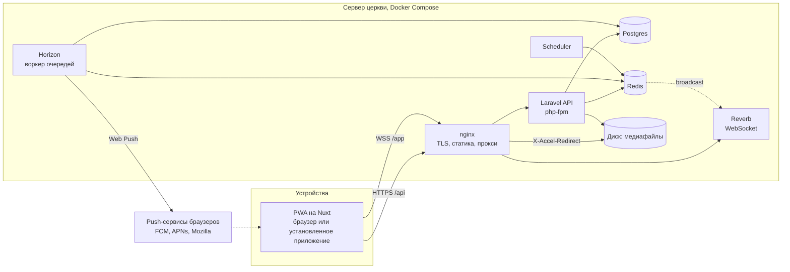
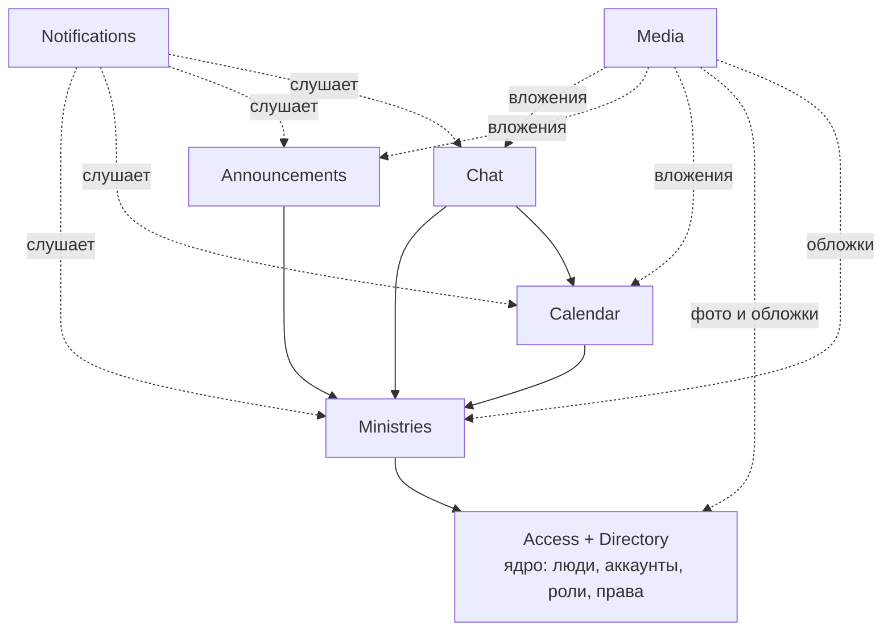

# Архитектура внутренней системы церкви

Дата: 2026-09-12. Статус: согласовано с заказчиком. Фаза 1 реализована в коде, её приёмка на продовом сервере впереди; фазы 2–4 спланированы (`docs/plans/`).

Документ фиксирует архитектуру, принятую на проектной сессии. Словарь терминов в [CONTEXT.md](../CONTEXT.md), причины ключевых решений в [docs/adr](./adr/). Термины в документе на русском, идентификаторы кода, таблиц и прав на английском.

## 1. Назначение и рамки

Внутренняя система одной поместной церкви:

- справочник людей и аккаунты по приглашению;
- служения с настраиваемыми ролями и правами;
- календарь событий со слотами ресурсов и шаблонами;
- доска объявлений;
- чаты: служений, событий, группы, личные;
- уведомления и пуши.

Проектный потолок: 1000 человек в справочнике, 300 активных аккаунтов, 30 служений, десятки событий в неделю. Один сервер, один разработчик, русский язык интерфейса.

Вне рамок v1: финансы, посещаемость, согласие и отказ по назначениям, недоступность людей, помещения и техника как ресурсы (расширение заложено, см. [ADR-0007](./adr/0007-resource-type-discriminator.md)), домашние группы с материалами, публичный сайт, мультиарендность, офлайн-режим, импорт данных, SMS, резервные копии (см. раздел 15).

## 2. Обзор системы



| Слой | Выбор |
|---|---|
| Клиент | Nuxt актуальной версии, SPA (`ssr: false`), Nuxt UI, Pinia, `@vite-pwa/nuxt`, Laravel Echo |
| API | Laravel актуального релиза, PHP 8.4+, Sanctum (cookie-сессии), Policies |
| Realtime | Laravel Reverb |
| Очереди и расписание | Redis, Horizon, Laravel Scheduler |
| БД | PostgreSQL 17+ |
| Медиафайлы | локальный диск через Laravel Storage, отдача через nginx `X-Accel-Redirect` |
| Пуши | Web Push с VAPID: собственный канал уведомлений поверх `minishlink/web-push` (решение плана фазы 2: таблица и учёт ошибок пакета `laravel-notification-channels/webpush` не совпадают с разделом 5.7) |
| Инфраструктура | Docker Compose, nginx, Let's Encrypt, GitHub Actions с деплоем по SSH |

## 3. Термины и идентификаторы в коде

Канонические определения в [CONTEXT.md](../CONTEXT.md). Здесь соответствие коду.

| Термин | Класс | Таблица |
|---|---|---|
| Человек | `Person` | `people` |
| Аккаунт | `User` | `users` |
| Приглашение, ссылка сброса пароля | `AccessLink` | `access_links` |
| Роль | `Role` | `roles`, `role_permissions` |
| Право | `Permission` (перечисление в коде) | нет таблицы |
| Выдача глобальной роли | `PersonRole` | `person_roles` |
| Служение | `Ministry` | `ministries` |
| Участие | `MinistryMember` | `ministry_members`, `ministry_member_roles` |
| Событие | `Event` | `events` |
| Слот | `EventSlot` | `event_slots` |
| Назначение | `EventAssignment` | `event_assignments` |
| Шаблон | `EventTemplate` | `event_templates`, `event_template_slots` |
| Объявление | `Announcement` | `announcements`, `announcement_views` |
| Чат | `Chat` | `chats`, `chat_members`, `chat_pinned_messages` |
| Сообщение | `Message` | `messages` |
| Уведомление | `Notification` (Laravel) | `notifications`, `notification_settings` |
| Push-подписка | `PushSubscription` | `push_subscriptions` |
| Медиафайл, вложение | `Media`, `MediaAttachment` | `media`, `media_attachments` |
| Журнал действий | `AuditEntry` | `audit_entries` |
| Настройки | `Setting` | `settings` |

## 4. Модули и границы

Модульный монолит: одно приложение Laravel, модули как неймспейсы `App\Modules\<Name>` с папками `Models`, `Policies`, `Actions`, `Events`, `Listeners`, `Jobs`, `Http/{Controllers,Requests,Resources}`, `Database/Migrations`. Сторонние пакеты модульности не используются.

| Модуль | Отвечает за | Владеет таблицами | Публикует доменные события |
|---|---|---|---|
| Access | каталог прав, роли обоих уровней, выдача глобальных ролей, вычисление прав, журнал | `roles`, `role_permissions`, `person_roles`, `audit_entries` | `RoleDeleted`, `PersonRolesChanged` |
| Directory | люди, аккаунты, приглашения, сессии, свой профиль, стирание данных | `people`, `users`, `access_links`, `sessions` | `PersonCreated`, `PersonArchived`, `UserCreated`, `UserDisabled`, `UserEnabled`, `PersonErased` |
| Ministries | служения, участие, роли участников, роль по умолчанию | `ministries`, `ministry_members`, `ministry_member_roles` | `MinistryCreated`, `MinistryArchived`, `MemberAdded`, `MemberRemoved`, `MemberRolesChanged` |
| Calendar | события, слоты, назначения, шаблоны, генерация, напоминания, iCal | `events`, `event_slots`, `event_assignments`, `event_templates`, `event_template_slots`, `event_reminders` | `EventCreated`, `EventChanged`, `EventCancelled`, `AssignmentCreated`, `AssignmentRemoved`, `EventReminderDue` |
| Announcements | объявления, просмотры | `announcements`, `announcement_views` | `AnnouncementPublished` |
| Chat | чаты всех видов, состав, сообщения, закрепления, непрочитанное | `chats`, `chat_members`, `messages`, `chat_pinned_messages` | `MessageSent`, `MessageEdited`, `MessageDeleted`, `ChatMembersChanged` |
| Notifications | центр уведомлений, категории, push-подписки, доставка | `notifications`, `notification_settings`, `push_subscriptions` | нет |
| Media | загрузка, обработка, раздача, вложения, очистка | `media`, `media_attachments` | нет |
| Settings | настройки церкви | `settings` | `SettingsChanged` |

Правила границ:

1. В таблицы модуля пишет только он сам, через классы `Actions`. Контроллеры и слушатели других модулей вызывают Actions, а не модели напрямую. Модулю, которому нужна запись в таблицы другого модуля, для этого достаточно объявить контракт в своём собственном пространстве `Contracts`: модуль-владелец таблицы реализует его своим Action и привязывает реализацию в `AppServiceProvider`, как сделано для `RoleCarrierDetacher` (`App\Modules\Access\Contracts`).
2. Читать чужие модели можно: связи Eloquent и запросы для списков. Это монолит с одной базой, запрет чтения дал бы только церемонию. Правило 1 на чтение не распространяется.
3. Реакции между модулями идут через доменные события Laravel и слушатели в очереди. Пример: Ministries публикует `MemberAdded`, слушатель в Chat добавляет аккаунт в чат служения.
4. Проверки прав живут в Policies каждого модуля, но все опираются на один сервис `Access\PermissionResolver`. Проверки по имени роли в коде запрещены, только ключи прав.
5. Модуль Notifications ничего не знает о смысле событий других модулей сверх того, что нужно для текста уведомления и адресатов. Он слушает, а не вызывается.



Стрелка «A → B» читается как «A зависит от B». Access и Directory взаимно зависимы (роли выдаются людям, приглашение требует роль) и считаются одним ядром.

## 5. Модель данных

Общие соглашения:

- Первичные ключи ULID (`HasUlids`), 26 символов. Публичные идентификаторы в URL это ULID, последовательных чисел нет.
- Время в `timestamptz`, хранится в UTC. Часовой пояс церкви одна настройка, все отображения и правила повторения считаются в нём.
- Архивируемые сущности имеют `archived_at`. Списки по умолчанию скрывают архивные, связи и история их показывают. Физическое удаление есть только у медиафайлов-сирот и в процедуре стирания персональных данных.
- Внешние ключи с `ON DELETE RESTRICT`. Удаление роли снимает её с носителей явно в Action, не каскадом базы.
- Уникальность «среди неархивных» реализуется частичными индексами Postgres (`WHERE archived_at IS NULL`).
- Валидация значений enum: тип Postgres `enum` или `varchar` с check-ограничением, одинаково для всех таблиц (выбрать один способ в первой миграции).

### 5.1 Access

`roles`

| Колонка | Тип | Примечание |
|---|---|---|
| id | ulid | |
| scope | enum `global`, `ministry` | |
| ministry_id | ulid, null | обязателен при `scope = ministry`, запрещён при `global` |
| name | varchar(100) | уникально среди глобальных; уникально в пределах служения |
| description | text, null | |
| is_system | bool | `true` только у роли «Администратор» |
| timestamps | | |

Ограничения: check на согласованность `scope` и `ministry_id`; частичные уникальные индексы `(name) WHERE scope = 'global'` и `(ministry_id, name) WHERE scope = 'ministry'`; `UNIQUE (id, ministry_id)` для составного внешнего ключа из `ministry_member_roles`.

`role_permissions`: `role_id`, `permission varchar(64)`, первичный ключ по паре. Ключ права проверяется кодом по каталогу (раздел 6.1) и по области: глобальной роли нельзя выдать право служения и наоборот.

`person_roles`: `person_id`, `role_id` (только `scope = global`, проверяет Action), `assigned_by_user_id`, `created_at`. Первичный ключ по паре `(person_id, role_id)`.

`audit_entries`: `id`, `actor_user_id` (null для консольных команд), `action varchar` (например `role.created`, `member.roles_changed`), `subject_type`, `subject_id`, `payload jsonb` (до и после для изменений), `ip`, `created_at`. Только запись и чтение, правок нет.

### 5.2 Directory

`people`

| Колонка | Тип | Примечание |
|---|---|---|
| id | ulid | |
| last_name, first_name | varchar(100) | обязательны |
| patronymic | varchar(100), null | |
| photo_media_id | ulid, null | FK `media` |
| phone | varchar(20), null | E.164, нормализуется через libphonenumber с регионом из настроек |
| email | varchar(254), null | нижний регистр |
| birth_date | date, null | |
| status | enum `member`, `attendee`, `guest` | член церкви, посещает, гость |
| note | text, null | видна только с `people.view_notes` |
| contacts_public | bool | «показывать мои контакты всем», меняет сам человек |
| archived_at | timestamptz, null | |
| timestamps | | |

Индекс для поиска: `pg_trgm` GIN по `lower(last_name || ' ' || first_name)`. Запрос сравнивается и со всей строкой (`similarity`, оператор `%`), и с ближайшей её частью (`word_similarity`, оператор `<%`): по первой мере человек находится по началам фамилии и имени («петр ив»), по второй — по началу одной фамилии («смирн»). Дубликаты не запрещены (у ребёнка может быть телефон родителя), но при создании человека с уже существующим телефоном или email интерфейс показывает предупреждение.

`users`

| Колонка | Тип | Примечание |
|---|---|---|
| id | ulid | |
| person_id | ulid | FK `people`, `UNIQUE` |
| phone | varchar(20), null | `UNIQUE`, логин; независим от телефона в карточке человека |
| email | varchar(254), null | `UNIQUE`, логин; независим от email в карточке человека |
| password | varchar | bcrypt/argon2id |
| remember_token | varchar, null | |
| ical_token | varchar(64) | `UNIQUE`, случайный, для ленты календаря |
| last_login_at | timestamptz, null | |
| disabled_at | timestamptz, null | отключённый аккаунт не может войти, сессии сброшены |
| timestamps | | |

Check: `phone IS NOT NULL OR email IS NOT NULL`.

Логины аккаунта и контакты человека это разные поля. Смена телефона в карточке человека не меняет логин, и наоборот. Логин меняется отдельной операцией с подтверждением текущего пароля; при приёме приглашения логин лишь предзаполняется из контактов.

`access_links`: `id`, `person_id`, `kind` enum `invite`, `password_reset`, `token_hash` (`UNIQUE`, хранится хеш, сам токен показывается один раз), `created_by_user_id`, `expires_at` (7 суток для приглашения, 24 часа для сброса), `used_at`, `revoked_at`, `created_at`.

`sessions`: стандартная таблица Laravel с `user_id`, `ip_address`, `user_agent`, `last_activity`. Служит списком устройств.

### 5.3 Ministries

`ministries`: `id`, `name` (уникально среди неархивных), `description`, `cover_media_id`, `default_role_id` (FK `roles`, заполняется в той же транзакции, что создаёт служение и его роли; в коде считается обязательным), `archived_at`, `timestamps`. Колонки `chat_id` у служения нет: связь хранится на стороне Chat в `chats.ministry_id` (`UNIQUE`), потому что чат создаёт модуль Chat, а в `ministries` пишет только Ministries (решение плана фазы 4).

`ministry_members`: `id`, `ministry_id`, `person_id`, `joined_at`, `added_by_user_id`. `UNIQUE (ministry_id, person_id)`, плюс `UNIQUE (id, ministry_id)` для составного ключа ниже.

`ministry_member_roles`: `member_id`, `role_id`, `ministry_id`. Первичный ключ `(member_id, role_id)`. Составные внешние ключи `(member_id, ministry_id) → ministry_members(id, ministry_id)` и `(role_id, ministry_id) → roles(id, ministry_id)` гарантируют на уровне базы, что участнику выдана роль его же служения.

### 5.4 Calendar

`events`

| Колонка | Тип | Примечание |
|---|---|---|
| id | ulid | |
| owner_type | enum `church`, `ministry` | владелец |
| ministry_id | ulid, null | обязателен при `owner_type = ministry` |
| template_id | ulid, null | FK `event_templates`, если создано из шаблона |
| occurrence_date | date, null | дата вхождения по календарю церкви, для идемпотентной генерации |
| title | varchar(200) | |
| description | text, null | |
| location | varchar(200), null | пока свободный текст |
| starts_at, ends_at | timestamptz | `ends_at > starts_at` |
| visibility | enum `church`, `ministry`, `assigned` | у церковного события `ministry` запрещена |
| status | enum `scheduled`, `cancelled` | |
| cancelled_at | timestamptz, null | |
| cancel_reason | varchar(500), null | |
| created_by_user_id | ulid, null | `null` после стирания аккаунта |
| archived_at | timestamptz, null | |
| timestamps | | |

Индексы: `(starts_at)`, `(ministry_id, starts_at)`, частичный `UNIQUE (template_id, occurrence_date) WHERE template_id IS NOT NULL`. Колонки `chat_id` у события нет: чат события создаётся по кнопке модулем Chat и хранит связь в `chats.event_id` (`UNIQUE`) (решение планов фаз 3 и 4).

`event_slots`: `id`, `event_id`, `label varchar(100)` (для слота с ролью по умолчанию имя роли, можно переопределить), `resource_type` enum `person`, `role_id` (FK `roles` со `scope = ministry`, null для свободного слота), `required_count smallint > 0`, `sort_order`, `archived_at`, `timestamps`. Check: `resource_type = 'person'` (расширяется миграцией при добавлении помещений). Удаление слота архивирует его, сохраняя историю.

`event_assignments`: `id`, `slot_id`, `resource_type` enum `person`, `person_id` (FK `people`, null), `assigned_by_user_id` (null после стирания аккаунта), `created_at`, `archived_at`. Check: при `resource_type = 'person'` заполнен `person_id`. Частичный `UNIQUE (slot_id, person_id) WHERE archived_at IS NULL`: снятие назначения архивирует запись, повторное назначение создаёт новую. Индекс `(person_id)` для поиска пересечений. Слот может быть заполнен сверх `required_count`, интерфейс показывает «3 из 2». Активный состав события учитывает только неархивные назначения неархивных слотов; связи для истории сохраняют архивные записи.

`event_templates`

| Колонка | Тип | Примечание |
|---|---|---|
| id | ulid | |
| owner_type, ministry_id | как у событий | |
| title, description, location, visibility | как у событий | |
| start_time | time | локальное время церкви |
| duration_minutes | int | |
| recurrence | jsonb, null | `null` для шаблона без повторения; иначе `{type, weekday, nth, anchor_date}` |
| active | bool | неактивный шаблон не генерирует события |
| generated_until | date, null | до какой даты события уже созданы |
| created_by_user_id | ulid, null | `null` после стирания аккаунта |
| archived_at | timestamptz, null | |
| timestamps | | |

Правило повторения `recurrence.type`: `weekly` (каждый `weekday`), `biweekly` (каждые две недели от `anchor_date`), `monthly_nth_weekday` (`nth` от 1 до 5 или −1 для последнего, `weekday`).

`RecurrenceRule` принимает только поля выбранного вида: `type` и целый ISO `weekday` от 1 до 7; для `biweekly` обязательна реальная календарная дата `anchor_date` строго `YYYY-MM-DD`, для `monthly_nth_weekday` — целый `nth` из `−1, 1…5`. Лишние поля отвергаются. Опорная дата не обязана совпадать с днём недели: фазу задаёт ближайший `weekday` не раньше `anchor_date`; это точка отсчёта, а не запрет вхождений до неё. `occurrencesBetween` возвращает локальные полуночи в закрытом диапазоне календарных дат; раз в две недели означает кратность 14 календарным дням независимо от перехода часов. Месяцы без пятого нужного дня пропускаются. `start_time` API принимает и возвращает как `HH:MM` по часам церкви, длительность — 15…1440 минут. Эти локальные значения не переводятся в UTC при правке шаблона.

Владелец шаблона после создания неизменяем. PATCH меняет только переданные редактируемые поля; переданный `slots` заменяет весь текущий состав, архивируя прежние слоты. Проверка роли и подписи общая со слотами событий (`SlotAttributes`), до 30 слотов, количество 1…50. Карточки отдают только неархивные слоты. Правка и архивация блокируют и перечитывают родительский шаблон в транзакции: создание события из шаблона использует ту же блокировку для согласованной копии полей и слотов. Архивация устанавливает `archived_at` и `active = false`, дальнейшие правки возвращают `template.archived`; повторная архивация сохраняет исходную дату. Существующие события не меняются.

`event_template_slots`: как `event_slots`, но с `template_id`, включая `archived_at` для архивации вместо физического удаления.

`event_reminders`: `event_id`, `kind` enum `h24`, `h2`, `sent_at`. Первичный ключ по паре: одно напоминание каждого вида на событие.

### 5.5 Announcements

`announcements`: `id`, `scope` enum `church`, `ministry`, `ministry_id` (обязателен при `scope = ministry`), `author_user_id` (null после стирания автора), `title varchar(200)`, `body text` (подмножество Markdown: абзацы, жирный, курсив, ссылки, списки, заголовки), `pinned_at`, `hide_after date` (null означает «показывать всегда»), `notify_on_publish bool`, `published_at`, `archived_at`, `timestamps`.

`announcement_views`: `announcement_id`, `user_id`, `viewed_at`. Первичный ключ по паре. Счётчик просмотров это `count(*)`.

### 5.6 Chat

`chats`

| Колонка | Тип | Примечание |
|---|---|---|
| id | ulid | |
| type | enum `ministry`, `event`, `group`, `direct` | |
| ministry_id | ulid, null, `UNIQUE` | для `ministry` |
| event_id | ulid, null, `UNIQUE` | для `event` |
| direct_key | varchar(53), null, `UNIQUE` | два ULID аккаунтов через `:` в отсортированном порядке, для `direct` |
| title | varchar(100), null | у служения и события берётся от родителя, у личного не нужен |
| avatar_media_id | ulid, null | |
| created_by_user_id | ulid, null | |
| last_message_id, last_message_at | денормализация | для списка чатов |
| archived_at | timestamptz, null | архивный чат только для чтения |
| timestamps | | |

`chat_members`: `chat_id`, `user_id`, `is_owner bool` (создатель группы), `muted_until timestamptz null` (null: звук включён; дата в далёком будущем: навсегда), `last_read_message_id`, `joined_at`. Первичный ключ по паре. Выход из группы удаляет строку; из чата служения и события выход невозможен, состав ведёт синхронизация.

`messages`: `id` (ULID, монотонен по времени с точностью до миллисекунды, курсор пагинации это пара `created_at, id`), `chat_id`, `sender_user_id` (null после стирания отправителя, сообщение остаётся), `body text null` (до 4000 символов), `reply_to_id` (FK `messages`, null), `edited_at`, `deleted_at` (заглушка «Сообщение удалено», вложения отвязываются и удаляются), `created_at timestamptz(6)` (UTC с сохранением микросекунд). Курсор истории — `created_at` в формате `YYYY-MM-DDTHH:mm:ss.ffffffZ`, затем `|` и ULID; проверяются реальная дата UTC и алфавит/диапазон ULID, регистр идентификатора сохраняется (Laravel генерирует строчные ULID). Индекс `(chat_id, created_at DESC, id DESC)`. Сообщение без текста обязано иметь вложение, проверяет Action.

`chat_pinned_messages`: `chat_id`, `message_id` (`UNIQUE`), `pinned_by_user_id` (null после стирания аккаунта), `pinned_at`.

Непрочитанное считается как число сообщений чата с парой `(created_at, id)` больше `last_read_message_id`, не удалённых и не своих. Сравнение сохраняет микросекунды; сообщения стёртого отправителя (`sender_user_id = null`) учитываются. При отсутствии курсора считаются все такие сообщения. Счётчики списка считаются одним запросом, общий счётчик — только по участию в `chat_members`; чтение через `ministries.view_all` без участия не создаёт курсора и не влияет на непрочитанное. На проектном масштабе денормализация не нужна.

### 5.7 Notifications

`notifications`: стандартная таблица Laravel (`id uuid`, `type`, `notifiable_type`, `notifiable_id char(26)`, `data jsonb`, `read_at`, `created_at`, `updated_at`). UUID записи совместим с каналом `database`, а `notifiable_id` хранит ULID аккаунта. Индексы: `(notifiable_type, notifiable_id, created_at)` и частичный по `notifiable_id WHERE read_at IS NULL`. Это центр уведомлений. Сообщения чатов сюда не пишутся: сам список чатов и есть их «входящие».

Центр доступен своему аккаунту без отдельного права. `GET /notifications?cursor` возвращает `data` с полями `id`, `category`, `title`, `body`, `url`, `read_at`, `created_at`, следующий `next_cursor` и `meta.unread_count` по всему центру аккаунта. Порядок — `created_at DESC, id DESC`, по 30 записей. Курсор проверяется до пагинации: кодировка, дата и время `created_at`, UUID `id`, boolean направления; повреждённый курсор даёт русскую ошибку `422` по полю `cursor`. `POST /notifications/read` принимает либо непустой список UUID `ids`, либо строго `all: true`; наличие обоих полей, `all: false` и пустой выбор дают `422`. Action меняет только непрочитанные записи своего аккаунта, сохраняет прежний `read_at` прочитанных и возвращает `unread_count`. Чужие и неизвестные UUID молча игнорируются.

`notification_settings`: `user_id`, `category` enum `announcements`, `chat`, `assignments`, `reminders`, `enabled bool`. Первичный ключ — пара `(user_id, category)`, отдельного `id` нет. Отсутствие строки означает «включено»; чтение и явное включение категории без сохранённой строки не создают строки. Выключение сохраняется, а повторное включение обновляет существующую строку. `GET /notification-settings` возвращает все четыре категории с русской подписью и состоянием; `PUT` принимает объект `settings` с перечисленными категориями и меняет только их. Неизвестная категория даёт `422` с ошибкой `settings.{category}`. Аккаунт управляет только своими настройками, без отдельного права.

`push_subscriptions`: `id`, `user_id`, `endpoint text UNIQUE`, `public_key`, `auth_token`, `content_encoding`, `user_agent`, `created_at`, `last_success_at`, `failures smallint`. `POST /push-subscriptions` сохраняет подписку текущего аккаунта (201), а повторная подписка с тем же endpoint переносит её к текущему аккаунту, обновляет ключи и обнуляет состояние доставки. Принимает `endpoint`, `keys.p256dh`, `keys.auth` и необязательный `content_encoding` (`aes128gcm` по умолчанию, также `aesgcm`). `DELETE /push-subscriptions` с `endpoint` удаляет только свою подписку (204), неизвестная или чужая даёт `422`, `push.subscription_not_found`. Эти действия доступны своему аккаунту без отдельного права. Подписки удаляются при выходе с устройства, отключении аккаунта (слушателем в очереди) и стирании человека; стирание через Notifications Action по контракту `AccountEraser` также удаляет настройки категорий и записи центра аккаунта.

### 5.8 Media

`media`: `id`, `uploader_user_id` (null после стирания аккаунта), `disk varchar`, `path`, `original_name`, `mime`, `size bigint`, `kind` enum `image`, `video`, `file`, `width`, `height`, `variants jsonb` (пути миниатюр), `status` enum `processing`, `ready`, `failed`, `created_at`.

`media_attachments`: `id`, `media_id` (`UNIQUE`: медиафайл принадлежит ровно одному объекту), `attachable_type`, `attachable_id`, `sort_order`, `created_at`. Полиморфная связь с сообщением, объявлением или событием. Фото человека, обложка служения и аватар чата ссылаются на `media` прямыми колонками, а не через вложения.

### 5.9 Settings

`settings`: `key varchar PK`, `value jsonb`, `updated_at`. Ключи: `church.name`, `church.timezone`, `church.phone_region` (регион по умолчанию для разбора телефонов), `calendar.horizon_weeks` (8), `calendar.reminder_offsets` (`["h24","h2"]`). Лимиты медиафайлов живут в конфиге приложения, не в настройках.

## 6. Права доступа

Подробное обоснование в [ADR-0003](./adr/0003-permissions-in-code-roles-in-data.md).

### 6.1 Каталог прав

Каталог это класс `App\Modules\Access\Permission` с ключами, областью (`global` или `ministry`), русским названием и описанием для редактора ролей. Эндпоинт `GET /api/v1/permissions` отдаёт его клиенту.

Глобальные права:

| Ключ | В интерфейсе | Что даёт |
|---|---|---|
| `people.view` | Видеть справочник | Список людей и карточка: ФИО, фото, статус, служения |
| `people.view_contacts` | Видеть контакты | Телефон, email, дата рождения любого человека |
| `people.view_notes` | Видеть заметки | Заметки руководства о людях |
| `people.manage` | Управлять людьми | Создавать, редактировать, архивировать людей, менять ФИО и статус, стирать данные |
| `people.invite` | Приглашать | Создавать приглашения и ссылки сброса пароля, отключать и включать аккаунты |
| `ministries.create` | Создавать служения | Создание и архивация служений |
| `ministries.view_all` | Видеть все служения | Состав, события, объявления любого служения без участия в нём; чаты служений только для чтения |
| `ministries.manage_all` | Управлять всеми служениями | Все внутренние права в каждом служении |
| `roles.manage_global` | Управлять глобальными ролями | Редактор глобальных ролей и выдача их людям |
| `calendar.church.manage` | Управлять церковным календарём | События и шаблоны уровня церкви, все их слоты, отмена, чаты этих событий |
| `announcements.church.publish` | Публиковать объявления церкви | Публикация, правка, закрепление, архивация церковных объявлений |
| `chats.create_groups` | Создавать группы | |
| `chats.dm` | Писать в личные чаты | Начинать личный чат с любым аккаунтом |
| `chats.moderate_all` | Модерировать любые чаты | Удалять чужие сообщения, закреплять, менять состав групп, архивировать чаты |
| `settings.manage` | Настройки церкви | |
| `audit.view` | Журнал действий | |

Права внутри служения:

| Ключ | В интерфейсе | Что даёт |
|---|---|---|
| `members.manage` | Управлять составом | Добавлять и исключать участников, выдавать и снимать роли служения |
| `members.view_contacts` | Контакты участников | Телефон, email, дата рождения участников этого служения |
| `roles.manage` | Управлять ролями служения | Создавать, редактировать, удалять роли служения, выбирать роль по умолчанию |
| `events.manage` | Управлять событиями служения | События и шаблоны служения, все их слоты, отмена, чат события |
| `slots.assign` | Заполнять слоты своих ролей | Назначать людей в слоты с ролями этого служения в любых событиях |
| `announcements.publish` | Объявления служения | Публикация, правка, закрепление, архивация объявлений служения |
| `chat.moderate` | Модерировать чат служения | Удалять чужие сообщения, закреплять |
| `ministry.edit` | Редактировать служение | Название, описание, обложка |

Список ролей служения (`GET /ministries/{id}/roles`) читают носители `roles.manage` и `members.manage` в этом служении: выдать роль участнику (`members.manage`) невозможно, не увидев сперва каталог ролей, а создание, правка, удаление ролей и выбор роли по умолчанию остаются только за `roles.manage`.

Всегда доступно без прав любому активному аккаунту: свой профиль (фото, телефон, email, дата рождения, флаг «показывать контакты всем», настройки уведомлений, устройства, свои логины и пароль), свой календарь и лента iCal, объявления церкви, события с видимостью «вся церковь», события своих служений с видимостью «служение», события, куда назначен, чаты, где состоит, центр уведомлений.

### 6.2 Вычисление прав

```text
permissions(user):
    если user.disabled_at задан → пустое множество
    roles = глобальные роли user.person
    если среди них роль с is_system → ВСЕ глобальные права + маркер «админ»
    иначе → объединение role_permissions всех roles

can(user, key):
    key ∈ permissions(user) или «админ»

canInMinistry(user, key, ministry):
    если «админ» или can(user, 'ministries.manage_all') → true
    member = участие user.person в ministry
    если нет участия → false
    иначе → key ∈ объединение прав ролей участника в этом служении

isMember(user, ministry):
    есть участие user.person в ministry
```

Резолвер возвращает для аккаунта одну структуру: множество глобальных прав и словарь «служение → множество прав». Она кешируется в Redis под ключом с версией прав аккаунта. Любое изменение ролей, их прав, выдачи ролей, участия или доступности аккаунта увеличивает версию у затронутых аккаунтов (слушатели событий `PersonRolesChanged`, `MemberRolesChanged`, `MemberAdded`, `MemberRemoved`, `MinistryArchived`, `RoleDeleted`, `UserDisabled`, `UserEnabled`, изменение `role_permissions`). Та же структура отдаётся клиенту в `GET /auth/me` для скрытия кнопок; сервер остаётся единственным авторитетом.

### 6.3 Инварианты ролей

1. Роль «Администратор» создаётся при установке, одна, `is_system = true`. Её нельзя удалить, переименовать, изменить её права. Нельзя снять её с последнего человека-носителя.
2. Глобальные роли удаляются с подтверждением, в котором показано число носителей. При удалении Action снимает роль со всех людей и пишет запись в журнал.
3. Приглашение можно создать только человеку, у которого есть хотя бы одна глобальная роль, нет аккаунта и который не архивирован. После создания аккаунта инварианта нет: человек без ролей видит только всегда доступный минимум, в списке людей у него пометка «без ролей».
4. У каждого служения есть роль по умолчанию. Она создаётся вместе со служением под именем «Участник» без прав, рядом создаётся роль «Лидер» со всеми правами служения. Обе обычные: переименовываются, редактируются, удаляются. Роль, стоящую по умолчанию, удалить нельзя, пока не выбрана другая.
5. Новый участник получает роль по умолчанию. Снять с участника последнюю роль нельзя: либо добавить другую, либо исключить из служения.
6. Роль служения нельзя удалить, пока на неё ссылаются неархивные слоты активных неархивных шаблонов или неархивные слоты неархивных событий со статусом `scheduled` и `ends_at > now()` (включая уже идущие). Интерфейс показывает каждый родитель один раз: `event_slot` с идентификатором события и названием с датой `дд.мм.гггг` по часовому поясу церкви, `template_slot` с идентификатором и названием шаблона. Скрытые зависимости тоже блокируют удаление, но вместо названия и даты возвращаются «Скрытое событие» / «Скрытый шаблон» по правилам `EventAccess`.

   Access собирает внешние блокировки через контракт `RoleUsageSource` и тег `access.role_usage_sources`; Calendar регистрирует `CalendarRoleUsageSource`. В транзакции удаления роль блокируется, блокировки проверяются заново, затем тегированные `access.role_reference_detachers` (контракт Access `RoleReferenceDetacher`) синхронно вызывают Actions модулей. Calendar через `DetachHistoricalRoleReferences` обнуляет только неблокирующие `role_id`: архивные слоты, завершённые/отменённые/архивные события, неактивные/архивные шаблоны. Подписи, слоты, назначения и родители сохраняются; активные требования не отвязываются, FK `RESTRICT` остаются. Ошибка удаления откатывает отвязку.
7. Глобальной роли можно выдать только глобальные права, роли служения только права служения. Право `roles.manage` внутри служения не позволяет затронуть ничего вне служения.
8. Роль служения выдаётся только участнику этого служения (составной внешний ключ, раздел 5.3).
9. Отключённый аккаунт (`disabled_at`) не имеет прав, его сессии и push-подписки удаляются. Включение снимает `disabled_at`; сессии и подписки появляются заново при следующем входе.

### 6.4 Правила видимости

Люди:

- Список и базовая карточка: `people.view`. Фильтр списка по служению сужает его только до служения, видимого смотрящему (`MinistryPolicy::view`); по идентификатору невидимого или несуществующего служения список пуст, чтобы фильтр не раскрывал ни состав, ни само служение.
- Контакты человека P видны, если выполнено любое: смотрящий сам P; `people.view_contacts`; у P включён `contacts_public`; есть служение, где состоят оба и у смотрящего в нём `members.view_contacts`.
- Заметка: `people.view_notes`.
- Карточка возвращает названия и идентификаторы глобальных ролей, без их прав. В списке служений карточки остаются только активные служения, доступные смотрящему по `MinistryPolicy::view`; отсутствие видимых служений не утверждает, что человек нигде не участвует.
- Своё: любой аккаунт видит и правит свои фото, телефон, email, дату рождения, флаг контактов, а также свои логины и пароль с подтверждением текущего пароля. ФИО и статус меняет только `people.manage`.
- Состав служения видят его участники и носители `ministries.view_all`/`ministries.manage_all` (`MinistryPolicy::view`) независимо от `people.view` — но ФИО и фото в этом составе подчиняются тому же правилу базовой карточки (`people.view` или сам человек), а не более слабой видимости состава: участник служения без `people.view` видит строку коллеги в составе, но не его имя и фото.
- Имена участников в блокировках использования роли и в ошибке удаления также подчиняются `PersonPolicy::view`: без чтения карточки возвращается «Скрытый человек». Блокировка последней роли и число носителей сохраняются независимо от видимости имени.
- `people.manage` и `people.invite` разрешают соответствующие операции записи независимо от `people.view`. Успешная запись возвращает полную карточку только при разрешении `PersonPolicy::view` (включая свою карточку); иначе ответ содержит только `data.id`. Это относится к созданию, изменению, архивации/восстановлению, фото и включению/отключению аккаунта; публичность контактов не открывает карточку через ответ записи.

События:

- Видимость `church`: все аккаунты.
- Видимость `ministry`: участники служения-владельца, `ministries.view_all`, управляющие событием.
- Видимость `assigned`: назначенные, управляющие событием, `ministries.view_all` для событий служений, а также носители `slots.assign` в служениях, чьи роли требуются слотами (иначе им нечего заполнять).
- Личное активное назначение в неархивный слот даёт доступ к неархивному событию независимо от его видимости и участия человека в служении-владельце; снятие назначения или архивация слота убирает этот путь доступа. Право `slots.assign` само по себе по-прежнему открывает чужое событие только с видимостью `assigned`.
- Управление событием: владелец `church` → `calendar.church.manage`; владелец `ministry` → `events.manage` в этом служении.
- Заполнение слота: управляющий событием заполняет любые слоты; `slots.assign` в служении S заполняет слоты с ролями S в любом событии; свободные слоты заполняет только управляющий.
- Шаблоны: управляющие владельцем видят его шаблоны; неархивные шаблоны служения видят также участники служения-владельца и носители `ministries.view_all`/`ministries.manage_all`, независимо от `visibility`. Неархивный церковный шаблон с `visibility = church` видят все активные аккаунты; `assigned` — только управляющие. Архивный шаблон видят только управляющие. Неактивность (`active = false`) сама по себе видимость не меняет. Отключённые аккаунты шаблонов не видят и не меняют. Список и карточка используют общий предикат `EventAccess::constrainVisibleTemplatesQuery`/`canViewTemplate`, в том числе для названий в блокировках удаления роли; управление — `canManageTemplate`. `GET /templates?scope=church` по умолчанию возвращает все видимые шаблоны, `ministry:{id}` только сужает список по владельцу. Архивные по умолчанию скрыты; `archived=1` включает доступную управляющим историю вместе с текущими шаблонами.
- Имена и фотографии назначенных в слотах подчиняются `PersonPolicy::view` (`people.view` или сам человек), как в составе служения; без этого права `full_name` и `photo_thumb_url` равны `null`. Контакты и заметки в карточку события не входят.
- `EventAccess` задаёт общее SQL-условие видимости для карточки и списка; администратор и `ministries.manage_all` получают внутренние права без участия в служениях. Архивные слоты и назначения не дают доступа, архивное служение роли не даёт доступа через `slots.assign`. Архивные события исключены из списка; по прямой ссылке их видят только управляющие событием.

Объявления: активные `church` видят все активные аккаунты; активные `ministry` видят участники, носители `ministries.view_all` и те, кто может править объявление. Это правило одинаково для списка и прямой ссылки. Публикация и правка: `announcements.church.publish` или `announcements.publish` в служении; автор правит своё и сохраняет видимость после выхода из служения. `ministries.manage_all` и администратор получают внутреннее право публикации через `PermissionResolver::canInMinistry`, поэтому видят объявления любого служения. Архивные объявления исключены из каждого списка; по прямой ссылке их видят только те, кто может править, остальные получают `404`. Для невидимого активного объявления ответ `403`. Счётчик просмотров возвращается только тем, кто может править.

Чаты: доступ по участию. Чат служения читают также носители `ministries.view_all` без права писать. Модерация: `chat.moderate` в служении для его чата; управляющие событием для чата события; владелец группы для группы; `chats.moderate_all` везде. Личный чат никто не модерирует.

`ChatAccess` задаёт единые правила чтения HTTP и канала `private-chat.{chatId}`. Отключённому аккаунту запрещены все действия. Архивный чат остаётся читаемым, но `can_write`, `can_moderate` и `can_manage_members` равны `false`. Имена и фото в составе чата, названии личного чата, отправителе сообщения и авторе ответа подчиняются `PersonPolicy::view` (`people.view` или сам человек), как в составе служения и слотах события. Без видимости человека `full_name`, `photo_url`, `photo_thumb_url` и `reply_to.sender_name` равны `null`; личный чат называется «Личный чат» и имеет `avatar_url = null`. Идентификаторы аккаунта и человека сохраняются. Само участие в чате не открывает базовую карточку человека; контакты и заметки в ресурсы чатов не входят.

Медиафайлы: доступ определяется объектом-владельцем. Вложение сообщения видно участникам чата, вложение объявления и события тем, кому видны они, фото человека тем, у кого `people.view`, обложка служения тем, кому видно служение, аватар чата его участникам.

### 6.5 Журнал действий

Пишутся: создание, изменение и удаление ролей и их прав; выдача и снятие глобальных ролей; добавление и исключение участников и смена их ролей; приглашения, ссылки сброса, отключение и включение аккаунтов, смена логина; архивация и стирание людей; создание и архивация служений; отмена событий; архивация объявлений и чатов; удаление чужих сообщений модераторами; изменение настроек. Не пишутся: обычные правки контента и отправка сообщений. Чтение по `audit.view`, фильтры по актору, действию, объекту и периоду, курсорная пагинация.

## 7. Ключевые процессы

### 7.1 Установка

Команда `php artisan app:install` в интерактивном режиме запрашивает название церкви, часовой пояс, регион телефонов, ФИО и телефон или email первого администратора, пароль. Создаёт настройки, роль «Администратор», человека, выдаёт ему роль, создаёт аккаунт. Других ролей команда не создаёт.

### 7.2 Приглашение и вход

1. Носитель `people.manage` создаёт человека. Носитель `roles.manage_global` выдаёт глобальную роль.
2. Носитель `people.invite` нажимает «Пригласить». Сервер проверяет инварианты (раздел 6.3, пункт 3), создаёт `access_links` с хешем токена, возвращает ссылку один раз. Клиент показывает ссылку и строит по ней QR-код локально. Ссылку передают любым способом: мессенджер, лично с экрана.
3. Человек открывает `/invite/{token}`. Публичный эндпоинт показывает имя и просит телефон или email (предзаполнены из карточки) и пароль. Создаётся `users`, ссылка помечается использованной, аккаунт входит, публикуется `UserCreated`.
4. Слушатель в Chat добавляет новый аккаунт в чаты всех служений человека и в чаты событий, куда он назначен.
5. Клиент предлагает установить PWA (обязательный шаг на iOS) и включить уведомления по явному нажатию кнопки.

Вход: телефон или email плюс пароль, cookie-сессия Sanctum с «запомнить меня» на 365 дней. Сброс пароля: носитель `people.invite` создаёт ссылку сброса (`access_links.kind = password_reset`, 24 часа) и передаёт её человеку; отправка ссылки письмом — после v1 (SMTP, раздел 13). Ссылка ведёт на `/password-reset/{token}` — публичный эндпоинт того же вида, что и приглашение, но без поля логина (он у аккаунта уже есть): человек дважды вводит новый пароль, сервер завершает все сессии аккаунта и не логинит, дальше — обычный вход на экране «Вход» с новым паролем. Экран «Устройства» показывает сессии и позволяет завершить любую, кроме текущей, или все. Завершение, как и выход, меняет `remember_token` аккаунта: «запомнить меня» хранит в cookie один токен на весь аккаунт, и со старым токеном завершённое устройство вошло бы по cookie заново. «Завершить остальные устройства» закрывает и устройство, чья сессия уже кончилась и в списке не видна. Остальные запомненные устройства теряют «запомнить меня» и входят заново, когда кончится их сессия. Устройство, которое завершало, если оно было запомнено, получает cookie с новым токеном. Отключает и включает аккаунт носитель `people.invite`; включение публикует `UserEnabled`. Свои логины и пароль аккаунт меняет на экране «Безопасность» (`/settings/login`) с подтверждением текущего пароля; контакты в карточке человека при этом остаются как были.

### 7.3 Служение

Создание (`ministries.create`) в одной транзакции: служение, роли «Лидер» (все права служения) и «Участник» (без прав), `default_role_id` на «Участника». Чат типа `ministry` создаёт слушатель модуля Chat на событие `MinistryCreated` в очереди; служениям, созданным до появления модуля Chat, чаты досоздаёт команда `chat:backfill`. Создатель не становится участником автоматически. `MinistryResource.chat_id` вычисляется чтением Chat и может быть `null` до обработки очереди. Команда `chat:backfill` идемпотентно восстанавливает и отсутствующие чаты, и пропущенное участие активных аккаунтов неархивных людей в уже существующих чатах; архивные служения пропускает.

Добавление участника (`members.manage`): выбирается человек, выдаётся роль по умолчанию и, по желанию, другие роли. Публикуется `MemberAdded`, Chat добавляет аккаунт человека в чат служения, если аккаунт есть. Исключение публикует `MemberRemoved`, Chat удаляет из чата. Слушатели Chat ставятся в очередь после внешнего коммита и сверяют текущий состав, чтобы запоздалая доставка не возвращала исключённого и не удаляла повторно добавленного. `UserCreated` догоняет участие аккаунта в активных служениях; человек без аккаунта не вызывает ошибку. Реальные изменения состава публикуют `ChatMembersChanged` после коммита; повторная доставка не порождает дубли. Архивация чата через `ArchiveChat` идемпотентна и пишет `chat.archived` с системным актором при архивации служения.

Архивация служения: шаблоны деактивируются, незавершённые события со статусом `scheduled` отменяются с уведомлением назначенным, чат архивируется и остаётся для чтения, участие сохраняется в истории. Calendar реагирует на `MinistryArchived` слушателем `OnMinistryArchived` в очереди через свой Action `ArchiveMinistryCalendar`; Ministries не зависит от Calendar. Action деактивирует шаблоны под той же блокировкой родителя, что правка, архивация и материализация. Для отмены выбираются только неархивные события служения с `ends_at > now()`, включая уже начавшиеся; после блокировки строки события допустимость проверяется заново. Общий `CancelEvent(event, 'Служение архивировано', null)` сохраняет системного актора в журнале даже при действующей сессии и публикует `EventCancelled` после внешнего коммита. Повторная доставка пропускает уже обработанное без новых записей журнала и событий; посторонние ошибки передаются очереди для повторной попытки. Завершённые, архивные, отменённые и чужие события, слоты и назначения сохраняются. Само архивное служение не редактируется (`ministry.archived`), как и архивный человек: ни название, описание и обложка, ни состав и роли участников, ни роли служения. Отказ дают сами Actions, поэтому он действует и на администратора, и на носителя `ministries.manage_all`.

### 7.4 Календарь

Список `GET /events`: даты `from` и `to` включительно в часовом поясе церкви, максимум 93 календарных дня; по умолчанию от сегодня до даты через 28 дней. Пересечение с диапазоном проверяется как `starts_at < начало следующего после to дня AND ends_at > начало from`, обе границы переводятся в UTC отдельно. `scope=church` означает все видимые события, `ministry:{id}` сужает их до владельца-служения, `mine` — до активных назначений человека в активных слотах. Неверный формат scope даёт `422`, неизвестный идентификатор служения — пустой список. Отменённые события остаются видимыми по тем же правилам. Порядок `starts_at, id`; постранично по 50 записей, максимум 200, ссылки сохраняют фильтры. `EventIndexQuery` переиспользуется внутренними потребителями без ограничения 93 дней; ограничение применяется только HTTP-запросом списка.

Создание события: владелец, заголовок, время, место, видимость, слоты. Слот с ролью получает подпись по имени роли, слот без роли обязан иметь подпись. Событие можно создать из шаблона на выбранную дату: копируются поля и слоты, `template_id` и `occurrence_date` заполняются.

`POST /templates/{id}/create-event` принимает точную календарную дату `date` (`YYYY-MM-DD`) и требует управления владельцем шаблона через `EventAccess::canManageTemplate`; ответ — `201 EventResource`. `CreateEventFromTemplate` в транзакции блокирует и перечитывает родительский шаблон, затем проверяет архив и наличие события с той же парой `(template_id, occurrence_date)`, включая отменённые и архивные события. Архивное служение-владелец отклоняется общим `Ministry::ensureNotArchived()` даже для администратора и носителя `ministries.manage_all`. Ошибки — `template.archived`, `ministry.archived` и `event.occurrence_exists`; уникальный индекс остаётся последней защитой. Неактивный неархивный шаблон без повторения также можно использовать вручную; `generated_until` не меняется. Копируются владелец, название, описание, место, видимость и только неархивные слоты с новыми идентификаторами и прежним порядком; назначения и вложения не копируются. Дата сохраняется по календарю церкви без преобразования через UTC; локальное `start_time` нормализуется до `HH:MM`, соединяется с датой в `ChurchSettings::timezone()` с нулевыми секундами и переводится в UTC. Конец вычисляется прибавлением `duration_minutes` к UTC-началу. Создатель передаётся явно и может быть `null` для фонового вызова. `EventCreated(eventId, 'none')` доставляется только после внешнего коммита; откат удаляет и событие, и копию слотов и не публикует событие.

Слотами управляет только управляющий событием через `EventAccess::canManage`, независимо от служения требуемой роли: роль может принадлежать любому действующему служению. Глобальная роль отклоняется с `slot.role_not_ministry`, роль архивного служения — с `slot.role_archived_ministry`. Подпись до 100 символов обрезается по краям; пустая подпись заменяется именем роли, а у свободного слота даёт `slot.label_required`. Вместимость `required_count` — от 1 до 50, обязательна при создании. `PATCH /slots/{id}` частичный: пропущенные подпись, роль и вместимость сохраняются; явный `label: null` возвращает имя текущей роли, `role_id: null` снимает требование роли с сохранением подписи. Action записывает только эти три поля. Новый слот получает следующий `sort_order` в событии.

Удаление слота в одной транзакции архивирует слот и все его активные назначения, сохраняя прежние архивные записи. Для каждого снятого назначения после успешного внешнего коммита публикуется `AssignmentRemoved(eventId, slotId, personId, userId, actorUserId)`; аккаунт назначенного (если есть) и действующий аккаунт (или `null` для фонового вызова) фиксируются до архивации. По прямому адресу архивный слот не изменяется и не удаляется повторно (`404`). Все три Actions слотов сначала блокируют и перечитывают родительское событие, затем проверяют отмену; отменённое событие заморожено для слотов (`event.cancelled`). Отмена события должна брать ту же блокировку строки события, чтобы сериализоваться с изменениями слотов.

`POST /events` принимает `notify: none | ministry | all` (по умолчанию `none`); `ministry` допустим только для владельца-служения, `all` — только для церкви. Значение передаётся в `EventCreated(eventId, notify)`, а не хранится в событии. Владелец при правке не меняется. Клиент не передаёт запрещённые поля PATCH (`owner_type`, `ministry_id`, `slots`, `notify`); непустое значение даёт ошибку валидации, а пустое (`null`, пустой список), допускаемое стандартным правилом `prohibited`, игнорируется: Action записывает только разрешённые колонки. Вложения передаются отдельно через `media_ids` (ниже). Частичная правка времени проверяет `ends_at > starts_at` с учётом сохранённой второй границы; время нормализуется в UTC. `EventChanged(eventId, changed)` содержит только фактически изменённые `starts_at`, `ends_at`, `location` в этом порядке; эквивалентные моменты в разных часовых поясах и правка описания его не публикуют. Время отменённого события заморожено (`event.cancelled`), описание и место менять можно. Доменные события создания и правки публикуются после успешной транзакции.

Назначение в слот: сервер проверяет право на слот, создаёт `event_assignments` и возвращает в ответе список предупреждений: `role_mismatch` (у человека нет требуемой роли), `time_conflict` (с идентификаторами доступных пересекающихся событий), `over_capacity` (слот заполнен сверх `required_count`). Предупреждения не блокируют, даже если присутствуют все три. Активное назначение человека повторно в тот же слот отклоняется с `assignment.duplicate`; частичный уникальный индекс защищает только активные строки. Архивный человек даёт `assignment.person_archived`. Снятие назначения архивирует его и публикует `AssignmentRemoved`; повторное назначение создаёт новую строку, сохраняя историю. `AssignmentCreated` и `AssignmentRemoved` несут `eventId`, `slotId`, `personId`, необязательный аккаунт назначенного `userId` и действующий аккаунт `actorUserId`; публикуются после успешного внешнего коммита. Actions назначения сначала блокируют родительское событие, затем перечитывают и блокируют активный слот и, при снятии, активное назначение. Архивные записи недоступны для изменения (`404`), отменённые события заморожены (`event.cancelled`). Авторизованное действие повторно проверяет право на перечитанном слоте; `can_fill` и получение кандидатов дополнительно требуют неотменённого события.

Кандидаты слота с ролью — активные люди, состоящие в действующем служении с этой ролью; `has_role = true`. Для свободного слота пустой или состоящий из пробелов поиск возвращает первые не более 20 активных разрешённых людей в порядке `last_name, first_name, id`; один символ возвращает пустой список. Поиск от двух символов использует те же триграммные меры, ранжирование и стабильный порядок, что справочник, максимум 20; `has_role = false`. Поиск по имени ограничен людьми, которых смотрящий вправе видеть через `PersonPolicy`: без `people.view` найти можно только себя, чтобы пустое имя в ответе не позволяло угадывать чужие имена поисковыми запросами. Имена и фотографии кандидатов, включая строки состава для слота с ролью, подчиняются `PersonPolicy::view`: без права и для другого человека равны `null`. Пересечения вычисляются заранее общим `TimeConflictFinder`, пакетно для всех кандидатов, только по активным назначениям активных слотов и событий; само заполняемое событие исключается. Если пересекающееся событие невидимо через `EventAccess`, кандидат получает общую подпись «Пересечение с недоступным событием» и `null` в `event_id`, `starts_at`, `ends_at`. В `time_conflict.event_ids` входят только видимые идентификаторы; предупреждение остаётся даже при пустом списке. Название, идентификатор и точное время скрытого события в API не раскрываются. Клиент показывает такое пересечение без ссылки.

Пересечение считается по `[starts_at, ends_at)` среди событий со статусом `scheduled`, куда человек назначен. Индекс по `person_id` и `starts_at` достаточен для проектного масштаба.

Изменение времени, места или отмена публикуют `EventChanged` или `EventCancelled` после успешного внешнего коммита. `CancelEvent::handle(Event, ?string $reason, ?User $actor)` в транзакции блокирует и перечитывает ту же строку события, что Actions слотов, назначений и правки события. Ставит `status = cancelled`, `cancelled_at`, обрезанную по краям причину (пустая — `null`), единственную запись `event.cancelled` в журнале и публикует `EventCancelled(eventId, reason)`. Повторная отмена, в том числе через устаревшую модель, даёт `event.already_cancelled` без новой записи и события. Вызов с `actor = null` записывает системную отмену независимо от текущей сессии через `Access\AuditLogger::recordForActor`; HTTP передаёт действующий аккаунт. Откат отменяет статус, журнал и отправку события. Слоты и назначения сохраняются, событие остаётся в календаре с пометкой и причиной; время, слоты и назначения заморожены (`event.cancelled`), описание и место можно править, `can_fill` равен `false`.

Создание и правка события принимают `media_ids` как упорядоченный список различных ULID существующих медиафайлов. При правке пропущенное поле сохраняет вложения, полный список заменяет их, пустой снимает все. `CreateEvent` и `UpdateEvent` вызывают `Media\Actions\SyncAttachments` в общей транзакции с явным аккаунтом создателя или редактора; `media_ids` не попадает в SQL-поля события. Новые медиафайлы должны принадлежать редактору, иметь статус `ready` и быть свободными; уже сохранённые вложения может оставить другой управляющий. Ошибка откатывает и поля события, и вложения; физические файлы удаляются только после внешнего коммита по общему правилу Media. `EventResource.attachments` содержит упорядоченные `MediaResource`, карточка и список заранее загружают `attachments.media`. В `media_attachments` используется псевдоним `event`; зарегистрированный через `media.owner_resolvers` `EventMediaOwnerResolver` делегирует видимость `EventAccess::canView`, включая назначения, отмену и архивную историю. Загрузивший файл не получает обхода видимости события.

Генерация из шаблонов: команда `calendar:materialize` в расписании `dailyAt('03:00')`. Для каждого активного неархивного шаблона с правилом повторения и неархивным служением-владельцем `MaterializeTemplate` в отдельной транзакции блокирует и перечитывает родительский шаблон и повторно проверяет допустимость генерации. Это та же блокировка, что при правке, архивации и ручном создании. Даты вхождений вычисляются от `max(сегодня, generated_until + 1)` до `сегодня + horizon_weeks * 7 дней` включительно в часовом поясе церкви; без `generated_until` — от сегодня. Восемь недель с воскресенья включают девять воскресений. Дата `generated_until` — завершённый горизонт, включая дни без вхождений: она сохраняется календарной строкой без сдвига через UTC и никогда не уменьшается при сокращении настройки горизонта. Расширение заполняет только ещё не обработанный диапазон. Для каждой отсутствующей даты вызывается `CreateEventFromTemplate` с системным создателем `null`, копируются только действующие слоты, а `EventCreated(..., 'none')` публикуется после внешнего коммита. Существующие события, включая отменённые и архивные, пропускаются без изменений; уникальный индекс `(template_id, occurrence_date)` остаётся последней защитой. Повторный запуск ничего не меняет. Правки шаблона не затрагивают созданные события. Подробнее в [ADR-0005](./adr/0005-materialized-events-instead-of-recurrence.md).

Напоминания: команда `calendar:send-reminders` запускается каждые 5 минут с `withoutOverlapping()`. Один запуск фиксирует UTC-время с точностью до секунды (как хранящиеся времена событий) и снимок `calendar.reminder_offsets`; пустой список отключает напоминания, `h24` и `h2` означают 24 и 2 часа. Выбираются неархивные события со статусом `scheduled`, у которых `starts_at` попадает в полуоткрытое окно `[now + offset, now + offset + 5 мин)` и нет записи этого вида в `event_reminders`. Action Calendar `RecordReminder` в транзакции блокирует и перечитывает событие, повторно проверяет статус, архивацию и то же окно, затем атомарно вставляет пару `(event_id, kind)` с явным `sent_at` из зафиксированного времени. Только новая строка публикует `EventReminderDue(eventId, kind)` через `ShouldDispatchAfterCommit` после внешнего коммита; откат не оставляет ни строки, ни доставки. Повторный запуск не меняет существующий маркер. Назначенный после прохождения окна напоминание этого вида не получает: это принято, догоняющей рассылки нет.

Слушатель Notifications `NotifyAboutReminder` работает в очереди, повторно читает событие и пропускает отсутствующее, отменённое или архивное. Через `Recipients::assignedToEvent` он выбирает без дублей активные аккаунты неархивных людей по действующим назначениям и слотам, порциями по 200 ставит `EventReminderNotification` в очередь. Категория — `reminders`, заголовок «Напоминание: за сутки» или «Напоминание: за два часа», текст содержит название, русскую дату и время по церкви через общий `EventText`, а при наличии — место; ссылка `/events/{id}`, тег `event-{id}-reminder`. Общие каналы и настройка категории наследуются от `AppNotification`.

Лента iCal: `GET /api/v1/calendar/feed/{ical_token}.ics` без сессии, только по токену аккаунта, независимо от аккаунта текущей сессии. Отключённый аккаунт, архивный человек и неизвестный токен дают `404`. Содержит все неархивные события со статусом `scheduled` с активными назначениями человека в неархивные слоты, без пагинации. Диапазон — от даты 30 дней назад до даты 180 дней вперёд включительно по календарю церкви; пересечение с диапазоном и перевод его границ в UTC используют `EventIndexQuery`, без HTTP-ограничения в 93 дня. Каждое событие — один VEVENT с названием и местом, в описании только подписи активных слотов человека. UID стабилен: `event-{id}@{host APP_URL}`, начало и конец передаются в UTC с `Z`; текст экранирует генератор `spatie/icalendar-generator`. Ответ `text/calendar; charset=UTF-8`, `Cache-Control: private, no-store`, ограничение 60 запросов в минуту. `GET /auth/me` (и тот же снимок аккаунта при входе) содержит `user.ical_url`. `POST /me/ical-token/rotate` в Directory через `RotateIcalToken` меняет токен и возвращает `{ data: { ical_url } }`, прежняя ссылка сразу даёт `404`, даже при действующей сессии; журнал для этого личного действия не пишется.

### 7.5 Объявления

Публикация с областью, заголовком, текстом в подмножестве Markdown, вложениями, флагом закрепления, датой «скрыть после» и галочкой «уведомить» (по умолчанию включена). Публикуется `AnnouncementPublished` через Laravel `ShouldDispatchAfterCommit`, после commit внешней транзакции публикации и вложений; при rollback событие не доставляется. При включённой галочке Notifications рассылает уведомление категории `announcements` всем активным аккаунтам (область `church`) или аккаунтам участников (область `ministry`). Каждое разрешённое открытие карточки фиксирует первый просмотр в `announcement_views` один раз на аккаунт, включая автора и носителя права публикации; повторное открытие сохраняет исходный `viewed_at`. Списки скрывают объявления с прошедшей `hide_after` по календарному дню часового пояса церкви; в саму дату объявление ещё видно, а прямая ссылка работает и после этой даты. Закреплённые идут первыми по времени закрепления убыв., затем по `published_at` убыв.; одинаковое время разрешается по `id` убыв. Повторное закрепление сохраняет исходное время; снятие закрепления и архивация также повторяемы. Архивация вместе с единственной записью в журнале выполняется транзакционно, архивное объявление закреплять и снимать с закрепления нельзя. Редактирование, закрепление и архивация не рассылают повторное уведомление.

Markdown очищается на сервере при сохранении: HTML удаляется, изображения превращаются в alt-текст, ссылки допускают только `http`, `https`, `mailto`, `tel` и относительные пути (в том числе `../`). Очистка учитывает вложенные скобки в адресах и reference-ссылки. На клиенте Markdown рендерится библиотекой с отключённым HTML и санитайзером.

### 7.6 Чат

Клиент: «Новая группа» в списке доступна по `chats.create_groups`; поиск участников использует обычный защищённый `people.view` справочник, серверный фильтр `has_account=1` и его страницы. Права чата не открывают справочник. Выбор исключает собственный, отключённые и архивные аккаунты, существующих участников; серверные Actions повторно проверяют допустимость. Меню группы строится по `is_owner`, `can_manage_members`, типу и архиву: переименование, аватар через общий MediaUploader, добавление/исключение, выход с подтверждением только невладельцу, архивация с подтверждением владельцу или управляющему. Состав служений и событий в клиенте не редактируется. Настройка «Без звука» доступна только участнику: 8 часов, неделя, навсегда или включение звука; индикаторы списка и меню обновляются при истечении срока, включая возврат к вкладке после сна, с очисткой таймеров.

«Написать» в карточке человека доступно по `chats.dm` для другого активного аккаунта. Карточка события предлагает создать чат по `can_manage` или открыть существующий по `chat_id`. Вкладка «Чат» служения появляется при наличии `chat_id`; встроенный экран — тот же `ChatScreen(chatId)`, что маршрут `/chats/{id}`, с фактическим идентификатором чата. Общие правки сообщений обновляют и закреплённые превью читателей без участия; удаления и более свежие снимки не заменяются старыми ответами.

Отправка: `POST /chats/{id}/messages` с текстом, идентификаторами заранее загруженных медиафайлов и необязательным `reply_to_id`. Action проверяет участие, привязывает медиафайлы (они должны быть загружены этим же аккаунтом и ещё никуда не привязаны), сохраняет сообщение, обновляет `last_message_*` у чата, публикует `MessageSent`.

Текст ограничен 4000 символами; пустой текст допустим только с вложением (`message.empty`). Ответ допускается только внутри того же чата (`message.reply_other_chat`). Отправка и архивация блокируют одну строку чата: Action повторно проверяет актуальное участие и архив, а `MessageSent` публикуется только после внешнего commit. Отправка, правка и удаление после блокировки чата/сообщения перечитывают аккаунт без блокировки его строки: устаревший снимок аккаунта не разрешает действие после отключения. Читатель без участия получает `403`, участник архивного чата — `422 chat.archived`. Вложения и аватар используют `ChatMediaOwnerResolver` с общим `ChatAccess::canRead`, включая чтение служения через `ministries.view_all`; загрузивший файл не обходит правила чата после выхода.

История `GET /chats/{id}/messages?before&after&limit` возвращает `data`, `next_before`, `next_after`; размер страницы 1–100, по умолчанию 50. Без курсора и с `before` выбираются последние сообщения до границы, затем разворачиваются в хронологический порядок. С `after` выбирается ближайшая следующая страница по возрастанию `(created_at, id)`, чтобы при догоне не пропустить середину истории. Обе границы одновременно запрещены, неверный курсор даёт `422 cursor.invalid`; сравнение сохраняет UTC и микросекунды. Курсоры продолжения равны границам страницы только при наличии сообщений за ними. Ресурс содержит отправителя, текст, краткий ответ, вложения, времена и курсор; удалённое сообщение скрывает текст, ответ и вложения, а ответ на него сохраняет идентификатор и признак удаления без прежнего текста.

Слушатели `MessageSent`: broadcast в канал `chat.{id}` и в каналы `user.{id}` участников для обновления списка чатов; пуш всем участникам, кроме автора, у кого чат не в режиме «без звука» и включена категория `chat`, с `tag = chat-{id}`, чтобы уведомления одного чата сворачивались в одно. Присутствие в приложении не отслеживается: пуш идёт всегда, клиент в открытом чате его гасит через service worker. Для каждого пуша категории `chat` с согласованными `/chats/{id}` и `chat-{id}` worker заново опрашивает видимые окна того же источника через отдельные `MessageChannel` с ожиданием до одной секунды; состояние в памяти worker не требуется. Общий `ChatScreen`, в том числе на вкладке служения, отвечает только для загруженного доступного чата после свежих `GET /auth/me` и `GET /chats/{id}`. Смена сессии, аккаунта, маршрута, идентификатора чата, скрытие или размонтирование экрана делают ответ недействительным; worker повторно проверяет видимость и URL окна. Ошибка, отсутствие или запоздание ответа сохраняют показ уведомления. Полезная нагрузка не содержит идентификатора адресата, поэтому подтверждается текущий авторизованный аккаунт и экран, а не принадлежность старого пуша прежнему аккаунту. `tag` и `renotify` сохраняют сворачивание карточек. Нажатие предпочитает окно с тем же путём чата и допускает переход только внутри текущего источника.

`NotifyAboutChatMessage` выполняется в очереди после commit и выбирает текущих активных участников порциями по 200. `ChatMessageNotification` хранит только идентификаторы чата и сообщения и использует только `WebPushChannel` через `PushGate`: без записи в центре и без notification broadcast. При фактической доставке сохранённых каналов `shouldSend` заново проверяет аккаунт, участие, срок «без звука», категорию `chat`, подписку и отсутствие удаления сообщения. Название и текст разрешаются заново для получателя: `PersonPolicy` защищает имя; скрытый отправитель подписан «Участник», скрытый личный чат — «Личный чат», стёртый отправитель — «Удалённый человек». Текст без тела — «Вложение». Realtime по-прежнему использует отдельные сигналы `chat.updated` и `message.sent`.

«Без звука»: `POST /chats/{id}/mute` принимает необязательный `until` — ISO 8601 с временем и часовым поясом, строго в будущем; отсутствие означает `9999-12-31T00:00:00Z`, явный `null` запрещён. `DELETE /chats/{id}/mute` возвращает звук (`muted_until = null`). Оба возвращают полную свежую `ChatResource` с непрочитанным. Actions блокируют и перечитывают аккаунт и собственное участие; участник архивного чата может менять настройку, отключённый аккаунт и читатель/модератор без участия получают `403`. Настройка меняет только `muted_until`, сохраняя участие, историю и указатель чтения; время нормализуется в UTC.

Чтение: клиент шлёт `POST /chats/{id}/read` с `message_id` последнего видимого сообщения и получает свежие целочисленные `unread_count`, `unread_total`. `MarkChatRead` заново проверяет аккаунт, доступ и участие; строка участника блокируется и перечитывается, указатель двигается только вперёд по полной паре `(created_at, id)` с микросекундами. Повторный или старый указатель ничего не меняет. Собственное и удалённое сообщение допустимы как граница, чужое или отсутствующее даёт `422 message.not_in_chat`. Участник архивного чата может отмечать прочитанное; читатель служения через `ministries.view_all` без участия получает `422 chat.read_only`, посторонний или отключённый аккаунт — `403`. Только реальное продвижение публикует `ChatRead(chatId, userId)` после внешнего commit; подписчик пересылает счётчик в `user.{id}`.

Правка (`PATCH /messages/{id}` с `body`) и удаление (`DELETE /messages/{id}`) своих сообщений без ограничения по времени доступны только текущему участнику неархивного чата. Править чужое сообщение не может и модератор. `EditMessage::handle(Message, string, User)` принимает явного актора для повторной проверки политики после блокировки строки чата и сообщения; такой же порядок блокировок использует `DeleteMessage`. Пустая правка допустима только с сохранённым вложением, лимит — 4000 символов. Повторная правка или удаление удалённого сообщения возвращает `422 message.deleted`. Удаление ставит `deleted_at`, обнуляет `body` и `reply_to_id`, сохраняет строку и `last_message_id`. Action модуля Media `DeleteAttachedMedia` отвязывает и удаляет строки медиафайлов в общей транзакции; физические файлы удаляются только после внешнего commit. `MessageEdited` и `MessageDeleted` также публикуются после внешнего commit. Модератор удаляет чужие сообщения по `ChatAccess`, а `message.deleted_by_moderator` с явным актором записывается в той же транзакции; откат сохраняет сообщение, вложения, файлы и журнал.

Закрепление (`POST /messages/{id}/pin`) и снятие (`DELETE /messages/{id}/pin`) доступны только модераторам по `ChatAccess::canModerate`: без личных и архивных чатов и отключённых аккаунтов. Оба эндпоинта возвращают `200 { data: list<MessageResource> }` с теми же порядком и ограничением, что карточка; ограничение 20 относится к выдаче, а не числу сохранённых закреплений. Actions повторно проверяют актуальные чат, сообщение и доступ под блокировками Chat → Message. Закрепление удалённого сообщения даёт `422 message.deleted`, повторное — `422 message.already_pinned`, снятие отсутствующего — `422 message.not_pinned`. Удаление сообщения атомарно снимает закрепление. Только реальное изменение закреплений публикует `ChatPinsChanged(chatId)` после внешнего commit; откат сохраняет закрепления и сообщение и не публикует события.

Состав: чаты служений и событий синхронизируются слушателями (`MemberAdded`, `MemberRemoved`, `AssignmentCreated`, `AssignmentRemoved`, `UserCreated`). Группу создаёт носитель `chats.create_groups`, становится владельцем, управляет составом и названием, участники могут выйти; владелец выйти не может, он архивирует группу. Личный чат открывается идемпотентным `POST /chats` с `type = direct` и `user_id`: существующий возвращается с `200`, новый создаётся с `201`; оба ответа содержат полную `ChatResource` с актуальным непрочитанным. Пока в нём нет сообщений, он не показывается в списке чатов обоих участников. `direct_key` не даёт завести второй чат для той же пары.

Чат события создаётся только явным `POST /events/{id}/chat` управляющего через `EventPolicy` и `EventAccess::canManage`; новый возвращается с `201`, существующий с `200`, оба с актуальным непрочитанным. Состав — активные аккаунты неархивных людей с неархивным назначением в неархивный слот, плюс первоначальный создатель. Создатель сохраняется после снятия последнего назначения; повторный запрос другого управляющего не добавляет его в состав. Создание и сверка состава перечитывают событие под той же блокировкой строки Event, что и изменения назначений Calendar; затем блокируется Chat. Уникальный `chats.event_id` и транзакция сохраняют один чат с согласованным начальным составом. Отложенные `AssignmentCreated` и `AssignmentRemoved` сверяют текущее назначение и аккаунт по человеку, а не повторяют историческое действие или `userId`. `UserCreated` догоняет только уже существующие неархивные чаты неархивных событий `scheduled`, включая прошедшие, и сохраняет ветку догоняния служений. Архивный родитель запрещает создание и дальнейшую синхронизацию. Отмена события не архивирует чат и не отменяет сверку назначений; управляющий вправе явно создать чат отменённого события. Управление событием даёт модерацию, но не чтение сообщений без участия: повторный ответ неучастнику скрывает последнее сообщение и закрепления. `EventResource.chat_id` читает nullable string из `chats.event_id`; Calendar не пишет связь.

Открытие личного чата требует `chats.dm` у инициатора; ответ в существующем чате требует только участия. `OpenDirectChat` в одной транзакции блокирует оба аккаунта в порядке идентификаторов, заново проверяет актора и собеседника и затем ищет или создаёт чат с двумя участниками без владельца. Встречные открытия сериализуются на тех же блокировках аккаунтов; повторное открытие не меняет настройки участия и указатель чтения. Открытие с собой возвращает `422 chat.direct_self`, с отключённым аккаунтом — `422 chat.direct_user_disabled`. Название и фото собеседника по-прежнему подчиняются `PersonPolicy`.

Управление группой (`POST /chats` с `type = group`, `PATCH /chats/{id}`, `PUT /chats/{id}/avatar`, добавление и исключение участников, выход и архивация) выполняется Actions Chat в транзакциях. Создание требует хотя бы один другой активный аккаунт; идентификаторы нормализуются без повторов и создателя. Весь список добавления проверяется до записи, отключённые аккаунты и архивные люди не добавляются. Владелец не может выйти или быть исключён даже носителем `chats.moderate_all`. Чаты служений и событий меняют состав только синхронизацией и архивируются с родителем; личные чаты эти операции не поддерживают. Архивная группа доступна только для чтения.

Actions перечитывают аккаунты, чат и заблокированный состав перед проверкой Policies через `ChatAccess`. При создании и добавлении все затронутые аккаунты блокируются в порядке идентификаторов до чата и состава, согласованно с выходом и настройкой «без звука». Блокировки аккаунтов в операциях групп — PostgreSQL `FOR NO KEY UPDATE`: они защищают актуальное состояние от изменения и удаления, но совместимы с `KEY SHARE` проверки внешнего ключа отправителя сообщения. Иначе отправка (чат → FK аккаунта) и изменение группы (аккаунт → чат) могут взаимно блокироваться. Блокировки чата и состава остаются `FOR UPDATE`. Аватар проверяется `AttachDirectMedia` и записывается в той же транзакции. Только фактическое изменение состава публикует `ChatMembersChanged`; изменение названия, аватара и архивация публикуют внутреннее `ChatMetadataChanged` после commit. Слушатель обновляет существующих участников персональным `chat.updated` с актуальным состоянием; новых общих wire-событий нет.

Носитель `chats.moderate_all` может управлять чужой группой без участия, но это не даёт права читать её сообщения. Ответы управления сохраняют разрешённые метаданные и состав с идентичностями по `PersonPolicy`, а `last_message`, `last_message_at` и `pinned_messages` для такого актора равны `null`, `null` и пустому списку. Обычные карточка, история и медиафайлы продолжают требовать права чтения. Ответы участников сохраняют актуальное непрочитанное.

Новый участник видит всю историю чата. Автоудаления нет. Архивный чат открывается для чтения, писать нельзя.

`GET /chats` возвращает только чаты участия (включая архивную историю), скрывает личные без сообщений и сортирует по `last_message_at DESC NULLS LAST`, затем по `id DESC`. `meta.unread_total` — целочисленная сумма уже загруженных счётчиков непрочитанного этих чатов. Карточка показывает состав, непрочитанное и собственные `muted_until`/`is_owner`; у читателя без участия это `0`/`null`/`false`. Последнее сообщение списка — минимальная проекция `last_message_id`: идентификатор, время, признак удаления и первые 150 символов текста, без имени отправителя; удалённое сообщение показывает «Сообщение удалено». История, отправка и закрепления используют полный `MessageResource` с одинаковыми правилами видимости имени и фотографии отправителя. Карточка сразу содержит `pinned_messages`: до 20 неудалённых сообщений, порядок `pinned_at DESC, message_id DESC`.

Экран `/chats/{id}` использует переиспользуемый `ChatScreen(chatId)`: шапка и состав, «без звука», закрепления, история, ответ, правка и удаление с подтверждением, композер с предпросмотром вложений. Черновик и выбранные вложения сохраняются при сбое отправки и повторе загрузки. Архив и `can_write` запрещают отправку; отметка прочитанного требует участия, видимого документа и пересечения фактического последнего сообщения с областью браузера, не чаще раза в секунду и только вперёд. Положение истории сохраняется по видимому сообщению, поэтому одновременное добавление старых и новых сообщений не сдвигает читаемое место.

Клиент сохраняет курсоры непрозрачными и сортирует ресурсы по точным UTC `created_at` и `id`. При повторной подписке он исчерпывает `next_after` от подтверждённой HTTP-границы независимо от живых сообщений, затем перечитывает загруженные сообщения для пропущенных правок/удалений. Для ранее пустого чата без курсора исчерпывает страницы назад. Удаление необратимо для текущего экземпляра истории и очищает также предпросмотры ответов; устаревшие ответы не восстанавливают содержимое. Смена чата/аккаунта и снятие участия инвалидируют ожидающие запросы; снятие участия повторно проверяет возможность чтения без участия, `403` очищает экран. Канал чата покидает последний из перекрывающихся экранов; персональный канал по-прежнему принадлежит уведомлениям. Изменения карточки списка обновляют метаданные открытого экрана и перечитывают его актуальные флаги.

### 7.7 Уведомления

| Категория | Триггер | Адресаты | Каналы | Tag пуша |
|---|---|---|---|---|
| `announcements` | опубликовано объявление с включённой галочкой | все активные аккаунты или активные аккаунты участников служения | database, webpush, broadcast | `announcement-{id}` |
| `chat` | новое сообщение | активные участники чата кроме автора, не «без звука», с включённой категорией и подпиской | webpush | `chat-{chatId}` |
| `assignments` | назначение создано | аккаунт назначенного | database, webpush, broadcast | `event-{eventId}` |
| `assignments` | назначение снято | аккаунт назначенного | database, webpush, broadcast | `event-{eventId}` |
| `assignments` | событие изменено (время, место) или отменено | аккаунты назначенных | database, webpush, broadcast | `event-{eventId}` |
| `assignments` | галочка «уведомить участников служения» или «уведомить всех» при создании события, по умолчанию выключена | участники служения или все аккаунты | database, webpush, broadcast | `event-{eventId}` |
| `reminders` | за 24 часа и за 2 часа до начала | аккаунты назначенных | database, webpush, broadcast | `event-{eventId}-reminder` |

Реализация: общий `Notifications\AppNotification` наследует Laravel `Notification` и реализует `ShouldQueue`. Наследник задаёт `category`, `title`, `body`, `url`, `tag`; базовый класс сериализует их и ограничивает текст предпросмотра шириной 140 символов с многоточием. Каналы: `database` (центр уведомлений), `webpush` (если категория включена и есть подписки) и `broadcast` (канал `user.{id}`, для живого бейджа). `ChatMessageNotification` переопределяет каналы и полезную нагрузку для получателя: только Web Push. Все уведомления ставятся в очередь. Отключение категории влияет только на Web Push, центр и broadcast остальных категорий продолжают работать.

`Notifications\Listeners\NotifyAboutAnnouncement` обрабатывает `AnnouncementPublished` в очереди и повторно читает объявление: отсутствующее, архивное или с выключенной галочкой не рассылается. `Recipients::allActive()` и `Recipients::ministryMembers()` лениво выбирают аккаунты без `disabled_at`, связанные с неархивными людьми; человек без аккаунта адресатом не становится. Выборка участников сохраняет идентификатор аккаунта (`users.*`). Слушатель материализует порции по 200 адресатов и ставит `AnnouncementPublishedNotification` в очередь по каналам. Текст — заголовок и тело без Markdown-разметки, ссылка `/announcements/{id}`, тег `announcement-{id}`; стирание автора не отменяет доставку другим адресатам.

Слушатели Notifications для `AssignmentCreated`, `AssignmentRemoved`, `EventChanged`, `EventCancelled`, `EventCreated` работают в очереди после внешнего коммита Calendar и повторно читают событие; отсутствующие и архивные события не рассылаются. `Recipients::assignedToEvent(eventId)` лениво выбирает без дублей активные аккаунты неархивных людей только по неархивным назначениям и слотам неархивного события. Изменение начала или конца даёт одну подпись «время», изменение места — «место»; правка одного описания не уведомляет. Отмена сохраняет назначения для доставки причины, включая системную отмену без действующего аккаунта.

Создание и снятие назначения уведомляют его аккаунт, кроме действий над собственным назначением (`userId === actorUserId`); `actorUserId = null` не мешает доставке. Создание дополнительно проверяет, что назначение и слот ещё действуют. Снятие читает историческую подпись архивного слота и доставляется даже после утраты видимости события из-за снятия последнего назначения. Флаг `notify = all | ministry` при создании задаёт только круг кандидатов: слушатель пересекает его с текущей видимостью `EventAccess`, поэтому скрытое `assigned` событие не раскрывается всем аккаунтам или всем участникам служения. Уведомления пяти видов имеют категорию `assignments`, ссылку `/events/{id}` и тег `event-{id}`; `EventText::when` форматирует начало явно по-русски и в часовом поясе `ChurchSettings`, сохраняя общие каналы и настройки категории `AppNotification`.

Web Push: сервер хранит VAPID-ключи в окружении; `php artisan webpush:vapid` печатает пару для `.env`, публичный ключ отдаётся в `GET /settings` как `vapid_public_key`, закрытый ключ API не отдаёт. Полезная нагрузка содержит `category`, `title`, `body`, `icon`, `tag` и верхнеуровневый `url` для перехода; service worker переносит `url` в `NotificationOptions.data.url`, показывает уведомление и по клику открывает или фокусирует нужный маршрут. Отправитель ограничивает `body` 140 символами Unicode, а закодированный JSON — 3 КиБ (3072 байт). Если остальные поля не помещаются, выбрасывается `LengthException` до отправки без изменения счётчиков: адрес и тег не обрезаются. Транспорт поверх `minishlink/web-push` возвращает результат для каждой подписки. Перед шифрованием он проверяет ключ устройства (несжатая точка P-256) и 16-байтный секрет `auth`: повреждённые сохранённые ключи дают неуспешный результат без HTTP-запроса, учитываются обычным счётчиком ошибок и не мешают доставке на другие устройства. Ошибки общей конфигурации VAPID и неожиданные ошибки программы продолжают прерывать задачу и не записываются как ошибки подписок. Ответы 404 и 410 удаляют подписку сразу, прочие ошибки (включая сетевую без HTTP-статуса) увеличивают `failures`; десятая ошибка подряд удаляет подписку, успех обнуляет счётчик и записывает `last_success_at`. Все изменения доставки и очистка выполняются Actions модуля Notifications.

### 7.8 Медиафайлы

Загрузка: `POST /media` (multipart, поле `file`, поле `purpose`: `message`, `announcement`, `event`, `person_photo`, `ministry_cover`, `chat_avatar`). Сервер проверяет MIME по содержимому (`finfo`), расширение в имени медиафайла по белому списку — написаниям разрешённых типов всех видов (`jpeg`, `jfif` для JPEG, `opus` для Ogg и т. п.), имя без расширения или с другим получает `media.extension_not_allowed`: документ скачивается под своим именем, и скрипт, который по содержимому читается как текст, ушёл бы как `.vbs`, размер по виду файла, сохраняет на диск `media` по пути `{yyyy}/{mm}/{ulid}.{ext}`, создаёт запись. Изображения получают статус `processing` и задачу в очереди: удаление EXIF, поворот по ориентации, пережим до 2000 px по большей стороне, миниатюры 320 и 1080 px в WebP; оригинал HEIC или HEIF перекодируется в JPEG под путём с `.jpg`. До декодирования размеры читаются из заголовка файла: изображение больше `media.max_image_pixels` (50 мегапикселей) не декодируется и получает `failed`. Документы и видео сразу `ready`.

Лимиты и типы:

| Вид | Размер | Типы |
|---|---|---|
| image | до 10 МБ | jpeg, png, webp, gif, heic и heif (конвертируются в jpeg при наличии imagick с libheif, иначе отклоняются с понятной ошибкой) |
| file | до 50 МБ | pdf, doc, docx, xls, xlsx, ppt, pptx, txt, csv, zip, mp3, m4a, ogg |
| video | до 100 МБ | mp4, mov, webm, без перекодирования, воспроизведение штатным `<video>` |

nginx: `client_max_body_size 100m`. PHP: `upload_max_filesize = 100M`, `post_max_size = 110M`.

Привязка: создающие эндпоинты сообщений, объявлений и событий принимают `media_ids[]`. Сервер проверяет, что загрузил тот же аккаунт, файл обработан (`status = ready`, иначе `media.not_ready`) и ещё не привязан, создаёт `media_attachments`. Прямые ссылки (фото человека, обложка, аватар) ставятся отдельными эндпоинтами с тем же правилом.

Для объявлений `media_ids` — список различных существующих ULID; порядок задаёт `sort_order`. На `PATCH` отсутствие поля сохраняет вложения, переданный список полностью заменяет их, пустой снимает все. Уже сохранённые вложения может оставить и переставить любой, кто может править объявление; проверка загрузившего и `ready` применяется к новым идентификаторам. Единственная точка записи вложений — `Media\Actions\SyncAttachments::handle(Model $attachable, list<string> $mediaIds, User $uploader): void`. Она блокирует объект-владелец и строки всех старых и новых медиафайлов, используя общий `Media::lockedFind` в стабильном порядке, проверяет весь новый список до изменения связей. Занятость учитывает и вложения, и прямые ссылки через `MediaUsage`. Публикация/правка и изменение связей/строк медиафайлов выполняются в одной транзакции; ошибка откатывает также объявление. Исчезнувшие связи и записи медиафайлов удаляются в транзакции, а оригиналы и варианты по сохранённым путям — только после успешного внешнего коммита. Откат сохраняет связи, строки и байты.

В `media_attachments.attachable_type` объявления используют псевдоним `announcement` через необязательную `Relation::morphMap`; глобальное принуждение псевдонимов не включается, `User` сохраняет FQCN для существующих уведомлений. `AnnouncementResource.attachments` содержит упорядоченный список `MediaResource` (`id`, `kind`, `status`, `url`, `thumb_url`). Доступ к скачиванию и статусу вложения определяет зарегистрированный под тегом `media.owner_resolvers` резолвер объявления через `AnnouncementVisibility::canSee`: прошедший `hide_after` не запрещает прямую ссылку, архивное вложение видно только управляющим; загрузивший не получает обхода этого правила. Неизвестный владелец вложения означает отказ, а возврат к загрузившему возможен только для непривязанного файла.

Раздача: ресурсы API отдают уже подписанные ссылки вида `/api/v1/media/{id}?variant=thumb&expires=…&signature=…` (временная подпись Laravel, 60 минут). Контроллер проверяет право на объект-владелец (раздел 6.4), ставит `Content-Type`, `Content-Disposition` и отвечает заголовком `X-Accel-Redirect: /_protected/{path}`. nginx отдаёт файл из `internal`-location с `alias` на каталог медиафайлов. PHP байты не гоняет.

Статус обработки: `GET /media/{id}/status` отдаёт `MediaResource` тем же JSON, что и `POST /media`, — без подписи, по сессии. Читает тот, кому позволяет `MediaAccess::canView` (то же правило владельца, что и у раздачи: загрузивший — своё ещё не привязанное, дальше по объекту-владельцу). Несуществующий и чужой идентификатор отвечают одинаковым `403`, чтобы нельзя было угадывать чужие id. Клиент опрашивает этот эндпоинт, пока `MediaUploader` ждёт `status = ready` после загрузки: следующий запрос — через секунду после ответа на предыдущий, всего не дольше 15 секунд; ответ, пришедший после срока, отказа или ухода с экрана, файл не привязывает. Тем же загрузчиком ставятся и фото человека, и обложка служения.

Очистка: ежедневная задача удаляет медиафайлы без привязки старше 24 часов; файлы без загрузившего (его аккаунт стёрт, раздел 7.9) привязать уже некому, их она удаляет при ближайшем запуске независимо от возраста. Удаление сообщения удаляет его файлы физически.

### 7.9 Стирание персональных данных

Команда `php artisan people:erase {id}` для запроса «удалите меня»: ФИО заменяется на «Удалённый человек», контакты, дата рождения и заметка стираются, фото снимается с карточки, аккаунт удаляется вместе с сессиями и подписками, человек архивируется. Перед удалением аккаунта команда в той же транзакции вызывает реализации контракта `Directory\Contracts\AccountEraser` (`eraseAccount(string $userId): void`), зарегистрированные модулями тегом `directory.account_erasers`: Access и Ministries обнуляют, кто выдал глобальные роли и добавил участников; Media обнуляет загрузившего у всех файлов аккаунта; Notifications удаляет подписки и настройки, Announcements, Calendar и Chat обнуляют авторство и снимают участие в чатах. Файл, которым после этого ничто не пользуется (снятое фото — кем бы оно ни было загружено, непривязанные загрузки аккаунта), становится сиротой: его никто не видит и не может привязать, а ежедневная очистка (раздел 7.8) удаляет его вместе с вариантами. Сама команда файлы не удаляет — один путь для фото любого загрузившего, и на диске ничего не пропадает внутри транзакции, которая может откатиться. Файл, которым пользуется чужой объект (обложка служения, поставленная стёртым аккаунтом), остаётся у объекта. Ссылки доступа человека удаляются, а у ссылок, созданных стираемым аккаунтом, автор обнуляется (`access_links.created_by_user_id = null`): иначе неиспользованное приглашение стёртого человека осталось бы рабочим. Участия, назначения и сообщения остаются, но ссылаются на обезличенную запись. Запись в журнал и событие `PersonErased`. Команда без `--force` спрашивает подтверждение. Через интерфейс операция недоступна намеренно.

## 8. API

`PersonResource.user_id` — обязательное поле типа `string|null`: идентификатор аккаунта или `null`, в списке и полных карточках. Связь аккаунта загружается пакетно вместе с флагами карточки. Ответы записи, возвращающие человека, имеют две формы по `PersonPolicy::view`: полный `PersonResource` или `PersonReferenceResource` только с `id`. Создание возвращает `201` и массив `warnings` при обеих формах; остальные операции — `200`. Схема чтения остаётся полной. `GET /people` поддерживает необязательный булев фильтр `has_account`: отсутствие не ограничивает аккаунты, `has_account=1` отбирает людей с любым аккаунтом (включая отключённый), `has_account=0` — без аккаунта; неверное значение даёт `422` по правилам валидации Laravel. Фильтр применяется до пагинации и совместим с поиском, статусом, служением, архивом и «без ролей»; `people.view` по-прежнему обязателен. Клиент отдельно исключает отключённые аккаунты из выбора.

Соглашения:

- REST JSON под `/api/v1`. Одна версия на весь срок жизни v1, единственный клиент.
- Ответы через Laravel API Resources. Даты в ISO 8601 в UTC. Идентификаторы ULID.
- Ошибки в формате Laravel: `422` с `message` и `errors` по полям; нарушения доменных правил также `422` с полем `code` (`member.last_role_cannot_be_removed`, `invite.person_has_no_global_role`, `role.in_use`). `403` без раскрытия деталей права. Гость на любом защищённом эндпоинте получает `401` в JSON независимо от заголовка `Accept`; перенаправлений на вход у API нет, экран входа живёт в клиенте. Тексты ошибок русские (`APP_LOCALE=ru`, сообщения проверки в `lang/ru`); `401`, `403`, `404`, `429` и в production `5xx` отвечают одной общей фразой без подробностей — у `404` в том числе без имени класса модели, заголовки вроде `Retry-After` сохраняются.
- Предупреждения, не блокирующие операцию, возвращаются в теле успешного ответа в массиве `warnings`.
- Пагинация: курсорная для сообщений, уведомлений и журнала; постраничная для списков людей, событий, объявлений.
- OpenAPI генерируется из кода (`dedoc/scramble`), по ней собирается типизированный клиент (`openapi-typescript`) в `apps/web`. Схема коммитится, расхождение проверяет CI.
- Авторизация запроса: cookie-сессия Sanctum, CSRF-cookie через `/sanctum/csrf-cookie`, `statefulApi()`.

Контур эндпоинтов по модулям:

| Модуль | Эндпоинты |
|---|---|
| Auth | `POST /auth/login`, `POST /auth/logout`, `GET /auth/me` (аккаунт, человек, права), `GET /auth/sessions`, `DELETE /auth/sessions/{id}`, `POST /auth/sessions/logout-others`, `GET /access-links/{token}` (публичный: имя и вид ссылки), `POST /access-links/{token}/accept` (приглашение и сброс пароля) |
| People | `GET /people` (поиск, фильтры по служению, статусу, архиву, «без ролей»), `POST /people`, `GET /people/{id}`, `PATCH /people/{id}`, `PUT /people/{id}/photo`, `POST /people/{id}/archive`, `POST /people/{id}/restore`, `PUT /people/{id}/roles` (глобальные), `POST /people/{id}/invite`, `POST /people/{id}/password-reset-link`, `POST /people/{id}/disable`, `POST /people/{id}/enable`, `GET /me/profile` (свои контакты и `contacts_public` для экрана «Профиль»), `PATCH /me/profile`, `PUT /me/photo`, `PATCH /me/login`, `PATCH /me/password`, `POST /me/ical-token/rotate` |
| Roles | `GET /permissions`, `GET /roles?scope=global`, `POST /roles`, `PATCH /roles/{id}`, `DELETE /roles/{id}`, `GET /roles/{id}/usage` (носители, слоты, шаблоны), `GET /ministries/{id}/roles`, `POST /ministries/{id}/roles` |
| Ministries | `GET /ministries`, `POST /ministries`, `GET /ministries/{id}`, `PATCH /ministries/{id}` (включая `default_role_id` — это поле проверяется по `roles.manage`, остальные по `ministry.edit`, запрос с обоими типами полей требует оба права), `PUT /ministries/{id}/cover`, `POST /ministries/{id}/archive`, `GET /ministries/{id}/members`, `POST /ministries/{id}/members`, `PUT /ministries/{id}/members/{memberId}/roles`, `DELETE /ministries/{id}/members/{memberId}` |
| Calendar | `GET /calendar/slot-choices?owner_type&ministry_id`, `GET /events?from&to&scope=church|ministry:{id}|mine`, `POST /events`, `GET /events/{id}`, `PATCH /events/{id}`, `POST /events/{id}/cancel`, `POST /events/{id}/slots`, `PATCH /slots/{id}`, `DELETE /slots/{id}`, `GET /slots/{id}/candidates`, `POST /slots/{id}/assignments`, `DELETE /assignments/{id}`, `GET /templates`, `POST /templates`, `GET /templates/{id}`, `PATCH /templates/{id}`, `POST /templates/{id}/archive`, `POST /templates/{id}/create-event`, `GET /calendar/feed/{token}.ics` (публичный по токену) |
| Announcements | `GET /announcements?scope=church\|ministry&ministry={id}&page&per_page` (постранично, по умолчанию 20, максимум 100; фильтры только сужают видимый список; ссылки страниц сохраняют фильтры и размер страницы), `POST /announcements`, `GET /announcements/{id}` (фиксирует первый просмотр аккаунта), `PATCH /announcements/{id}`, `POST /announcements/{id}/pin`, `POST /announcements/{id}/unpin`, `POST /announcements/{id}/archive` (три действия требуют права правки; повторная архивация не дублирует журнал; `views_count` в ресурсах присутствует только для тех, кто может править) |
| Chat | `GET /chats` (с непрочитанным и последним сообщением), `POST /chats` (группа или личный), `POST /events/{id}/chat` (чат события, маршрут модуля Chat), `GET /chats/{id}`, `PATCH /chats/{id}`, `PUT /chats/{id}/avatar`, `POST /chats/{id}/members`, `DELETE /chats/{id}/members/{userId}`, `POST /chats/{id}/leave`, `POST /chats/{id}/mute`, `DELETE /chats/{id}/mute`, `POST /chats/{id}/archive`, `GET /chats/{id}/messages?before&after&limit`, `POST /chats/{id}/messages`, `GET /messages/{id}` (текущее сообщение или заглушка, по праву чтения чата), `PATCH /messages/{id}`, `DELETE /messages/{id}`, `POST /chats/{id}/read`, `POST /messages/{id}/pin`, `DELETE /messages/{id}/pin` |
| Notifications | `GET /notifications?cursor`, `POST /notifications/read`, `GET /notification-settings`, `PUT /notification-settings`, `POST /push-subscriptions`, `DELETE /push-subscriptions` |
| Media | `POST /media`, `GET /media/{id}` (подписанный), `GET /media/{id}/status` (JSON-статус обработки по сессии), `DELETE /media/{id}` (своё непривязанное) |
| Settings, Audit | `GET /settings` (публичная часть — название, часовой пояс, ключи Reverb и VAPID — всем аккаунтам; носителю `settings.manage` дополнительно регион телефонов для экрана «Настройки церкви»), `PUT /settings`, `GET /audit?cursor&actor&action&subject_type&subject_id&from&to` |
| Realtime | `POST /broadcasting/auth` |

`GET /slots/{id}/candidates?search` сохраняет `CandidateResource` и авторизацию `fill`: свободный слот без поиска → до 20 активных видимых людей в стабильном порядке; один символ → пустой массив; от двух → прежний ранжированный поиск. Без `people.view` свободная выдача ограничена самим смотрящим. Ролевой состав и маскировка скрытых людей/пересечений сохранены; новые поля и пагинация не вводятся.

`GET /calendar/slot-choices?owner_type=church|ministry&ministry_id` — минимальная проекция Calendar для выбора требований слотов событий и шаблонов. Значения `owner_type` — строго `church` или `ministry`; служение-владелец обязательно существует и активно, для церкви ненулевой `ministry_id` запрещён. Policy создания события делегирует авторизацию `EventAccess::canManageOwner`. Ответ `data: [{id,name,roles:[{id,name}]}]` содержит все активные служения и только их роли `scope=ministry`, без прав ролей, носителей или контактов. Это метаданные доступного управляющему создания слотов, а не доступ к управлению ролями; `RolePolicy` и `/ministries/{id}/roles` сохраняют прежние ограничения.

## 9. Realtime

Laravel Reverb за nginx по пути `/app`, клиент Laravel Echo с драйвером `reverb`. Авторизация каналов через `/broadcasting/auth` по cookie-сессии: гость получает `401` JSON, чужой канал и отключённый аккаунт — `403`. В dev Nuxt проксирует `/broadcasting` и WebSocket `/app` на `NUXT_API_PROXY_TARGET`, как `/api`. Адрес сокета клиент берёт из своего же источника (`window.location`: хост, порт и схема страницы, путь `/app`), а публичный ключ приложения Reverb — из `GET /settings`, как и публичный ключ VAPID: в собранном клиенте нет ни домена, ни ключа, и образ `web` не зависит от домена (раздел 11).

Каналы:

- `private-user.{userId}`: уведомления со значением `type: notification.created`, `chat.updated` (последнее сообщение и счётчик непрочитанного), `unread.total`. Для уведомлений Laravel передаёт стандартное имя события `Illuminate\Notifications\Events\BroadcastNotificationCreated`, которое слушает Echo `.notification()`; `AppNotification::broadcastType()` задаёт поле `type` полезной нагрузки, а не имя события. `User::receivesBroadcastNotificationsOn()` возвращает `user.{id}`, префикс `private-` добавляет Laravel. Полезная нагрузка уведомления содержит `id`, `category`, `title`, `body`, `url`, `tag`, `read_at: null`, `created_at` в UTC.
- `private-chat.{chatId}`: `message.sent`, `message.edited`, `message.deleted` передают только `{message_id}`, `chat.pinned` — `{chat_id}`, `chat.members_changed` — `{added: userId[], removed: userId[]}`. Подписка разрешена участникам и читателям с `ministries.view_all`. Это сигналы инвалидирования без текста, имён, фото, превью ответа и ссылок вложений: уже подключённый сокет может сохраниться после снятия участия. Клиент получает текущее сообщение через `GET /messages/{id}` с проверкой `ChatPolicy::view` и персонализированным `MessageResource`, состав и закрепления — повторным `GET /chats/{id}`. Массивы состава нельзя применять как актуальное состояние: события очереди могут прийти поздно. При `403` клиент покидает канал и очищает данные; поздний ответ загрузки не должен восстанавливать удалённое сообщение поверх заглушки.
- `chat.updated` передаёт `{chat: ChatListItemResource}` с правами и непрочитанным конкретного получателя; при текущем отсутствии участия — только `{chat: {id}, removed: true}`. `unread.total` передаёт `{total}`. В очередь сохраняются идентификаторы, аккаунт, участие, ресурсы и счётчики загружаются при фактической доставке задания вещания; отключённые и отсутствующие аккаунты не получают канал. Пустой личный чат остаётся скрыт до первого сообщения. Читатели без участия не получают персональных обновлений; `ChatRead` обновляет только прочитавшего.

Клиентский `notifications` владеет общим каналом `user.{id}` и покидает его; `auth` сначала подключает уведомления, затем `chats` добавляет свои обработчики на тот же экземпляр. При смене аккаунта и сбросе обработчики чатов снимаются отдельно, данные и поколения запросов сбрасываются до ожидания сети. Повторная настройка того же аккаунта идемпотентна; замена экземпляра канала подключает обработчики заново. Переподключение обновляет оба списка, а запоздавший HTTP-снимок чатов не отменяет живые изменения, исключения и общий счётчик. Ошибка подключения не прерывает вход; кнопка повтора заново подключает оба набора обработчиков и загружает список.

Presence-каналы и индикатор набора не используются. Все события broadcast ставятся в очередь. При переподключении клиент запрашивает сообщения открытого чата после последнего известного и заново тянет список чатов.

## 10. Клиент

### Утверждённое направление фазы 7 (01.11.2026, реализуется по задачам)

Заказчик одобрил [макет и спецификацию](design/phase-7/spec.md): графитовая тёмная тема по умолчанию, синий акцент, явный выбор светлой темы на устройстве, общая геометрия страниц, компактные списки людей, формы по смысловым блокам и чаты со списком рядом на компьютере. План — [phase-7.md](plans/phase-7.md), по дополнительному указанию заказчика одна задача одному субагенту, с последовательной проверкой координатором. Основа темы реализована задачей 1; остальные целевые изменения нельзя считать внедрёнными до отметки соответствующих задач.

Тема (фаза 7, задача 1): `tokens.css` содержит точные графитовую и светлую палитры спецификации, отдельный `--ui-on-accent` для текста акцентных кнопок и `--ui-navigation` для навигации. Корневой фон по умолчанию `#141719`, независимо от темы ОС. Обычный синхронный `/theme-init.js` в `<head>` выполняется после начального `theme-color`, до таблицы стилей и запуска Nuxt: читает только допустимые `dark`/`light` из `church.ui.theme`; неизвестное значение и ошибка Storage дают dark. CSS также остаётся тёмным при недоступности самого инициализатора. `useTheme(): { theme: Ref<'dark' | 'light'>; setTheme(value): void }` подхватывает установленный `html[data-theme]`, делит состояние через `useState('ui.theme')`, синхронно обновляет тему, `color-scheme` и `theme-color`, сохраняет выбор без зависимости от аккаунта и без ошибки наружу при запрете Storage. Клиентский плагин закрепляет реактивный заголовок с тем же приоритетом метатега, чтобы Nuxt не восстанавливал тёмный запасной цвет поверх сохранённой светлой темы. Манифест имеет тёмные начальные `background_color`/`theme_color`; его стартовая заставка не меняется вместе с локальным выбором. Экран «Оформление» (`/settings/appearance`, задача 15) содержит нативный выбор «Тёмная / Светлая», применяет существующий `useTheme` сразу и сохраняет настройку устройства при выходе; локальные цвета модулей переводятся последующими задачами. `theme.pw.ts` требует свежий `npm run generate` перед запуском: первый кадр проверяется на собранном HTML/CSS с заблокированным запуском приложения, остальные проверки — в живом клиенте (обе темы, контраст, фокус, 390/1440 px и 320 px с текстом 200%).

Календарь, создание и просмотр событий выделены заказчиком как максимальный приоритет. [Отдельный аудит](design/phase-7/calendar-audit.md) фиксирует отсутствие быстрого выбора даты/«Сегодня», потерю контекста при возврате, незаметное открытие редактора под карточкой и дублирование слотов. Задачи 4–8 предусматривают календарный обзор/список, создание на выбранный день, явный режим редактора, единый состав и предпросмотр кандидатов. Задача 7 реализовала предпросмотр первых не более 20 разрешённых активных людей свободного слота при пустом поиске; поиск от двух символов сохраняет ранжирование и прежние права, один символ даёт подсказку. Модель времени, назначений, шаблонов и видимости не меняется.

Остальные принятые изменения: «Безопасность» вместо подписи «Вход» в личных настройках при сохранении `/settings/login`; начальный список разрешённых людей в селекторах; начало личного чата из списка чатов через существующий API; явный возврат на телефоне; отсутствие списка участников в личном чате; отдельные строки «Без звука». Сокращённая навигация и одиночный выбор роли в демонстрации не заменяют полный набор разделов и множественные роли приложения. Права проверяются существующими ключами, скрытые данные не восстанавливаются клиентом. Конкретные разделы ниже актуализируются в задачах реализации, а не заранее как будто код уже изменён.

Общая оболочка и навигация (фаза 7, задача 2): `layouts/default.vue` больше не рисует поверхность, рамку, тень или внутренний отступ вокруг каждой страницы. Контейнер ограничен 1152 px, выровнен слева; внешние отступы — 16 px на телефоне и 24–32 px на компьютере. Непосредственные корни страниц `main`/`section`/`div` сохраняют свою ограниченную ширину, но получают `margin-inline: 0`: личные настройки, шаблоны, объявления, уведомления, участники/роли служений и административные страницы больше не центрируются относительно остальных разделов. Вложенные элементы, действия, диалоги и вертикальные отступы этим правилом не меняются. Существующие поверхности самих модулей переводятся их отдельными задачами. `PageHeader` принимает `title: string`, необязательное `description?: string`, слоты `breadcrumbs` (навигационная область «Путь к странице») и `actions`; заголовок и описание стоят на общей левой оси, действия переносятся при недостатке ширины. Компонент готов для последующего перевода модульных страниц; массовая замена их заголовков не входит в задачу 2.

Панель использует `--ui-navigation` и локальные линейные значки с видимыми подписями; активный раздел отмечен фоном, насыщенным текстом и `aria-current`. Сохранены все прежние ссылки и проверки ключей прав; «Календарь телефона» дополнительно доступен напрямую и в «Ещё», без одновременного выделения «Профиль». Ширина боковой панели — 224 px (192 px при 768–1023 px); при увеличении текста она растёт максимум до 280 px, прокручивается независимо по высоте. Нижняя панель сохраняет «Главная / Календарь / Чаты / Уведомления / Ещё», полные подписи от 14 px и области нажатия от 44 px; при 200% пункты переносятся целиком. Счётчики раздельны, текст на их синем фоне использует `--ui-on-accent`. Событие `resize(height)`, фактический нижний отступ с safe-area, закрытие «Ещё» при изменении прав/сессии/маршрута/переходе на компьютер и возврат фокуса сохранены. `#main-content` и ссылка пропуска навигации, а также `chatLayout` с доступной высотой и естественной прокруткой при увеличении текста сохранены; вложенный отступ оболочки чата также убран. Эти размеры заменяют прежнюю геометрию фазы 5 ниже. `foundation.pw.ts` проверяет обе темы на 320/390/767/768/1024/1440/1920 px; `navigation.pw.ts` — те же ширины с текстом 100/200%, клавиатуру, счётчики и доступные разделы.

На коротком мобильном экране (фаза 7, задача 20a) `AppNav` сравнивает свою фактическую высоту с 40% доступной высоты `visualViewport` (при отсутствии — окна). Более высокая панель становится обычным потоком перед содержимым: событие `flow(true)` включает `app-layout--nav-flow`, а `resize(0)` и `--app-nav-height: 0px` убирают только резерв перекрытия. При росте окна или уменьшении текста возвращаются фиксация и измеренный резерв; от 768 px остаётся боковая панель без мобильного режима. `ResizeObserver`, изменение окна и visual viewport обновляют измерения, обработчики снимаются при размонтировании; переход не меняет ширину панели и не образует цикл измерения. Полные подписи, размеры текста, счётчики, права, порядок Tab и «Ещё» сохраняются. В режиме обычного потока оболочка чата имеет естественную высоту, полезную область содержимого минимум в высоту окна и общую прокрутку, чтобы меню не отнимало высоту истории и формы. `navigation-short-screen.pw.ts` проверяет обе темы, 320×390/200%, 375×390/100%, 320×900/200%, 390×844/100%, 768/1440 px, обратимые переходы, уведомление, клавиатуру, чат и фокус формы.

### Текущая реализация клиента

Центр уведомлений (фаза 7, задача 18): заголовок, действия и группы ленты имеют общую левую ось. `NotificationList` объединяет записи по календарной дате церкви через `useChurchDate`, отдельно показывает время; переход года и пояс устройства не меняют группы. Непрочитанное отмечено видимой подписью «Непрочитано» и значком. Пока идёт отметка, действие остаётся на месте, отключено и объявляет ожидание; счётчик не выдаёт оптимистический ноль за подтверждённый успех. Ошибка возвращает непрочитанное существующим store; успешное прочтение и ошибка открытия страницы сообщаются раздельно, повтор перехода не повторяет запись. Обработка действий и ошибок учитывает `sessionVersion` и размонтирование, обновление несвязанных прав той же сессии состояние не сбрасывает. На проверенных 320×900 при тексте 200% и 375×390 при 100% начало длинной строки с клавиатурным фокусом остаётся над мобильной навигацией; остальное читается общей прокруткой страницы. Сочетание 320×390 и 200% текста исправлено в задаче 20a: высокая навигация переходит в обычный поток, заголовок строки и действие доступны прокруткой и клавиатурой.

Подсказка установки, состояния пушей и потери связи используют общие токены обеих тем, обычный поток страницы и кнопки от 44 px. Нативный запрос разрешения пушей запускается только нажатием; iOS Safari отдельно объясняет добавление на экран «Домой», standalone скрывает подсказку, отказ запоминается на устройстве. Ожидание системного диалога установки блокирует повторное нажатие, ошибка позволяет повторить открытие; недоступное хранилище не роняет подсказку. Первая неудачная проверка аккаунта закрывает защищённый экран, неудачное обновление сохраняет подтверждённую сессию и предлагает повтор. Общая ошибка безопасного отключения пушей по-прежнему видна вне текущей страницы. `EnableNotificationsButton` принимает необязательный `heading?: boolean`: центр включает заголовок, а настройки сохраняют единственный заголовок существующего `FormSection`. Контракты подписок, категорий и раздельных счётчиков сохранены.

Общий выбор людей (фаза 7, задача 9): `PeoplePicker { mode: 'people'|'accounts', excludedIds?: string[], disabled?: boolean }` выдаёт одного `Person` событием `select`; `excludedIds` всегда содержит идентификаторы людей. `usePeoplePicker` сразу читает первую страницу `GET /people` без `search`, с `per_page=20`; только режим аккаунтов добавляет `has_account=1`. Поиск выполняется через 300 мс, очистка сразу возвращает предпросмотр. Архивные люди исключаются, режим аккаунтов дополнительно исключает самого вошедшего, отключённые и отсутствующие аккаунты. На узком коротком экране список не имеет внутренней прокрутки: длинные имена и действия доступны общей прокруткой UiDialog; на остальных экранах высота списка ограничена. Пагинация определяется метаданными сервера независимо от количества оставшихся после исключения вариантов; страницы объединяются без повторов по `person.id`. Загрузка, успешная пустая выдача и ошибка с повтором различаются; ошибка следующей страницы сохраняет загруженные данные и повторяет ту же страницу, а `401`/`403` очищает снимок. Поколение запроса меняется сразу при вводе, смене режима, отзыве `people.view`, отключении и размонтировании; поздние ответы не возвращают прежние данные. Один смонтированный выбор относится к одной сессии аккаунта: после её смены требуется открыть его заново.

`AccountPicker` остаётся адаптером группового накопленного выбора и события `selected(userIds)`. Его `excluded` содержит идентификаторы аккаунтов: адаптер реактивно переводит их в person ID по фактическим загруженным записям, доступным через read-only `PeoplePicker.people`, и отдельно проверяет `user_id` перед выбором. Дополнительных запросов для перевода нет, равенство person/user ID не предполагается. Выбранные люди остаются у адаптера и исключаются из общего списка. `AddMemberDialog` использует общий выбор в режиме людей и `UiDialog`; смена служения/сессии либо отзыв `people.view`/`members.manage` закрывает окно и отвергает поздний ответ добавления. Новая группа использует блок участников `FormSection`, действия находятся в footer `UiDialog`. После успешного создания сохраняется идентификатор чата: сбой перехода сообщает отдельно о создании и предлагает только повтор открытия существующего чата, повторная отправка создания заблокирована. Все варианты используют разрешённые API имя/фото, токены темы и клавиатурные кнопки от 44 px без расширения прав.

Состав служения (фаза 7, задача 10): `MemberRow` получает только `member`, показывает компактную строку с разрешёнными сервером фото/инициалами, именем и всеми ролями и отправляет `open(member)`. Поиск на странице состава фильтрует уже загруженные имя и роли без дополнительных запросов. `MemberDetailsDialog` получает `member/ministryId/rolesCatalogue`, отправляет `removed(memberId)`, `rolesChanged(member)`, `close`; необязательные `rolesLoading/catalogueError` и событие `retryRoles` показывают состояние каталога и повтор прямо в открытом окне. Текущие `member.roles` читаются независимо от загрузки каталога, сохранение доступно после его получения, исключение требует отдельного подтверждения. Во время записи обычное закрытие окна недоступно до ответа, чтобы подтверждённый результат не потерялся; смена контекста или отзыв прав по-прежнему закрывает окно немедленно. Несколько ролей и серверная роль по умолчанию сохраняются; клиент объясняет попытку снять последнюю роль, сервер остаётся окончательной проверкой. Смена служения, поколения сессии или отзыв `members.manage` закрывает редактирование и отвергает поздние ответы; изменение `people.view` очищает прежние имена/фото перед новым чтением. Обновление посторонних прав того же аккаунта сохраняет ввод и незавершённые операции. Список и обзор служений используют `PageHeader`, формы — `FormSection`; подтверждённое создание сохраняет успех при сбое последующего обязательного чтения списка, повтор выполняет только чтение. Кнопка «Написать» относится к следующей задаче.

Редактор события (фаза 7, задача 5): `EventEditor` сохраняет props `event`, `defaultOwner` и события `saved/cancel`, добавляет `initialDate?: string` строго `YYYY-MM-DD` только для создания. Новый объект получает выбранный день либо сегодня по времени церкви; время остаётся пустым до явного ввода. Общие `FormSection` разделяют «О событии», «Дата и время», «Видимость и уведомление», «Слоты», «Вложения»; дата и время — отдельные нативные поля, секунды доступны через `step=1`. Длительность считается между UTC-моментами, включая переход через полночь и перевод часов. Неизменённая граница редактируемого события сохраняет исходный UTC-момент и секунды, в том числе второй повторный час; PATCH передаёт только изменённые разрешённые поля, без владельца/слотов/notify и без времени отменённого события. Ошибка стоит возле поля с `aria-describedby`, доступное имя поля не меняется; фокус переходит к первой ошибке. Действие сохранения доступно в начале и конце формы с общим состоянием ожидания; загрузка вложений и повторная отправка блокируются. Смена владельца с непустыми слотами требует отдельного подтверждения сброса, отказ сохраняет владельца и слоты. Отмена редактирования и уход по маршруту из изменённой формы используют `UiDialog`; закрытие/перезагрузка вкладки — нативное подтверждение браузера. Ошибка отправки сохраняет ввод, поздние ответы другого владельца/сессии и после отзыва прав не применяются; обновление несвязанных прав того же аккаунта не теряет подтверждённое создание. `/events/new` принимает `date`, разрешённое `ministry` и проверенный `safeCalendarReturn(return)`, сохраняет контекст после сохранения/отмены. Inline-создание во вкладке событий служения получает выбранный день, меняет заголовок на «Новое событие» и переводит фокус в название. Явный режим редактора в подробной карточке и единое управление её слотами реализованы в задаче 6 и описаны ниже.

Общие формы и состояния (фаза 7, задача 3): `FormSection { title, description? }` именует смысловой блок через заголовок, сохраняет default slot и нативные `fieldset`/поля. `.ui-form-grid` использует ширину собственного контейнера: до 680 px каждый блок занимает строку, от 680 px — две колонки с промежутком 24 px. `.ui-form`, `.ui-field`, `.ui-fieldset`, `.ui-choice`, `.ui-hint`, `.ui-field-error`, `.ui-form-actions` и варианты `.ui-button` задают явную общую раскладку; поля отличаются от поверхности фоном canvas и видимой рамкой. Нативные select, radio, checkbox и выбор медиафайлов сохраняются; у подписей выбора область нажатия от 44 px. Новые страницы используют эти элементы вместо копирования локального CSS; перевод конкретных редакторов выполняется следующими задачами.

`UiDialog` сохраняет `open`, `label`, `close` и владение заголовком/закрытием в default slot. Необязательный `actions` добавляет только отделённую область действий после содержимого: не создаёт второй заголовок или кнопку закрытия. Кнопка вне формы связывается с ней нативным `form="id"`; старые потребители не обязаны переходить на слот. `.ui-dialog-header` доступен для явного заголовка с закрытием. Размер окна определяется содержимым, ограничивается экраном; длинное содержимое прокручивается без минимальной пустой высоты. Прежние Escape, ловушка Tab/Shift+Tab, возврат фокуса и запасной фокус на `#main-content` сохранены. `PasswordField` принимает необязательный `error`, связывает его с input через `aria-describedby` вместе с переданной подсказкой, помечает `aria-invalid` и отделяет ошибку от доступного названия. Ошибка `MediaUploader` связана с кнопкой выбора и нативным input; повторная загрузка снимает старую связь. `LoadingState` и `EmptyState` используют компактную поверхность и прежние статусные объявления. Профильные проверки `dialogs.pw.ts`/`states.pw.ts` покрывают обе темы, 390/1440 px и 320 px при тексте 200%, короткое окно; тестовый Vite-harness монтирует реальные общие компоненты без маршрута приложения.

Модальные формы новой группы, состава группы и перевыпуска ссылки календаря используют общий `UiDialog` (`open`, `label`, событие `close`) на нативном `<dialog>`: открытие через `showModal`, фокус внутри окна, Escape и возврат фокуса к вызвавшему действию; если действие исчезло или временно недоступно, фокус возвращается к основной области. Окно ограничено шириной экрана, прокручивается по высоте и допускает увеличение текста. Встроенные подтверждения отмены события и архивации шаблона остаются частью страницы без ложного `aria-modal`. Выбор медиафайла открывает обычная клавиатурная кнопка; загрузка/обработка отключают повторный выбор, ошибки сообщаются через alert, готовые вложения доступны для предпросмотра и снятия. Смена аккаунта и отзыв доступного действия закрывают относящиеся к нему окна и не дают запоздавшей загрузке привязать медиафайл к новому контексту.

Визуальная основа (фаза 5, задача 1): общие токены --ui-* в app/assets/css/tokens.css и низкоспецифичные базовые стили base.css подключаются через Nuxt. Первоначальная светлая палитра заменена двумя темами задачей 1 фазы 7; системный sans-serif без внешних загрузок, текст 16 px, базовые текстовые поля и кнопки от 44 px сохраняются. layouts/default.vue ограничивает контейнер содержимого до 72rem, допускает сжатие flex-элемента и резервирует место для нижней панели с safe-area. Ссылка «К содержимому» переводит клавиатурный фокус на основную область. Боковая навигация прокручивается независимо при малой высоте; активный раздел имеет цветовой фон и насыщенный текст. Состав ссылок и проверки прав сохранены. Унификация конкретных форм/карточек, навигация и геометрия чата выполняются отдельными задачами docs/plans/phase-5.md: базовая тема не означает завершение редизайна всех экранов.

Навигация телефона (фаза 5, задача 5): «Ещё» использует общий UiDialog, сохраняет полные подписи и содержит объявления, профиль и остальные разрешённые разделы, включая шаблоны для носителей прав управления календарём. На десктопе остаётся полный список. Раздел определяется также по вложенным маршрутам; карточка события относится к календарю, настройки своего аккаунта — к профилю. Счётчики чатов и уведомлений обновляются в единственных ссылках нижней панели. Переход, изменение прав, смена сессии и переключение на десктоп закрывают меню. При увеличении текста пункты переносятся целиком на дополнительные строки с областями нажатия от 44 px; ResizeObserver передаёт фактическую высоту панели (включая safe-area) в макет через событие resize и CSS-переменную --app-nav-height. Нижний отступ содержимого учитывает эту высоту. При увеличении текста внешние и внутренние горизонтальные отступы телефона ограничены 12/16 px, внутренний отступ десктопа — 24 px, внешний — clamp(16px, 2.5vw, 40px); боковая панель растёт не более чем до 280 px. Это сохраняет ширину для читаемых слов и действий на 320/768 px без уменьшения текста. Прежняя горизонтальная лента заменена этим поведением. Браузерные проверки navigation.pw.ts покрывают 320/375/768/1440 px, текст 100/200%, клавиатуру, счётчики и ограниченные права.

Рабочие страницы (фаза 5, задача 7) используют общие токены, ширину до 72rem, согласованные белые поверхности списков/карточек и основные действия с синим акцентом. Фильтры и вкладки переносятся, длинные ФИО и названия остаются доступны без горизонтального растягивания страницы. На телефоне главная отделяет блоки разделителями без повторных внутренних отступов; размеры заголовков заданы в rem и растут вместе с текстом. Горизонтальные поля карточек ограничены 16 px. Период календаря церкви и служения показывает обе полные календарные даты в коротком числовом формате, элементы time сохраняют исходные даты, рядом указан подтверждённый часовой пояс церкви. Форматирование этих календарных дат не зависит от пояса устройства; даты и время самих событий по-прежнему выводятся в поясе церкви с обеими датами. Существующие проверки ключей прав, can_manage/can_fill и серверная видимость контактов/имён сохранены. Браузерные сценарии pages.pw.ts проверяют пустые и заполненные экраны, архив, отменённое событие и длинные данные на 375/768/1440 px, текст 200% на 320/375/768 px и отсутствие разрывов обычных слов в заголовках главной.

Геометрия чата (фаза 5, задача 6): маршруты `/chats/{id}` и `/ministries/{id}/chat` включают компоновку по доступной высоте с фактически измеренной нижней навигацией и safe-area. Заголовок и Composer сохраняют естественную высоту, история занимает оставшееся место сетки с читаемым минимумом; `contain: size` исключает длину сообщений из расчёта минимальной высоты сетки. Вкладки внутри чата имеют компактные внешние отступы, а на широком экране высотой до 500 px внешние и внутренние отступы чата ограничены 8 px; размеры текста и областей нажатия сохраняются. При слишком малой высоте или увеличенном тексте общая поверхность содержимого прокручивается единым потоком, без уменьшения текста и отдельных тесных областей прокрутки заголовка, формы и вкладок служения. ResizeObserver истории сохраняет последнее сообщение у нижней границы после изменения размера, но не перемещает человека, читающего более ранние сообщения. Действия сообщения открываются явной кнопкой в общем UiDialog: ответ, правка своего сообщения, удаление и закрепление по прежним серверным флагам. Меню чата и подтверждение удаления также используют общий диалог; перед открытием следующего окна предыдущее закрывается, Escape возвращает фокус. Браузерные проверки `chat-layout.pw.ts` покрывают 375×390, чат служения 375×844, меню 375×500, поворот, текст 200%, ответ, правку, вложение и состояния чтения/архива; они не заменяют проверку клавиатуры на физических iOS/Android.

Длинные данные в объявлениях и редакторах календаря (фаза 5, задача 4) переносятся внутри своих поверхностей через overflow-wrap: anywhere. Нативные fieldset допускают сжатие через min-inline-size: 0, а input/textarea/select ограничены шириной формы; редакторы — до 40rem. Фильтр владельца шаблонов занимает доступную ширину, полные подписи сохраняются в нативных option. Общего скрытия горизонтального переполнения нет. Браузерные сценарии content-overflow.pw.ts проверяют заголовок объявления из 200 символов без пробелов, служение и роль из 100 символов, вложенные редакторы слотов/правила повторения, даты, количество и ошибки на 320/375/768/1440 px при размере текста 100% и 200%. Серверные контракты, ключи прав и преобразования времени сохранены.

Настройки аккаунта (фаза 7, задача 15) используют `FormSection` и собственную `.ui-form-grid`: две колонки только при ширине формы от 680 px. «Профиль» разделён на фото, контакты и видимость; от 680 px фото и видимость стоят друг под другом слева, контакты занимают обе строки справа без большой пустой области. На узком экране и в порядке клавиатуры сохранено фото → контакты → видимость; ФИО/статус не редактируются, контакты не меняют логин. «Безопасность» сохраняет маршрут `/settings/login` и независимое подтверждение текущего пароля для логина и пароля. Подтверждённое сохранение контактов отдельно от фонового GET нормализованных данных: GET обновляет только поля, не изменённые после отправки, а его ошибка сохраняет форму и успех записи с отдельным повтором загрузки; успех изменения логина не зависит от последующего обновления `/auth/me`. Завершение устройства обновляет список только после ответа сервера и не теряет подтверждённый результат при ошибке перечитывания; операции взаимно блокируются. Запросы профиля, безопасности и устройств защищены поколением сессии и размонтирования; обновление несвязанных прав того же аккаунта сохраняет ввод. Сохранены категории уведомлений, iCal, независимый выход текущего устройства и отказ выхода без сброса аккаунта. Подтверждение перевыпуска iCal использует `actions` только для кнопок, заголовок остаётся в default slot.

Настройки аккаунта и церкви, редакторы человека и роли (фаза 5, задача 8) используют общие CSS-токены: формы ограничены шириной до 32–40rem, вкладки переносятся и выделяют текущую ссылку, главные и опасные действия различаются цветом. Списки ролей переходят в две колонки с редактором только на широком экране; длинные роли, права и сведения об устройствах переносятся внутри доступной ширины. Отступы вложенных карточек ограничены в пикселях, чтобы увеличение текста не сужало их дополнительно; на телефоне формы профиля и человека используют поверхность оболочки без повторной рамки и отступа, сохраняя полную дату и нативную кнопку календаря при увеличении текста. Вкладки сохраняют области нажатия от 44 px, а их отступы и интервалы не удваиваются при увеличении текста. Устройства показывают краткое название браузера и системы из User-Agent с запасной подписью «Устройство»; исходная строка доступна в нативном раскрываемом блоке «Сведения о программе». Это только подпись, не проверка подлинности устройства. Даты по-прежнему показываются в часовом поясе церкви; текущее устройство нельзя завершить с этого экрана. Проверки ключей прав, системная роль только для чтения, отзыв прав и существующие подтверждения сохраняются.

Обратная связь (фаза 5, задача 9): общий `LoadingState` сообщает о выполняющемся запросе через `role=status`; вращение индикатора отключается при `prefers-reduced-motion: reduce`. При переходе между страницами `app.vue` использует штатный `useLoadingIndicator` Nuxt с задержкой 150 мс: показывает текст «Загружаем страницу…» и сохраняет текущий экран до готовности следующего. Общий `EmptyState` появляется только после успешной пустой выдачи, поясняет следующий шаг по текущим ключам прав и существующим элементам экрана. Ошибка содержит повтор, не выдаётся за пустой список или успех. Обновление людей после создания, объявлений после публикации и пагинация сохраняют известные данные той же сессии при ожидании и временном сбое сети/сервера; смена области или аккаунта очищает прежнюю выдачу и отвергает запоздавшие ответы. Явный 401/403 при чтении людей или объявлений очищает снимок, повтор начинает его с первой страницы. Единственные переход на вход и перечитывание прав остаются в `useApi`; `ConnectionGate` сохраняет различие первой неуспешной проверки и предупреждения посреди работы. После смены сессии или ухода со страницы завершение отметки уведомления прочитанным не выполняет запоздавший переход и не показывает прежнюю ошибку. Браузерные сценарии `states.pw.ts` проверяют задержку перехода, 401/403/500, офлайн и повтор, читаемые состояния на 320 px с текстом 200%, 375/1440 px и уменьшенное движение; компонентные сценарии дополняют их реальной сменой аккаунта через `auth.setMe`.

Визуальные регрессии npm run test:visual используют настоящий браузер и контролируемые ответы API (playwright.visual.config.ts, tests/visual/). Они проверяют вычисленные стили, геометрию и клавиатуру без базы и не заменяют E2E с настоящим API и Reverb. Файлы *.pw.ts отделены от Vitest.

Приёмочная матрица `acceptance-matrix.pw.ts` охватывает 31 маршрут и восемь ширин от 320 до 1920 px; отдельно проверяются текст 200% и короткое окно. Мобильный h1 использует общую шкалу 1.25rem с сохранением удвоения текста. Вложенные поверхности на телефоне не должны повторно съедать полезную ширину: локальные поля и промежутки ограничиваются сверху, а строки с аватаром, названием и счётчиком переходят на дополнительные строки по доступной ширине в rem. Обычные слова фиксированных подписей получают достаточную колонку; длинные пользовательские строки продолжают переноситься. Заголовок чата группирует аватар и название, меню переносится целиком, когда строка не вмещает обе группы. Увеличение текста не отменяется и переполнение не скрывается. Реальные JPEG разных пропорций хранятся с происхождением и лицензией в `tests/visual/fixtures/README.md`; подмена API явно перечисляет контракты и отклоняет неизвестные запросы. Результаты, границы браузерных/серверных проверок и открытые проверки устройств описываются в `docs/design-acceptance.md`.

Каждая строка истории чата сохраняет одинаковую структуру и экземпляр `MessageItem` по ID: приход следующего сообщения не закрывает открытое меню предыдущего и не меняет адресата действия. Ref прежней последней строки не очищает новую последнюю строку; наблюдение видимости, следование и якорь истории сохраняются. В мобильном пузыре горизонтальные отступы ограничены 10px, чтобы при тексте200% обычные короткие имена и слова тела не теряли полезную ширину; длинные произвольные строки продолжают переноситься. При закрытии `UiDialog` возврат к opener допустим только для подключённого, доступного и видимого элемента с успешным фокусом; иначе используется основная область `main-content`. Это охватывает скрытие «Ещё» при переходе в desktop, сохраняя нативное поведение вложенных диалогов.

Список шаблонов передаёт фильтр `archived` в GET-запросе как `0/1`: строковые `false/true` не проходят существующее правило Laravel `boolean`. Это сериализация клиентского фильтра, без изменения серверного API или смысла архива.

Публичные `/login`, `/invite/{token}` и `/password-reset/{token}` используют общий `AuthShell`: карточка активной темы до 28rem, смысловые группы нативных полей, safe-area, прокрутка документа при малой высоте. Выбранная на устройстве тема сохраняется на публичных экранах. Заголовок остаётся при ожидании и ошибке ссылки. Проверка ссылки запускается без блокировки первого рендера: сначала виден статус «Проверяем ссылку…», поля появляются только при успешной проверке нужного вида ссылки. Ошибка содержит переход ко входу. Общий `account-forms.css` загружается Nuxt для публичных форм и `/settings/login`, поэтому оформление не зависит от ранее открытого маршрута. `PasswordField` сохраняет подпись, атрибуты на input и required; для `autocomplete="new-password"` действует minlength=8, для `current-password` минимум длины не добавляется. Подсказка новых паролей связана через aria-describedby. Публичные формы показывают процесс отправки и блокируют повтор; очистка паролей приглашения/сброса перед запросом, успешная очистка в настройках и серверные контракты сохранены. Смена пароля по ссылке по-прежнему ведёт на обычный вход с уведомлением, а приём приглашения — в приложение.

Шаблоны `/templates` доступны для чтения по правилам API; пункт «Шаблоны» рядом с календарём и создание показаны носителям `calendar.church.manage`, `ministries.manage_all` или `events.manage` хотя бы в одном служении. Фильтр «Все владельцы» соответствует `scope=church` (все видимые шаблоны); выбор служения сужает владельца, флаг архива включает доступную историю. Карточка показывает правило повторения по-русски, время по часам церкви, слоты и состояние. Управление требует `can_manage` и текущего ключа права владельца; архивный шаблон доступен только для чтения. Ручное создание на выбранную календарную дату разрешено и у неактивного шаблона. Активность меняется отдельно, архивация требует подтверждения. Редактор использует общий `SlotEditor` и Calendar-проекцию `/calendar/slot-choices`, отправляет только изменённые поля, не передаёт владельца или `generated_until` при правке; неизменённые слоты не заменяются. `RecurrenceEditor` формирует только поля выбранного вида правила, поясняет опорную дату как фазу чередования, а не начало генерации. `start_time` (`HH:MM`) и выбранная дата (`YYYY-MM-DD`) не преобразуются через UTC. Интерфейс объясняет независимость уже созданных событий от последующих правок шаблона. Список использует общую ось заголовка и фильтров с компактными строками времени, повторения и состояния. Редактор разделён на блоки «О шаблоне», «Время и повторение», «Видимость и создание», «Слоты». При ширине формы от 680 px блоки «О шаблоне» и видимости стоят слева по содержимому, время и повторение — справа, слоты — на всю ширину с двумя колонками полей; ниже сохраняется исходный одноколоночный порядок. Явный режим правки переводит фокус к заголовку, отмена и сохранение возвращают его к карточке. Смена владельца новой формы с заполненными слотами требует подтверждения сброса, остальные значения сохраняются. Ошибки связаны с полями без изменения их доступных имён; переход к первой ошибке оставляет поле выше мобильной навигации при увеличенном тексте. Дата и безопасный календарный контекст из query сохраняются при переходах список → шаблон → созданное событие. Подтверждённое создание шаблона или события блокирует повторную отправку и сохраняет ссылку при сбое перехода; ошибка чтения на странице результата повторяет только GET. Несвязанный пересмотр прав того же аккаунта не сбрасывает черновик и подтверждённый результат; смена сессии, шаблона или действительных прав владельца инвалидирует старый контекст. Ошибка архивации остаётся внутри открытого подтверждения.

Вкладка «События» в общем `MinistryTabs` открывает `/ministries/{id}/events`: общий `EventList` загружает все страницы выбранного диапазона через `useEvents` с `scope=ministry:{id}`. Создание использует `EventEditor` с выбранным служением по умолчанию и доступно по `events.manage` только для неархивного служения. Существующие страницы обзора, состава, ролей и объявлений остаются самостоятельными маршрутами. В общих вкладках личных настроек доступен «Календарь телефона» (`/settings/ical`): ссылка берётся из `auth.user.ical_url`, копирование подтверждается сообщением либо объяснением отказа. Перевыпуск требует отдельного подтверждения с пояснением, что старая ссылка перестанет работать; успешный ответ обновляет снимок аккаунта даже после ухода со страницы, но только если аккаунт и поколение сессии не сменились. Новый URL появляется при следующем открытии настроек; интерфейс предлагает добавить его подпиской для автоматических обновлений. Токен не сохраняется отдельно в клиентских хранилищах.

В карточке объявления открытый редактор блокирует отдельные кнопки закрепления и архивации; до завершения отдельного запроса изменения редактор открыть нельзя. Это сохраняет согласованное состояние закрепления в пределах одной карточки, не перезаписывая несохранённый ввод. Отмена или сохранение закрывает редактор и возвращает отдельные действия.

Клиент объявлений: `/announcements` переключает церковь и служения, загружает страницы через API; `/ministries/{id}/announcements` ограничивает список конкретным служением. Главная показывает до трёх действительно закреплённых церковных объявлений. Автор определяется по ID аккаунта; действия также доступны по ключам публикации соответствующего уровня. Архивные записи доступны управляющим по прямой ссылке, но клиент скрывает изменение, закрепление и архивацию. Счётчик просмотров показывается только при наличии поля в ответе. Архивация требует подтверждения.

Редактор объявлений отправляет уведомление по умолчанию только при создании; при правке не отправляет `notify_on_publish`, `scope` и `ministry_id`. Загрузчик вложений с назначением `announcement` последовательно ждёт `ready` и возвращает ID без немедленной привязки. Во время загрузки и при её ошибке сохранение закрыто; неудавшуюся загрузку можно повторить или явно пропустить. Правка передаёт полный упорядоченный `media_ids`, сохраняя выбранные прежние вложения независимо от загрузившего. Названия файлов не предполагаются: ссылки и миниатюры берутся из `MediaResource`. Markdown отключает исходный HTML в renderer `marked` до очистки `DOMPurify` по белому списку; разрешены только HTTP(S), mailto, tel и относительные ссылки, открываемые с `noopener noreferrer`. Время публикации проходит через `useChurchDate`; `hide_after` остаётся календарной строкой даты без преобразования через UTC.

Nuxt актуальной версии в режиме SPA (`ssr: false`): всё за авторизацией, SEO не нужен, сборка `nuxi generate` в статику.

Структура `apps/web/app`:

- `pages/`: `login`, `invite/[token]`, `password-reset/[token]`, `index` (главная: закреплённые объявления, ближайшие свои события, непрочитанное), `people/`, `people/[id]`, `ministries/`, `ministries/[id]/` с вкладками участники, роли, события, объявления, чат; `calendar`, `events/[id]`, `templates/`, `announcements/`, `chats/`, `chats/[id]`, `notifications`, `settings/` (профиль, вход, устройства, уведомления, iCal), `admin/` (глобальные роли, настройки, журнал).
- `components/` по модулям, `composables/` (`useApi` с типами из OpenAPI, `useCan` с `can(key)` и `canIn(ministryId, key)`, `useEcho`, `usePush`, общая для установки и пушей проверка `usePlatform`), `stores/` на Pinia (`auth`, `chats`, `notifications`), `layouts/` (нижняя панель вкладок на телефоне, боковая панель на десктопе; макет по умолчанию применяется ко всем экранам, кроме входа, приглашения и сброса пароля; на телефоне пять пунктов «Главная», «Календарь», «Чаты», «Уведомления», «Ещё»; остальные разрешённые разделы открываются через меню «Ещё» без горизонтальной прокрутки). Сами экраны на телефоне не шире экрана (проверяется сквозными сценариями на 375 px): уже 768 px двухколоночные экраны, как редакторы ролей, встают в одну колонку.
- `sw.ts`: собственный service worker через `injectManifest`: предкеш оболочки, обработчики `push` и `notificationclick`. Запросы к API не кешируются, офлайн-режима нет.

PWA: манифест с `display: standalone`, иконками и русским названием. Экран-подсказка по установке для iOS показывается, пока приложение открыто в Safari, а не с экрана «Домой». Разрешение на уведомления запрашивается только по нажатию кнопки «Включить уведомления», после чего подписка отправляется на сервер; при выходе клиент отписывается и удаляет подписку.

Кнопка включения пушей находится в центре уведомлений и личных настройках уведомлений. На iOS вне установленной PWA вместо неё показывается инструкция установки, в том числе когда браузер ещё не предоставляет API пушей; запрет разрешения и отсутствие поддержки объясняются отдельно. При начальном восстановлении сессии, входе и приёме приглашения общий push store проверяет принадлежность существующей браузерной подписки через POST /push-subscriptions. Наличие endpoint само по себе не означает, что пуши включены для текущего аккаунта: этот признак общий для всех экранов и выставляется только после ответа сервера. Так восстанавливается и серверная запись, удалённая после ошибок доставки или отключения аккаунта. По явному нажатию браузер получает разрешение, затем клиент загружает публичный VAPID-ключ из настроек, создаёт или использует существующую подписку и отправляет её `endpoint`, `keys.p256dh`, `keys.auth` и `content_encoding: aes128gcm` через `POST /push-subscriptions`. Подписка считается включённой после ответа сервера; при сбое сохранения браузерная подписка отменяется, в том числе ранее существовавшая. Повторное включение выполняется кнопкой; автоматическая проверка не запрашивает разрешения.

При `auth.reset` (включая `401`) и смене известного аккаунта признак включения пушей сбрасывается немедленно, начинается отмена браузерной подписки прежнего аккаунта. Последующие операции привязки выполняются последовательно; запоздавшее сохранение отменяет свой endpoint и не меняет готовность нового аккаунта. Сброс не ожидает очереди операций, поэтому вызов из обработчика `401` не образует взаимное ожидание. Открытый запрос разрешения не блокирует выход и не включает пуши другого аккаунта. Выход и отписка также запоминают поколение при вызове: после смены аккаунта не отправляют прежнее удаление/выход с новой сессией и не сбрасывают новый аккаунт запоздавшим ответом. Если не удаётся даже прочитать или отменить потенциально чужую подписку, на всех страницах, включая вход, показывается общая ошибка с повтором проверки и инструкцией запретить уведомления в браузере; вход остаётся доступен. После успешной безопасной отмены остаётся явная кнопка включения. Этот клиентский механизм не может принудительно отменить endpoint, когда сам браузер отказывает в доступе к push API.

Перед `POST /auth/logout` клиент получает существующую регистрацию через `serviceWorker.getRegistration('/')`, читает подписку, отправляет `DELETE /push-subscriptions` с её собственным `endpoint` и отменяет подписку в браузере. Этот путь работает вне компонента; он не ожидает `serviceWorker.ready`, который без регистрации в dev или при отключённом SW мог бы задержать выход навсегда. Отсутствие SW или подписки не мешает выходу. Сбой удаления на сервере прерывает выход и сохраняет аккаунт; `401` означает уже завершённую сессию, а точный `422` с `code=push.subscription_not_found` — отсутствие своей записи. В обоих случаях браузерная подписка отменяется и выполняется настоящий серверный выход; остальные ошибки `422`, сети и сервера не подавляются. Сбой самого `POST /auth/logout` также сохраняет аккаунт и канал уведомлений, как описано ниже.

Service worker показывает `title`, `body`, `icon`, `tag`, переносит верхнеуровневый `url` в `NotificationOptions.data.url`; стандартная иконка `/icons/icon-192.png` совпадает с существующей иконкой PWA 192×192. `renotify` включён только при непустом `tag`, иначе браузер отвергает показ. Клик закрывает системную карточку, предпочитает окно уже на нужном маршруте, затем любое открытое окно; ожидает его перехода перед фокусом либо открывает новое. `npm run generate` и `npm run verify-sw` проверяют обработчики в собранной статике вместе с прежним предкешем оболочки и исключениями API/CSRF/защищённых медиафайлов. Эти локальные проверки не подтверждают физическую доставку на iOS/Android; она остаётся отдельным критерием фазы 2.

Права на клиенте служат только для скрытия недоступных действий, берутся из `GET /auth/me` и обновляются при переподключении к каналу пользователя. Вкладки видны по тем же правам, что и их содержимое: вкладка служения «Роли» — носителям `roles.manage` или `members.manage` в этом служении (они читают список ролей, раздел 6.1). Пункт навигации «Служения» виден участнику хотя бы одного служения, носителям `ministries.view_all`, `ministries.manage_all` и `ministries.create` (создание живёт на экране списка); если созданное служение не попало в список создателя (он не участник, раздел 7.3), экран говорит об этом прямо. Даты показываются в часовом поясе церкви из настроек, а не устройства.

Типизация: `npm run gen:api` берёт OpenAPI из `apps/api` и генерирует `types/api.d.ts`. Обёртка над `$fetch` добавляет `credentials: include`, `Accept: application/json`, CSRF-cookie и единую обработку `401` (переход на вход) и `403` (права на клиенте устарели — обёртка перечитывает `GET /auth/me` и пробрасывает исходную ошибку дальше, экран сам показывает отказ). Сессию на клиенте сбрасывает только ответ `401`. Если `GET /auth/me` не получил ответа (сеть, `5xx` при выкладке), человек не считается гостем и остаётся со своими правами: при первой проверке после загрузки приложение закрыто экраном «Нет связи с сервером» с кнопкой «Повторить», посреди работы (обновление прав после `403`) то же предупреждение стоит над экраном. Выход — кнопка «Выйти» в профиле: `POST /auth/logout`, и только после ответа сервера клиент чистит стор и ведёт на вход; без ответа человек остаётся вошедшим и видит отказ. Текст отказа на любом экране даёт одна функция `apiErrorMessage(error, запасной текст)`: `403` — «Нет права на это действие.», `404` — «Запись не найдена — возможно, её удалили.», `429` — «Слишком много попыток. Подождите минуту.», `422` — сообщение сервера (проверка полей и доменные правила, по-русски), всё прочее, включая `5xx` и сбой сети, — запасной текст экрана. Других текстов сервера клиент не показывает.

Справочник `/people`: список доступен по `people.view`, создание — по `people.manage`. Поиск по имени и фамилии отправляется через 300 мс после последнего ввода; фильтры по статусу, доступному служению, архивным людям и отсутствию глобальных ролей сбрасывают пагинацию. «Показать ещё» дополняет список следующей страницей; запоздавшие ответы от предыдущих фильтров не меняют текущую выдачу. Сбой загрузки служений не закрывает список людей. Форма создания сохраняет ввод при ошибке и показывает предупреждения о дубликатах телефона или почты вместе с подтверждением успешного создания. Заметку в форме видят носители `people.view_notes`; настройка публичности контактов остаётся в собственном профиле. Снятие прав посреди сессии скрывает недоступные данные и действия.

Карточка человека `/people/{id}` с управлением доступом открывается из списка. `GET /people/{id}` дополнительно возвращает `global_roles` и `ministries` как массивы `{id, name}`; ответ списка сохраняет прежнюю форму, ответы записи выбирают полную карточку или только `id` по `PersonPolicy::view` (раздел 8). Редактор отправляет только видимые поля: отсутствующие в ответе контакты и заметка не превращаются в пустые значения при сохранении. Выдача глобальных ролей — по `roles.manage_global`, редактирование, архивация и возврат из архива — по `people.manage`; приглашения, ссылки сброса, отключение и включение аккаунта — по `people.invite`. Архивация и отключение требуют подтверждения. После записи карточка перечитывается, после изменения собственного аккаунта — также `/auth/me`. Изменение прав и переход к другому человеку очищают прежнюю карточку и одноразовые ссылки. Ссылка приглашения или сброса показывается только в текущем модальном окне: копирование и QR-код, построенный локально библиотекой `qrcode`, без сохранения ссылки в хранилище клиента.

Журнал `/admin/audit` показывает действия и виды объектов словами по словарю клиента (`utils/audit.ts`); код без названия показывается как есть, чтобы новое действие сервера не пропало с экрана. Фильтр действия — выбор из названных действий, актор и объект ставятся щелчком по строке. Сбой «Показать ещё» не прячет загруженные записи, «Повторить» запрашивает ту же страницу. Даты фильтра подписаны «Начало периода / Конец периода», рядом указан часовой пояс церкви; даты строк размечены `time`. Фильтры собраны в общий `FormSection`, сброс автора/объекта имеет отдельную доступную подпись. Смена сессии или отзыв `audit.view` очищает записи и фильтры автора/объекта, поздние ответы прежнего контекста не применяются.

Административные экраны `/admin/roles`, `/admin/settings` и `/ministries/{id}/roles` используют общий `PageHeader`; редактор роли делится на «О роли» и «Права роли», настройки церкви — на «О церкви» и «Региональные настройки» (`FormSection`). Группы прав сохраняют нативные checkbox, читаемые подписи и отдельные доступные описания. Системная роль остаётся только для чтения по `is_system`, подтверждение удаления через `UiDialog` показывает число носителей, блокировки и доменный отказ сервера. Поля связывают ошибки через `aria-describedby`, после отказа фокус получает доступное поле с ошибкой. Родитель блокирует обычный выбор/создание другой роли на время записи; подтверждённое сохранение и ввод не сбрасываются из-за замены объекта той же роли или несвязанного обновления прав. Смена сессии, служения или отзыв соответствующего права закрывает редактор и инвалидирует поздние успех/ошибку/завершение. Ответ смены роли по умолчанию дополнительно инвалидируется при отзыве `roles.manage`, даже если `members.manage` оставляет список доступным и право затем возвращено. Настройки применяют ответ `PUT /settings` к общему хранилищу только в текущей сессии; повторный вход тем же аккаунтом не принимает старый ответ.


Топология запросов в dev повторяет топологию прода (раздел 11, маршрутизация nginx): SPA и API отдаются с одного источника, клиент ходит относительными путями (`/api/v1/...`, `/sanctum/...`), без CORS для cookie-запросов и без адреса API в собранном бандле. В проде источник один потому, что nginx проксирует `/api/`, `/sanctum/` на `app:9000`; в dev тот же эффект даёт `routeRules`-прокси самого dev-сервера Nuxt (`nuxt.config.ts`) на API-контейнер.

`settings` хранит публичные настройки церкви в Pinia: название, часовой пояс, ключи Reverb и VAPID. Одновременные чтения настроек объединяются. `useChurchDate` читает пояс реактивно: уже открытые центр уведомлений, журнал и устройства меняют отображение после обновления настроек. Прежний чистый `formatChurchDateTime` остаётся совместимой числовой обёрткой того же форматтера; границы суток фильтра журнала по-прежнему вычисляются с учётом переходов часового пояса.

Личный канал и центр уведомлений инициализируются из общего `auth.setMe` (вход, проверка сессии и приём приглашения). Echo создаётся лениво после загрузки ключа из настроек; схема, хост и порт берутся из источника страницы. Pusher сам добавляет `/app/{key}`, дополнительный `wsPath` не задаётся. `useApi` принимает GET-параметры и тело DELETE; единственное исключение из префикса `/api/v1` — точный POST `/broadcasting/auth` с общей обработкой cookie, CSRF и ошибок. Существующий прокси `/broadcasting/**` сохранён. Каждый запрос запоминает поколение сессии: запоздавшие `401/403` прежнего аккаунта не сбрасывают и не перечитывают новый аккаунт; если сессия сменилась при ожидании CSRF-cookie, изменяющий запрос не отправляется.

Сквозные тесты поднимают собственные API, Redis-воркер и Reverb в способах `docker` и `native`. До очистки проверяются фактическая конфигурация подключения к `church_e2e`, выбранные Redis 14/15 и соединения очереди/кеша. Перед Nuxt preview работает отдельный HTTP/WebSocket-прокси: публичный порт 3010, внутренний preview 3011, Reverb 8011; браузер сохраняет один источник, путь `/app/{key}` передаётся без дополнительного префикса. Сценарии ждут подтверждённую личную подписку перед публикацией и наблюдают стандартный Laravel notification event с `type: notification.created`, бейдж без перезагрузки и переход через центр с отметкой прочитанным. Для объявления служения положительная доставка участнику предшествует проверке отсутствия у постороннего и отказа прямой ссылки. Service worker заблокирован: эти проверки не заменяют приёмку пуша на физических iOS/Android из раздела 13.

Центр загружает первую страницу и непрочитанное при инициализации и каждом подтверждении подписки Echo; при повторной подписке обновляет также права аккаунта. Он слушает стандартный Laravel notification event через `.notification()` с `type: notification.created` в полезной нагрузке. Дубликаты отбрасываются, `chat` не добавляется в центр и его счётчик. Уведомление открывается по адресу после отметки прочитанным; при ошибке отметка откатывается. Выключенная категория ограничивает только пуши. Смена аккаунта и `auth.reset` покидают прежний канал и очищают личный список, счётчик и курсор; запоздавшие ответы и события прежнего аккаунта игнорируются. Неудачный выход сохраняет текущий аккаунт и канал. Экран категорий доступен из вкладок настроек и центра и отправляет одну изменённую категорию за запрос.

Загрузка страницы центра, пересёкшая отметку прочитанным, не применяет прежний снимок: ждёт подтверждения или отката отметки и перечитывает ту же страницу с тем же курсором. До ответа сохраняется оптимистичная отметка; после ошибки перечитывания курсор остаётся доступен для повтора. При выходе ожидание освобождается, а запоздавшая операция не меняет новый аккаунт.

Календарь `/calendar` открывает текущий месяц по календарю церкви: от 1024 px по умолчанию месячная сетка, ниже список; явный выбор вида сохраняется в query. `useCalendarView` проверяет `date=YYYY-MM-DD`, `view=month|list`, `scope=church|mine|ministry:{id}`. Стрелки сдвигают месяц, сохраняя день по возможности (31 января → 28 февраля); «Сегодня» берёт дату церкви, прямой выбор даты открывает полный список выбранного дня, в том числе явное пустое состояние. Месяц запрашивает включительный диапазон всех показанных недель с понедельника по воскресенье, включая крайние дни соседних месяцев; список — календарный месяц. «Все / Мои» выбирает `church` / `mine`; фильтр служений получает только доступные варианты из `GET /ministries`, и query служения принимается только при его наличии в этом списке. Смена прав/аккаунта очищает старые варианты и события; запоздавшие ответы не возвращают их. `/ministries/{id}/events` использует ту же навигацию с фиксированным scope текущего служения.

`useEvents.load` загружает все страницы диапазона и убирает дубли по идентификатору. `groupCalendarDays` разворачивает событие на каждый затронутый день в часовом поясе церкви, ограничивая разворачивание видимым диапазоном; интервал полуоткрытый `[starts_at, ends_at)`, поэтому конец ровно в полночь не занимает следующий день. Начало, продолжение и окончание обозначены явно; дата окончания показывается и при окончании в полночь. Календарные даты диапазона и подписи дней вычисляются как даты без перевода через часовой пояс устройства. В сетке показано краткое событие и «Ещё N»; раскрытие переводит фокус к полному списку дня после загрузки. На узком экране явный месячный вид допускает локальную горизонтальную прокрутку сетки, сохраняя цели нажатия от 44 px. Ссылки событий несут только проверенный внутренний календарный `return` с датой, видом и областью; неизвестные пути/параметры и внешние адреса дают `/calendar`. Ссылка создания передаёт выбранную дату следующему редактору через `date`.

Карточка `/events/{id}` показывает личное назначение в первом блоке по совпадению `person.id` с человеком текущего аккаунта; этот же признак отмечает человека в составе, не раскрывая скрытое имя или фото. Время в поясе церкви, место, владелец и описание сгруппированы рядом с единственным составом слотов; видимость, вложения и чат — в блоке подробностей. Каждый слот показывает полный счётчик, свободное количество или переполнение; назначение и структурные действия находятся в его строке. `EventSlotManager(event, slot?, mode)` получает явно выбранный слот и режим `new|edit|remove`, открывает общее окно и не рисует второй список. Отмена события с необязательной причиной, снятие назначения и архивация слота с его назначениями имеют отдельные подтверждения. `EventCard` сохраняет события `edit/cancel/assign/assignmentsChanged`; компактные строки календаря и `UpcomingEvents` сохраняют прежние контракты.

«Изменить» переключает карточку в явный режим с заголовком и фокусом названия; сам `EventEditor` владеет подтверждением отмены и ухода. После отмены фокус возвращается к кнопке изменения, после сохранения — к доступному заголовку карточки даже при ожидающем GET. Возврат в календарь использует проверенный `safeCalendarReturn`, сохраняет допустимый query и имеет область нажатия не менее 44 px. Серверные `can_manage`/`can_fill` остаются пределом доступных действий; отзыв соответствующих ключей прав сразу отключает действия, маскирует чужие имена и фото и закрывает недоступное окно выбора. Несвязанное обновление прав сохраняет разрешённый ввод и подтверждённые предупреждения. Смена аккаунта и запоздавшие ответы не возвращают прежние данные.

Подтверждённая запись события, слота, назначения или отмены отделена от последующего перечитывания. Сбой GET сохраняет сообщение об успехе и разрешает повторить только чтение, блокируя новые действия по устаревшему составу; успешное редактирование сразу применяет ответ записи. `403`/`404` после записи очищает событие и окна с сообщением «Изменение сохранено. Событие больше недоступно.». Обновление снимка того же слота не переинициализирует редактор и не теряет результат ожидающего POST/PATCH. Скрытые имена и фото не восстанавливаются дополнительными запросами; ссылка на служение показывается только при доступности служения в текущем снимке прав.

Календарь, карточка и блок ближайших событий сначала дожидаются успешного чтения настроек: при ошибке часовой пояс не заменяется молча на UTC, показывается ошибка с повтором. Блок главной загружает `scope=mine` за 14 календарных дней, от сегодня включительно, отбрасывает уже начавшиеся события по одному зафиксированному моменту и показывает до пяти ближайших. Будущие отменённые события остаются с явной отметкой. Ошибка блока не закрывает остальную главную. Смена диапазона, области или сессии не позволяет запоздавшему ответу заменить актуальные данные; смена сессии очищает личные события.

Редактор события вводит `datetime-local` по часовому поясу церкви только после успешной загрузки настроек, без подстановки пояса устройства или UTC. Конвертер проверяет календарные значения и существование местного времени: пропуск часа отклоняется; при повторе часа выбирается ранний момент (подсказка в форме), секунды сохраняются. PATCH содержит только изменённые поля; владелец неизменяем, `notify` только при создании. Отменённое событие не отправляет время и изменения слотов. Вложения используют общий `MediaUploader` с `purpose=event`, ожидают `ready`; при замене отправляется полный упорядоченный список с оставленными файлами других редакторов.

Под заполненным `datetime-local` показано полное выбранное местное значение `ДД.ММ.ГГГГ, ЧЧ:ММ[:СС]`, связанное с полем через `aria-describedby`: нативное поле при большом тексте может визуально показывать только дату. Подпись форматирует непосредственно выбранную строку, без повторного преобразования часового пояса; пустое поле не получает пустой подписи. Это допускает повтор значения на широком экране, сохраняя нативное редактирование и прежнюю модель/UTC-контракт отправки.

Диалог назначения использует общий `UiDialog`: один заголовок в содержимом, закрытие в области действий, возврат фокуса и клавиатурный цикл. Кандидаты слота с ролью загружаются сразу, имена фильтруются на клиенте; свободный слот сразу получает ограниченный сервером предпросмотр. Очистка поиска возвращает предпросмотр, один символ показывает «Введите хотя бы два символа», от двух символов выполняется прежний API-поиск с задержкой 300 мс. Ожидание задержки и ответа показывает загрузку; ошибка с повтором и успешная пустая выдача различаются. Строки показывают разрешённые фото/инициалы, имя и пересечения; уже назначенного человека выбрать нельзя. Сокращение запроса, смена слота и закрытие отменяют отложенный поиск; запоздавшие ответы не меняют текущие результаты. Скрытые имя и фото не восстанавливаются, пересечение без идентификатора показывается общей подписью без времени и ссылки. Ответ назначения подтверждает уже созданное назначение; предупреждения не требуют повторного подтверждения и остаются видимыми при обновлении состава того же слота. Названия в предупреждении берутся только из известных доступных пересечений кандидата; пустой список доступных идентификаторов не скрывает предупреждение. Повторный выбор уже назначенного человека отключён. Снятие назначения требует подтверждения из его строки; обе операции перечитывают состав и счётчики. Сбой сети или сервера при перечитывании сохраняет подтверждение операции и предлагает повторить загрузку; `403`/`404` очищает карточку, диалог и действия с сообщением «Изменение сохранено. Событие больше недоступно.» (например, после снятия последнего собственного назначения). Все действия назначения и снятия используют `can_fill`. Страница передаёт `blocked` в необязательный `AssignDialog.disabled`: ожидание или ошибка перечитывания блокирует выбор всех кандидатов, включая ещё не назначенных, и проверяется перед записью. Подтверждение и предупреждения остаются в открытом окне; закрытие доступно, подсказка направляет к повтору чтения в карточке. Успешный GET снимает блокировку без повторения записи. Сам диалог, в том числе вне страницы события, закрывается при отзыве `people.view`, потере `can_fill` или смене сессии и отвергает поздние результаты чтения и записи. Несвязанное обновление прав того же аккаунта сохраняет ввод и подтверждение. Обновление роли того же слота инвалидирует только поиск, не ответ выполняющегося назначения; если роль изменилась, предупреждение о её отсутствии использует общую подпись.

## 11. Инфраструктура и эксплуатация

Монорепозиторий:

```text
/
├── CONTEXT.md
├── docs/
│   ├── architecture.md
│   ├── deploy.md                установка сервера и чек-лист проверки
│   └── adr/
├── apps/
│   ├── api/          Laravel
│   └── web/          Nuxt
├── infra/
│   ├── php/Dockerfile           цели prod и dev
│   ├── web/Dockerfile           сборка Nuxt → nginx со статикой и конфигом
│   ├── nginx/                   конфиги
│   ├── compose.yml, compose.prod.yml
│   └── deploy.sh                выкладка на сервере
└── .github/workflows/  ci.yml, deploy.yml
```

Образы: `app` (php:8.4-fpm-alpine с расширениями pdo_pgsql, redis, pcntl, intl, gd и imagick (imagick с libheif читает HEIC), bcmath, zip, exif, opcache; `composer install --no-dev`) и `web` (стадия node собирает Nuxt, результат кладётся в nginx:alpine). Один образ `app` для всех PHP-ролей, различается командой запуска. `infra/php/Dockerfile` многоэтапный: цель `prod` несёт код и зависимости без dev-пакетов, `php.ini-production`, opcache без проверки времени файлов, процессы от `www-data`; её точка входа выполняет `php artisan optimize` при старте каждого контейнера, потому что окружение приходит из `.env` сервера и в образ кеш конфигурации не запечь. Цель `dev` (по умолчанию) без кода: `compose.yml` монтирует его томом. В обеих целях `/media` в образе пустой и принадлежит `www-data`, и новый том медиафайлов получает этого владельца; в dev от `www-data`, как в prod, работают рабочие процессы php-fpm и воркер. Образ `web` собирается `nuxt generate` и проверяет собранный service worker (`verify-sw`); конфигурация nginx в нём — шаблон, домен подставляется при старте. Контекст сборки продовых образов — корень репозитория; `.dockerignore` пропускает только `apps/api`, `apps/web` и `infra/nginx/prod.conf`, без `.env`, зависимостей, журналов и артефактов сборки.

Сервисы Compose: `web` (nginx, HTTP-привязка `${WEB_HTTP_BIND:-80}:80`, HTTPS 443:443, тома сертификатов и медиафайлов только для чтения), `app` (php-fpm), `worker` (`php artisan horizon`), `scheduler` (`php artisan schedule:work`), `reverb` (с фазы 2; `php artisan reverb:start --host=0.0.0.0 --port=8080`), `postgres` (том данных), `redis` (том, `appendonly yes`), `certbot` (продление сертификатов раз в 12 часов через webroot; первый сертификат выпускается в режиме standalone до первого деплоя — `docs/deploy.md`). Медиафайлы в именованном томе, смонтированном в `app`, `worker`, `scheduler` (`media:prune` удаляет файлы) и `web`. У `web` проверка здоровья — `/api/v1/health` через nginx, у `app` — php-fpm принимает соединения. `worker` останавливается сигналом SIGTERM с запасом 90 секунд, больше таймаута задач Horizon. Образы `postgres` и `redis` закреплены на точной версии и дайджесте и обновляются правкой файла, а не через `pull`.

Маршрутизация nginx: `/` статика с `try_files … /index.html`; `/api/`, `/sanctum/`, `/broadcasting/` через fastcgi в `app:9000`, PHP исполняет только `public/index.php`; `/app/` (с фазы 2) в `reverb:8080` с заголовками `Upgrade` и `Connection`, `proxy_read_timeout` не меньше 60 секунд; `/_protected/` с `internal` и `alias` на каталог медиафайлов; `client_max_body_size 100m`; HTTP перенаправляется на HTTPS, кроме `/.well-known/acme-challenge/` для продления сертификата. Файлы сборки Nuxt с хешем в имени кешируются на год, всё остальное (оболочка, `sw.js`, манифест, манифест сборок) отдаётся с `Cache-Control: no-cache`, чтобы после деплоя клиенты сразу получали новую оболочку. Заголовки безопасности стоят на уровне `server` и приходят со всеми ответами HTTPS — статикой, API и медиафайлами: HSTS, `X-Content-Type-Options: nosniff`, запрет встраивания в чужие страницы (`Content-Security-Policy: frame-ancestors 'none'` и `X-Frame-Options: DENY`) и `Referrer-Policy: strict-origin-when-cross-origin`. Не `no-referrer`: запросы `` к медиафайлам Sanctum узнаёт как запросы своего клиента только по `Referer`. Своих `add_header` у локаций нет — они отменили бы унаследованные.

Окружение: `.env` только на сервере, секреты (`APP_KEY`, пароль базы, с фазы 2 — закрытый ключ VAPID) в репозиторий и в образы не попадают. Часовой пояс церкви и остальные настройки в таблице `settings`, не в `.env`.

CI и деплой: `ci.yml` на pull request, push в ветки, кроме `main`, и как вызываемый workflow из `deploy.yml`, с правом только на чтение кода: Pint, PHPStan, Pest (с `--ci`, чтобы забытый `->only()` не сужал прогон), проверка актуальности OpenAPI-схемы; проверка актуальности сгенерированных типов `types/api.d.ts`, ESLint, проверка типов, Vitest, сборка Nuxt, сборка статики `nuxt generate` и проверка собранного service worker (`verify-sw`); после них — задание `e2e` со сквозными сценариями Playwright (раздел 12) и трассировкой падения в артефакте. Новый пуш в ветку или pull request отменяет устаревший прогон; прогоны из `deploy.yml` не отменяются. `deploy.yml` на push в `main` сначала вызывает `ci.yml` и продолжает, только если прошли все его задания. Выкладывается тот же коммит, что проверен; запуски идут по одному в порядке пушей. Затем: сборка образов с кешем слоёв в кеше GitHub Actions, публикация в GHCR, копирование `compose.prod.yml` и `deploy.sh` на сервер по SSH (OpenSSH раннера, ключ хоста сверяется с секретом), вход Docker сервера в GHCR токеном запуска. Сторонние действия закреплены на коммитах: `docker/*` в `deploy.yml` (у них токен с правом публикации) и `shivammathur/setup-php` в `ci.yml`. `deploy.sh` на сервере: `docker compose pull`, `php artisan migrate --force` разовым контейнером нового образа до переключения, `docker compose stop worker`, затем `docker compose up -d --remove-orphans --wait` — ненулевой код, если `web` и `app` не стали здоровы за три минуты, и тогда в `.env` остаётся тег работавшей версии для отката. После успеха `deploy.sh` записывает тег в `.env` и удаляет образы `app` и `web`, кроме выложенного и предыдущего. Сброс кешей и перезапуск воркера — само пересоздание контейнеров с новым тегом: каждый контейнер PHP собирает кеши при старте. Horizon останавливается до переключения сигналом SIGTERM (тем же, что посылает `horizon:terminate`) и доделывает текущие задачи, новый стартует на новом образе. Отдельный `horizon:terminate` не выполняется: в контейнере-воркере он останавливает его главный процесс и обрывает собственный `docker compose exec` с кодом 137, а из другого контейнера сигнал до Horizon не доходит. Простой в несколько секунд при деплое допустим.

При первой установке CI работает сразу, а публикация образов и выкладка включаются переменной репозитория `DEPLOY_ENABLED=true` только после готовности публичного DNS и первого TLS-сертификата. До этого задание deploy пропускается. Workflow deploy также допускает ручной запуск на main для первой выкладки уже проверенного кода. На сервере с занятым HTTP-портом можно задать `WEB_HTTP_BIND=127.0.0.1:8081` и передавать запросы домена из host nginx; HTTPS остаётся непосредственно у контейнера web.

Логи: приложение пишет в stderr, читаются через `docker logs`, ротация в настройках драйвера json-file. Задачи очереди, исчерпавшие попытки, пишутся в стандартную таблицу Laravel `failed_jobs`: `php artisan queue:failed` показывает их с исключением, `queue:retry` повторяет. Эндпоинт `GET /api/v1/health` проверяет базу и Redis. Внешний мониторинг ошибок не ставится, кандидат на будущее GlitchTip.

Резервные копии не реализуются. Это окончательное решение заказчика от 2026-09-12, повторно оно не обсуждается; последствия описаны в разделе 15, риск 1.

## 12. Качество

- Pest: feature-тесты на каждый эндпоинт; тесты политик, где для каждого ключа права из каталога есть тест «без права запрещено, с правом разрешено» и провайдер данных, который падает, если у ключа нет теста; тесты инвариантов ролей (раздел 6.3); тесты генерации из шаблонов (еженедельно, раз в две недели, N-й день недели месяца, переход на летнее время, горизонт, идемпотентность); тесты пересечений и предупреждений; тесты синхронизации чатов; тесты уведомлений через фейковые каналы.
- Статика: PHPStan (Larastan) уровня 6 и выше, Pint. На клиенте ESLint, `vue-tsc`.
- Vitest для composables и stores. Playwright для сквозных сценариев: вход по приглашению, создание служения и роли, создание события и назначение, отправка сообщения с вложением, получение уведомления в центре.
- Окружение сквозных сценариев (`apps/web/e2e`, одна команда `npm run e2e` локально и в CI). Своя база `church_e2e` в том же Postgres и свои номера баз Redis для очереди и кеша; dev-база и dev-очередь не читаются и не пишутся. Перед каждым сценарием очищается только выделенный кеш Redis 15 после проверки фактической базы church_e2e и номера Redis: ограничения частоты запросов одного сценария не влияют на следующий, внутри сценария действуют штатные лимиты. Перед каждым прогоном подготовка проверяет фактическую конфигурацию процессов API и только затем очищает Redis сквозных тестов, выполняет `migrate:fresh` (база создаётся при отсутствии) и `app:install` с фиксированными опциями. API — `php artisan serve --no-reload` (без флага встроенный сервер не получает переменные окружения и читает только `.env`) и воркер очереди: права по ролям пересчитываются слушателями в очереди. Встроенный сервер не исполняет `X-Accel-Redirect`, поэтому показ фото и обложек сценарии не проверяют — его проверяет чек-лист `docs/deploy.md`. Клиент — `nuxt build` и `nuxt preview`, прокси `routeRules` которого ведёт на API сквозных тестов, так что браузер, как в проде, видит один источник. Способ запуска PHP задаёт переменная `E2E_API_RUNTIME`: `docker` локально (одноразовые контейнеры сервиса `app` с опубликованным портом; все они помечены меткой проекта и перед подготовкой убираются по ней, даже если прерванный прогон их оставил), `native` в CI (PHP на раннере, Postgres и Redis — сервисы задания). Браузер — только Chromium; приглашённые открывают ссылку в отдельном контексте с мобильным экраном. Разделы сценарии открывают через основную навигацию, на телефоне — через нижнюю панель вкладок и меню «Ещё»; по адресу открываются только ссылки, полученные извне, и проверяется, что прямой адрес чужого раздела закрыт. У каждой разовой команды подготовки и у всего прогона есть верхний предел: зависшая команда останавливается вместе со своим контейнером. Учётные данные и адреса описаны в одном файле `e2e/environment.ts`.
- CI блокирует слияние при падении любого шага: правило защиты ветки `main` с обязательными заданиями `api`, `web`, `e2e` (`docs/deploy.md`, шаг 6). На приватном репозитории личного аккаунта GitHub Free правила защиты недоступны, и тогда гейт слияния держится на договорённости; выкладку непроверенного коммита при этом всё равно не пропускает `deploy.yml`.

## 13. Фазы реализации

Порядок выбран так: сначала то, без чего нельзя войти и раздать права, затем канал связи с людьми, затем главная ценность, затем самый дорогой модуль.

**Фаза 1. Каркас.** Репозиторий, Compose, CI. Модули Access, Directory, Ministries, Media (загрузка, раздача, фото и обложки), Settings, журнал. Установка, приглашения, вход, сессии, свой профиль. Редакторы глобальных ролей и ролей служения, состав служений, роль по умолчанию. Оболочка Nuxt: навигация, справочник, служения, роли, профиль, устройства, установка PWA. Готово, когда админ ставит систему, создаёт роли, людей и служения, приглашает, и люди входят с телефонов.

**Фаза 2. Объявления и уведомления.** Модули Announcements и Notifications: центр уведомлений, категории, Web Push, service worker, канал `user.{id}` через Reverb. Готово, когда опубликованное объявление приходит пушем на установленную PWA на iOS и Android.

**Фаза 3. Календарь.** События, слоты, назначения с предупреждениями, отмена, видимость, шаблоны и генерация, напоминания, iCal. Готово, когда шаблон воскресного служения создаёт события на 8 недель, лидеры заполняют слоты с телефона, назначенные получают уведомления и напоминания.

**Фаза 4. Чат.** Чаты всех видов, сообщения, вложения, непрочитанное, закрепления, «без звука», модерация, realtime, пуши, синхронизация состава с досозданием чатов для уже существующих служений и событий. Готово, когда одно пилотное служение переносит общение из мессенджера.

**Фаза 5. Дизайн и адаптивность.** По запросу заказчика от 01.11.2026: единая визуальная система существующего клиента, доступные формы/диалоги, исправление переполнений и геометрии чата, понятная мобильная навигация, состояния загрузки и визуальная приёмка. План — docs/plans/phase-5.md; новые бизнес-возможности из списка ниже не входят. Эта фаза не заменяет проверки на устройствах и пилот предыдущих фаз.

**Фаза 7. Редизайн по утверждённому макету.** Запрос и одобрение заказчика от 01.11.2026: графитовая тёмная тема по умолчанию, синий акцент, единые списки/формы, исправление выбора людей и сценариев чата, отдельный приоритет календарю и созданию/просмотру событий. Спецификация — `docs/design/phase-7/spec.md`, план — `docs/plans/phase-7.md`. На момент планирования реализация не начата; последующим указанием заказчик поручил координатору исполнение по схеме «одна задача — один субагент». Новые возможности из списка после v1 не входят.

Кандидаты после v1, в порядке ожидаемого спроса: согласие и отказ по назначениям, недоступность людей, помещения и техника, реакции и голосовые в чате, сводка дней рождения, SMTP и двухфакторная аутентификация админов, нативный клиент.

## 14. Отклонённые альтернативы

| Альтернатива | Почему нет |
|---|---|
| Нативное приложение (Expo, Flutter) | Две сборки, магазины, ежегодная плата Apple. PWA достаточно для внутренней системы, API готов к нативному клиенту позже. [ADR-0001](./adr/0001-modular-monolith-laravel-nuxt-pwa.md) |
| Мультиарендность | Одна церковь. При необходимости отдельный инстанс на церковь |
| Firebase, Supabase и другие BaaS | Сервер должен стоять в стране церкви, стек PHP привычен разработчику |
| Микросервисы | Масштаб не требует, один разработчик |
| Telegram-группы и бот вместо чата | Нет связки с служениями, событиями и ролями. [ADR-0006](./adr/0006-own-basic-chat.md) |
| Matrix, Rocket.Chat | Тяжёлая инфраструктура и чужой UX, клиент всё равно свой |
| GraphQL | Один клиент; REST с OpenAPI типизируется так же и проще в отладке |
| Виртуальная рекуррентность (RRULE) | Каждое воскресенье имеет свой состав. [ADR-0005](./adr/0005-materialized-events-instead-of-recurrence.md) |
| Отдельные «позиции» помимо ролей | Одно понятие проще для лидеров. [ADR-0004](./adr/0004-ministry-roles-double-as-slot-positions.md) |
| Фиксированные роли без редактора | Отклонено заказчиком |
| Права как настраиваемые сущности, ACL на объект | Проверки в коде теряют смысл, редактор исключений не окупается. [ADR-0003](./adr/0003-permissions-in-code-roles-in-data.md) |
| Базовая роль «для всех», роли-заготовки при установке | Заказчик выбрал явную выдачу ролей перед приглашением |
| Универсальная таблица ресурсов | Люди остаются людьми, дискриминатор на слоте. [ADR-0007](./adr/0007-resource-type-discriminator.md) |
| MinIO или S3 сейчас | Один сервер; абстракция Storage даёт переезд сменой конфига |
| Отдельная админка (Filament) | Лидеры правят роли с телефона, интерфейс один |
| SMS-коды для входа | Стоимость и шлюзы; пароль плюс приглашение ссылкой |
| Согласие и отказ по назначениям, недоступность | Отложено заказчиком до v1.1 |
| Офлайн-режим | Отдельный большой объём работы без запроса |

## 15. Риски и открытые пункты

1. **Нет резервных копий.** Окончательное решение заказчика. Один сервер, Postgres и медиафайлы на одном диске: отказ диска, ошибочная миграция или удаление тома означают потерю всех данных без возможности восстановления. Риск принят, тема закрыта.
2. **Пуши на iOS только в установленной PWA.** Пользователи, открывающие сайт в Safari, уведомлений не получат. Смягчение: обязательный экран установки, проверка `Notification.permission` и подсказка в центре уведомлений.
3. **HEIC с iPhone.** Конвертация требует imagick с libheif в образе. Safari обычно сам отдаёт JPEG при выборе файла, но не всегда. Смягчение: понятная ошибка и просьба выбрать другой формат.
4. **Доступность push-сервисов.** Web Push ходит через FCM, APNs и Mozilla. В стране размещения они могут быть ограничены; проверить на первом же пилотном устройстве в фазе 2.
5. **Кеш прав.** Забытая инвалидация даст человеку права, которых уже нет. Смягчение: единая точка изменения версии прав в Access и тест на каждое событие, меняющее права.
6. **Смена часового пояса церкви** не пересчитывает уже созданные события. Настройка меняется до старта фазы 3 или с ручной проверкой календаря.
7. **Reverb за nginx.** Неверные таймауты прокси рвут соединение; клиент должен переподключаться и дотягивать пропущенное (раздел 9).
8. **Дубликаты людей.** Импорта нет, всё вводится руками. Предупреждение по телефону и email при создании, слияние карточек не реализуется.
9. **Роли без прав в списке ролей** («Вокалист») могут смущать админов. В редакторе роли служения показывать пометку «используется как позиция в слотах».
10. **Единственная точка отказа.** Сервер один, резервирования нет. Принято в рамках масштаба.
